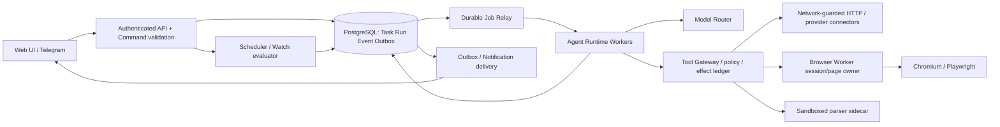
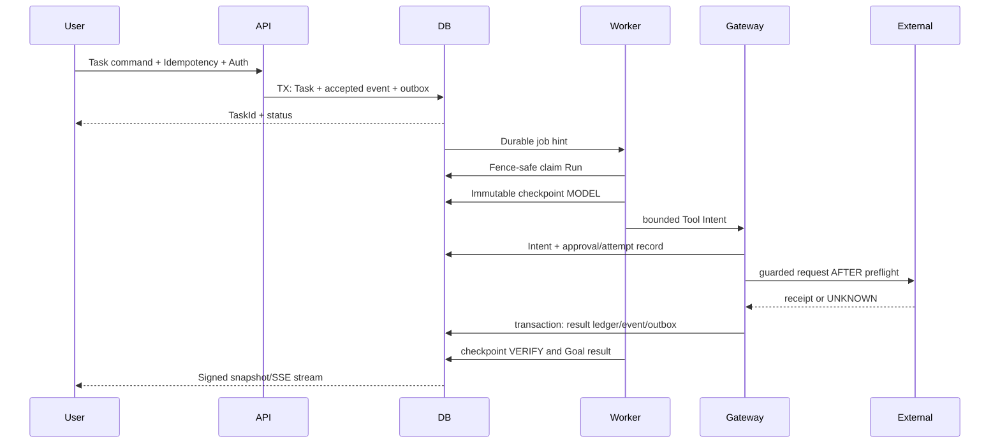

# System Architecture — Runtime and Trust Boundaries
> Status: **Draft**. Owner CHAT_00. Every component below is a proposed logical responsibility, not a deployed service. Physical tables, protocol message types and approval logic belong to other Owner specs.
## 1. Process topology

All external and browser/server-sidecar egress is denied unless explicitly allowed by network policy. Trusted model outputs never bypass command validation; provider documents remain untrusted.
## 2. Logical components and ownership
| Component | Canonical owner | Exposes (proposal) | Must not do |
|---|---|---|---|
| Web/Telegram/API | CHAT_08 | Task/Watch/create/read/approve/stream DTO, auth-scoped cursor | directly mutate Run internals or contact Tool without Gateway |
| Auth/Secrets | CHAT_09 | authenticated principal, capabilities, credential handles, egress deny | raw secrets inside LLM prompt |
| Runtime Host / Agent Loop | CHAT_02 | claim/recover/steer/cancel/checkpoint, model broker | arbitrary tool dispatch, indefinite recursive loop |
| Tool Gateway | CHAT_03 | manifest validate→risk/approval→durable attempt→dispatch | tool self-authorization, blind effect retry |
| Browser owner | CHAT_04 | session lease, bounded page operations, screenshot evidence | concurrent cross-owner Page control |
| Provider layer | CHAT_05 | read/adapt Amazon/Keepa/X/hotel data with provenance | raw provider text as trusted instructions |
| Memory/Skills | CHAT_06 | scoped reversible Memory Writer and gated Skill promotion | mutate source Evidence or grant new Tool power |
| Scheduler/Watch/Outbox | CHAT_07 | occurrence, observation compare, delivery intent | new Agent runtime or provider-specific duplicate queue |
| DB/Queue/Deploy | CHAT_10 | migrations, row CAS, counters, transactional outbox | silently define contradictory business semantics |
| QA | CHAT_11 | Contract/Fault/Benchmark fixtures | mark unrun checks as PASS |
| Intelligence | CHAT_12 | entity matching, discovery, risk, trends, reliability | claim confidence equals factual guarantee |
| Event adapters | CHAT_13 | normalize external subscription and event routing, change diff, notification ranking | spawn hidden Task without owner auth |
| Learned replay | CHAT_14 | bounded recipe / feedback routing | replay side effects based on read_only label |
| Document parser | CHAT_15 | sandboxed extract and provenance | executing macros/network requests |
## 3. Durable execution flow

A model can propose tools but the trust boundary is Tool Gateway. If provider sends a response but crashes before ACK, permanent external effect is **UNKNOWN**, not retried automatically.
## 4. Main state and ownership
- `Conversation` optional on Task (Watch/External Event can create Task without Conversation). `Task` holds user goal and its terminal state; `Run` is one attempt and its lease epoch; Worker recovery reclaims the same Run with new leaseEpoch; terminal Task retry creates a new Task linked to previous Task but never mutates history.
- `DomainEvent` aggregate sequence is per aggregate, `deliveryOffset` per tenant; durable event/outbox state and consistent projection snapshot precede a signed SSE cursor. Provider-originated Event and user-visible Domain Event are **different identities**.
- Same Step may require Model/Intent/Approval/Receipt checkpoints: immutable checkpointRevision with Run-head compare-and-swap. Only the current Run lease can commit a new head.
- `Observation` is measured fact; `Evidence` is the traceable extracted assertion; `Artifact` is raw/derived binary; `Memory` is editable user/context preference; `Skill` is a reviewed procedure. They may reference but never impersonate one another.
## 5. External event (X, email, webhook) pipeline
Provider signed delivery / authenticated poll → Connector `ExternalEvent` (untrusted payload + stable actor/provider IDs) → `ExternalEventReceipt` dedup + subscription generation/authoritative cursor in same DB TX → durable eligible Task dispatch intent → Actor/Policy/Source validation → Task and DomainEvent + outbox → Watch/Notification conditional send. Disabled/revoked subscriptions must produce zero *new* tasks after revocation; already-inflight external side effects remain in ledger. **PROVISIONAL owner acceptance:** CHAT_01, CHAT_05, CHAT_07, CHAT_09, CHAT_10, CHAT_13.
## 6. Entity/feedback/multimodal integration
Entity resolver never fuzzy-merges distinct SKU variants or storefronts; store/merchant identity and branch identity separate. Feedback about retailer exclusion is an explicit user preference with `scope`, canonical target, version and Undo tombstone, not a hard fact. Multimodal raw bytes undergo bounded isolated parsing, preserving transformation history and input byte/page/cell coordinates. Parser output never becomes trusted code or secret.
## 7. Threat boundaries & resource budgets
- Host/control plane: Agent has no arbitrary shell, SSH, Docker socket or unrestricted host mount. Worker container read-only, non-root, resource quota, explicit egress proxy and no internet sidecar bypass.
- Network: DNS and redirect re-evaluation, IP ranges blocked, browser resources/WebSockets/multipart and provider credentials scoped. Test full route (not just URL prevalidator).
- Provider: OAuth/scope, quota, rate, consent expiry, policy and price recency validated. Unauthorized API returns transparent limitations, not scraped bypass guarantees.
- Actions: irreversible purchase/reservation/post/payment require verified fresh approval bound to frozen parameters and current permissions; cache cannot bypass.
- Limits: finite Run steps, child Task count, token/currency budget, active browser tabs, file decompression ratio, external events/minute; automatic stop with inspectable error and retained evidence.
## 8. Data and transport contracts
HTTP endpoints and SSE are owned by CHAT_08, physical SQL by CHAT_10, versioned envelopes by CHAT_01. Sequence and event ordering proof require consistent MVCC projection and committed offset. Everything over wire for signed int64 uses canonical decimal strings; internal arithmetic BigInt; external amount in minor units BigInt/decimal.
## 9. Deployment and upgrade
Proposed TS packages: `api, runtime, gateway, browser-worker, connectors, automation, domain, memory, web, qa`; optional separate Python parser process, PostgreSQL. Docker Compose with network-guarded egress (CHAT_09) and non-root workers. No exact images/versions declared locked until license/API/health/sandbox tests pass. DB migrations expand→backfill→switch→contract with immutable history; no destructive overwrite of already applied migrations.
## 10. Failure protocol
| Fault | Detection / recovery | Mandatory invariant |
|---|---|---|
| API returns before Worker starts | durable Job/Task DB state | no lost accepted Task |
| Worker kill while model/Tool pending | latest immutable checkpoint + fence re-claim | zero double effect |
| Browser crashes/login expires | BrowserSession expired; wait for human/restart scoped context | no credential cross-use |
| Provider outage / 429 | finite backoff, budget accounted | unknown ≠ zero/current |
| Webhook replay / two pollers | unique subscription+provider event identity and generation | at most one accepted Task |
| Outbox relay ACK loss | persistent event ID and reconciliation | no false delivered state |
| DB restore/resume | migration checksum, checkpoint hash, tenant FK and owner gate | no stale writes |
| Parser malicious ZIP/Office | resource jail; fail closed and clean intermediate files | zero execution or uncontrolled network |
## 11. Release gates
Unit schema/codecs, real PostgreSQL FK/concurrent CAS/migration upgrade, Browser POST trap, cross-tenant authorization, Event snapshot→SSE gap, event trigger duplicate/revoke, external provider entitlements, isolated malicious file parser, Watch/Outbox UNKNOWN and budget enforcement. No `Verified` until code and tests exist.
## 12. ADR / cross-team decision pointers
[ADR decisions](architecture-decisions.md), [Glossary](domain-glossary.md), [Spec Index](spec-index.md). Owner-specific proposals remain Draft until their corresponding PR HEAD documents the resolved schema and cross-owner reviewer accepts.
