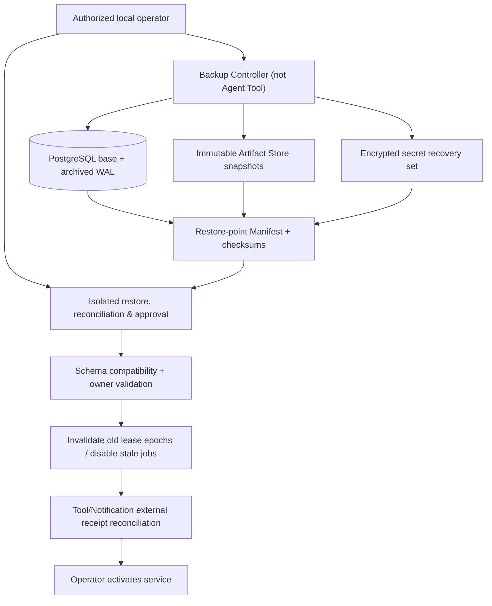

# Backup, Upgrade and Recovery — Detailed Implementation Specification (10-05)

> Owner: **CHAT_10** | Canonical: `docs/10-infrastructure/backup-upgrade-and-recovery.md` | Status: **Draft / [PROVISIONAL: CHAT_01/02/03/04/07/09/11]** | Revision: 0.1 | Research: 2026-10-30 JST | Source main: `3044c046b1caeea70c5ef6edfea7c57387c6c6da`  
> 本プロジェクトのPostgreSQL/Artifact/Secretの実バックアップ、restore、PITR、Upgradeを実行した証拠ではない。記載のSQL、設定値、Runbookはレビュー用の実装提案である。

## 0. 結論と採用案

**選択:** UbuntuセルフホストにおいてPostgreSQLの**検証済みbase backup +継続的WAL archive/PITR**を基本とし、Artifact Storeのversioned immutable objectsと照合可能なBackup Manifest、Secret Storeの管理者専用暗号化保管、Schema/Runtime互換性Manifestを**一つのrestore pointとして検証**する。第1候補`pgBackRest`、代替`WAL-G`。どちらもAgent自身にDB superuser、Shell、SSH、Docker socket、restore操作権限を渡さない。バックアップの存在と、**復元して利用可能なこと**は異なる。restore drillに合格していないbackupは`RESTORABLE`にしない。

**安全上の核心:** DBを過去へPITRしても外部世界の購入・投稿・通知・Web操作が巻き戻るわけではない。Task、Run、Watch、Outbox、Side-effect Ledgerの復元後、**デフォルトは全自動実行停止**。認可、実行世代、外部receipt、effect outcomeの再照合、失われたイベントの検査が済むまでは古いJobを再enqueueしない。Provider side-effectが`UNKNOWN`なら承認・照会なしの再試行を禁止する。失効した認証/secret/ownerも自動で有効化しない。

### 0.1 Backupの3つの境界
1. **Database:** committed `agent` business schema、`pgboss` queue metadata、Auth database（同DBか別DBかはCHAT_09と決定）、migration/version、Outbox/Run lease/Tool ledger、WALとtimeline。
2. **Artifacts:** HTML/PDF/スクリーンショット、Evidence raw、Checkpoint外部object、モデル結果に関連するobject metadata。DBの`artifact_id→object_key→sha256`を検証できること。バックアップ先は本番コンテナの普通の読み書きパスと分離。
3. **Secrets:** DBパスワード、Provider Key、Cookie/ブラウザ保存状態、暗号化鍵、リカバリ用復号キー。Raw secretsはManifestにもログにも載せない。復旧主体はoperator-only、Agent/LLMへ提供しない。

## 1. Scope / Non-scope / 関連SC

**Scope:** backup sets、WAL archive、artifact・DBのlogical point-in-time一致、Secret復元、checksum/manifest、独立試験環境でのrestore drill、Schema/runtime upgradeのexpand/contractとdrain、PITR後のreconciliation gate、RPO/RTO検証方法、operator操作・監査。

**Non-scope:** Task/Runの合法遷移（CHAT_01/02）、Tool/通知の外部副作用の確定判断（CHAT_03/07）、Browser cookie暗号化と人間引継ぎ（CHAT_04/09）、RBACと秘密保持期間（CHAT_09）、Queue lease/relay algorithm（10-02）、部署・企業向けHA/Geo replication（将来ADR）。**SC-02、SC-06、SC-07、SC-08、SC-09**が基礎、拡張SC-10（候補/Entity provenance）、SC-11（External event cursor）、SC-12（差分snapshot）、SC-15（複合Media artifact）、SC-16（ユーザーフィードバック/通知）も対象。

## 2. Prior Art / 実コード・テスト監査

| 実装と参照コミット | 実際に読んだSource/Test (Code verified) | 採用・制約 |
|---|---|---|
| **pgBackRest** `pgbackrest/pgbackrest@01c269c922ecc2bed771b981df94942afb8d95ae` | `src/command/backup/backup.c`: `backupInit()` / `backupStart()` / `manifestNewBuild()` / `manifestBuildValidate()`、`src/command/restore/restore.c`: `restorePathValidate()` / `restoreBackupSet()` / `manifestLoadFile()` / `timelineVerify()` / `manifestValidate()` / `restoreManifestValidate()`。`test/src/module/command/restoreTest.c` にchecksum不一致、稼働DBへのrestore拒否、backup set不正、target time/LSN等のテスト実装。[S1-S4] | **優先候補**。DBのWAL/PITRとmanifest/restore検証の学び。Agent Artifact/Secret全体の整合を自動保証するわけではない。MIT（LICENSE原文確認）。 |
| **WAL-G** `wal-g/wal-g@924c4788e8b1c54ea6fdf9c7dd07121d05329b4f` | `internal/databases/postgres/backup_push_handler.go` と `backup_fetch_handler_new.go`: `GetFetcherNew` / `deltaFetchRecursionNew`がbackupの復元系列を再帰で扱う。`wal_fetch_handler_test.go` の `TestTryDownloadWALFile_Exist/NotExist`、`backup_fetch_handler_test.go` のfixture検査。[S5-S8] | **代替候補**。Postgres+remote object storeのbackup/multipart運用に有用。複数Object Storeを含む自Agentの全整合性を自動化しない。Apache-2.0（LICENSE.md確認）。 |
| **PostgreSQL** official docs (v18) | `continuous-archiving`/WAL, PITR, `pg_basebackup`, `pg_verifybackup` とTransaction durabilityのドキュメント確認対象。[S9-S11] | ベースバックアップだけではPITRの任意時点復旧にならない。WAL欠損/失効、version mismatchを試験。ドキュメント根拠であり本Hostで実施したことではない。 |
| **Temporal** PostgreSQL migration manifest `temporalio/temporal@3eb5fb80523443d8583bcec463843275908f1bbc` | `schema/postgresql/v12/temporal/versioned/v1.19/manifest.json` の`CurrVersion`/`MinCompatibleVersion`を実際に確認。[S12] | アプリreader/writer互換floorの考え方のみ。独自agentの復元手順をTemporalへ依存させない。MIT。 |

### 2.1 代替設計の評価

| 案 | 評価 | 判断 |
|---|---|---|
| A. pgBackRest base+WAL + Artifact versioned manifest +独立restore drill | PITR検証・checksum・履歴/容量管理が必要。アプリ外部ストアとの整合は自前で設計 | **採用候補** |
| B. WAL-G base+WAL +同じmanifest/restore gate | S3互換の保管に便利な場合あり。機能/Storageのpinと試験が必要 | **fallback** |
| C. `docker compose cp`やPGDATA volumeの単純tarを稼働中に取得 | 一貫したDBスナップショット/WAL/Timelineが保証できない | **却下** |
| D. `pg_dump`だけを24時間Runの唯一のバックアップとする | logical recoveryには利点あるがPITR/WAL間の復旧時点と外部Objectの境界が弱い。復旧容量に依存 | **補助エクスポートのみ** |
| E. 外部サービスの副作用もDB restoreで取り消せるとみなす | 外部世界は巻き戻らず再通知/再購入の事故が起こる | **絶対に却下** |

OSSコードをコピーしない。現行メジャー、暗号、ライセンス/バイナリ供給、クラウド費用、S3互換の権限の検証なしに確定採用しない。

## 3. Canonical ownership and dependency



| Owner | 本書が固定するもの / 委譲するもの |
|---|---|
| CHAT_10-01 | Schema migration tables, physical FK, Task/Run checkpoint/Artifact/Outbox/receipt indexes。`tenant_id` + owner mapping is DDL projection |
| CHAT_10-02 | Relay/job claims/lease and replay controls。Restore gateからjob execution may restartか制御 |
| CHAT_01 | Canonical UUIDv7/Task State/Run State/Event Schema, recordVersion, goalRevision, leaseEpochの意味と範囲 |
| CHAT_02 | Resume vs new Run, safe boundary, cancel/steer/checkpointおよび旧Runのreplay |
| CHAT_03 | Side-effect ledger/Approval/Provider receipt照合、未知結果の再実行規則 |
| CHAT_04/09 | BrowserSession/Cookie/Secret ownership、復号とkey rotation、tenant-user auth、監査/retention |
| CHAT_07/13 | Watch/Scheduler/notification/EventSubscription cursor、missed slot、dup event、静音時間 |
| CHAT_08 | Web/TelegramのREST/SSE復旧後の状態表示と管理者アクション |
| CHAT_11 | Fault injection/restore drill/upgrade release gates |

## 4. Requirements

| ID | Level | 観測可能な受入条件 | SC |
|---|---|---|---|
| REC-001 | MUST | Postgres base backup +必要なWAL rangeを管理し任意の承認されたrestore timestampを再現できるか実テストで判定 | 07 |
| REC-002 | MUST | backup setはArtifact/Secret/Schema manifestと結合し、欠損時`VALID`と見なさない | 06,07,15 |
| REC-003 | MUST | ManifestにDB timeline/LSN、schema reader/writer floor、Artifact inventory checksum、key version、時間を安全な参照で記録 | 07,09 |
| REC-004 | MUST | checksumと署名/認証・暗号化を検証し、tampered backupをreject | 08 |
| REC-005 | MUST | Backup操作はAgent/Tool/Browserに提供せずoperator-onlyの最小権限で実行 | 08 |
| REC-006 | MUST | 復元先はネットワーク隔離、新規credential/localhost限定で始め、外部Toolと通知を無効にする | 07,08 |
| REC-007 | MUST | Restore後Run leaseEpoch/Task activeRun/GoalRevisionとTool effect ledgerを検査し旧Worker jobを実行しない | 07 |
| REC-008 | MUST | DBのPITRで消えた可能性のある外部副作用・Outbox・Watch通知を機械的に確定成功/未実行にしない | 02,07,11,16 |
| REC-009 | MUST | すべてのArtifact DB参照についてobject presence/size/hash照合、欠損は不完全と表示 | 01,05,12,15 |
| REC-010 | MUST | 失効済みTenant/User/session/secretがrestoreで意図せず有効化しない | 06,08 |
| REC-011 | MUST | upgradeはexpand/migrate/backfill/switch/contract、旧payload reader期間を確保しschema互換性停止条件を持つ | 07 |
| REC-012 | MUST | In-flight Task/Run/Watchを残してDeploy crash/rollbackしても永続状態がLostしない | 02,07 |
| REC-013 | MUST | backup・restore・recovery CLIの実行履歴、checksum、結果、Operator actor、漏えいなしの監査を保存 | 08 |
| REC-014 | MUST | RPO/RTOは測定方法、timestamp/bytes/障害点を定義し、実測前に達成値を宣言しない | 09 |
| REC-015 | MUST | retentionをOwner/Privacy policyと結合し、削除要求/Key rotation/backup不可逆性の影響を明示 | 08 |
| REC-016 | MUST | DB・WAL・Artifact Storeの容量不足、破損、WAL欠損を検出し誤successを報告しない | 07,09 |
| REC-017 | MUST | Recovered environmentのService起動許可は検査結果と明示operator承認の後だけ | 07,08 |
| REC-018 | SHOULD | 定期的なisolated restore drillとWAL gap alertを運用可能にし、失敗backupを隔離 | 07,09 |
| REC-019 | SHOULD | Artifact immutable version IDの世代管理でsnapshot/PITR参照点を再現 | 05,15 |
| REC-020 | LATER | 遠隔地冗長/複数リージョン復旧とKMS自動運用 | 09 |
| REC-021 | EXPERIMENT | pgBackRest vs WAL-Gを同条件環境でRTO/Storage/Complexity評価後選択 | 09 |

## 5. Contracts, typing, schema, validation [PROVISIONAL]

以下は物理Backupコントローラーの内部I/O。CHAT_01/09の型を再定義せず、ID/安全性はownerへ輸入する。

```ts
type BackupState = "PREPARING" | "CAPTURING" | "SEALED" | "VALIDATING"
                 | "VALID" | "FAILED" | "RESTORE_TESTED" | "REVOKED";
type RestoreMode = "dry_run" | "isolated_rehearsal" | "approved_live";
type RestorePoint = Readonly<{
  schemaVersion: 1;
  backupId: string;                    // server-issued UUIDv7, not authorization
  createdAt: string;                   // UTC, actual capture time
  dbSystemIdentifierHash: string;       // no raw machine identity in UI
  dbVersion: string; dbTimeline: string; dbBaseBackupRef: string;
  checkpointLsn: string; archivedWalFromLsn: string; archivedWalToLsn: string;
  appSchemaVersion: number; minCompatibleReader: number; minCompatibleWriter: number;
  artifactInventoryRef: string; artifactManifestSha256: string;
  secretRecoveryKeyVersionRef: string;  // no material/key/token
  encryptedMetadataRef: string;
  completedAt: string | null;
  state: BackupState;
  lastRestoreDrillAt?: string;
}>;
type RecoveryDecision = Readonly<{
  runId: string; taskId: string; expectedLeaseEpoch: number;
  restoredGoalRevision: number;
  effectReconciliation: "SAFE" | "UNKNOWN" | "NEEDS_APPROVAL";
  action: "RESUME" | "BLOCK" | "MANUAL_REVIEW";
  reviewEvidenceRefs: string[];
}>;
interface BackupPort {
  createRestorePoint(opts:{targetLsn?:string}):Promise<RestorePoint>;
  inspectBackup(id:string):Promise<{state:BackupState;errors:string[]}>;
  drillRestore(id:string, opts:{isolatedEnvironmentId:string}):Promise<RecoveryReport>;
  authorizeCutover(id:string, auth:OperatorApproval):Promise<void>;
}
interface RecoveryReport {
  backupId:string; dbConsistent:boolean; schemaCompatible:boolean;
  artifactMissingCount:number; artifactMismatchedCount:number;
  revokedPrincipalsRechecked:boolean; staleJobsSuppressed:number;
  unknownEffectsCount:number; restartPermission:"DENY"|"OPERATOR_REVIEW"|"ALLOW";
}
```

**Validation:** backupId UUIDv7。Inputはoperator auth受け、LLMやWebにrestore targetを与えない。Backup path/keyはverified allowlist。`targetLsn`の書式/範囲はPostgres adapterでvalidate。LSN同士をtimestamp文字列として比較しない。Snapshot versionless objectによりDB復元後にArtifactのhashが違う場合は`VALID`不可。`SECRET` valuesはbackupIdに内包せずoperator-only encrypted recovery keyで復号。Manifestは本番APIの一般ユーザーから取得不可。

### 5.1 Physical DB proposals

`agent.backup_restore_points` (backup_id UUIDv7 PK, phase, manifest_hash, db_timeline, checkpoint_lsn, wal_range, artifact_manifest_ref, secret_key_version_ref, schema_version, min_reader, min_writer, captured_at, tested_at, status, immutable_after_seal)はoperator-only schema。`agent.recovery_gates` (restore_generation BIGINT, recovery_mode, authorized_actor_ref, quarantine_until, current_schema, receipt_reconciliation_count, unknown_effects_count, opened_at)は独立restore controller用。**これらはCHAT_10-01への内部物理migration提案であり、現在のDDLに存在しない。** バックアップの正本Manifestは外部暗号化Store側にも保持し、DB自体が壊れたら`agent.backup_restore_points`がなくても復元できる。

## 6. Lifecycle and sequences

```text
Operator authorized command
  -> validate archive destination, permissions, free space, WAL archive status
  -> create Backup Manifest record PREPARING and immutable backup ID
  -> DB backupStart + snapshot LSN, capture artifact inventory watermark
  -> stream base backup; WAL continuously archive
  -> capture sealed artifact manifest at chosen logical watermark
  -> verify all DB artifact refs have present versions or record in-progress/unsealed
  -> separately seal encrypted Secret recovery set; no raw keys in metadata
  -> verify checksums/WAL coverage/compatibility and sign manifest
  -> state SEALED -> VALIDATING -> VALID (not yet RESTORE_TESTED)
  -> isolated restore drill on separate data directory/network
  -> verify all FK/queries/artifacts/keys/owner + no external side effects
  -> state RESTORE_TESTED if pass
  -> operator-approved live restore when necessary
  -> isolated boot in RECOVERY_QUARANTINE with tools/notifications OFF
  -> reconcile external receipts/outbox/lease/revocations
  -> explicit release gate -> production API/Worker
```

**Important:** DB/PITR point and Object Store snapshot do not automatically share an atomic clock. To claim a consistent restore point choose either (a) quiesce writers, flush all active artifact writes, acquire manifest watermark, capture DB LSN plus covered WAL; or (b) versioned immutable artifacts with retained historical versions and a ledger cut/watermark such that all **DB rows at target LSN** resolve to retained immutable object versions. Option (b) needs versioned object keys, reference protection and continuous archive guarantees. **Simple simultaneous snapshots without this protocol are invalid**. For both options, timestamp-only matching is insufficient; rely on stable object identity and hash/LSN.

### 6.1 Restore/quarantine state machine

```text
REQUESTED -- operator+valid manifest --> STAGING
STAGING -- WAL applied + DB consistent --> VERIFYING
VERIFYING -- schema/artifacts/secrets/owner pass --> QUARANTINED
QUARANTINED -- external receipt/Run lease/Watch cursor reconciliation -->
   NEEDS_MANUAL_REVIEW (if unknown effects or trust mismatch)
   or READY_FOR_APPROVAL
READY_FOR_APPROVAL -- fresh operator auth+explicit approval --> CUTOVER
CUTOVER -- health/readiness+test --> RUNNING
Any phase -- failures --> FAILED_SAFE (no dispatcher/effects)
```

A recovered Run does **not** inherit trust from a persisted lease_owner_ref. All old workers and queue deliveries must be fenced; use atomic restart generation plus CAS token and **new** Run leaseEpoch. Restored snapshot may roll back an epoch integer, thus an old still-running process with a higher generation could reconnect. **Network isolation and terminating all old instances are prerequisites**, not only `lease_epoch++`. New generation uniqueness must avoid collision with epochs from before restore: use separate monotonically advancing **operator restore incarnation / high entropy restart ID**, stored in trusted secure controller outside rolled-back DB and validated at worker gateway. [PROVISIONAL: CHAT_01/02/09]. If this is not available, live cutover blocked until all old workers are provably terminated/revoked and every stale credential invalidated.

## 7. Executable pseudocode / algorithms

```ts
async function backupAndVerify(operator, target) {
  requireLocalOperator(operator, "backup:create");
  const p = await backupStore.createPending();
  try {
    assertArchiveWritableAndDiskBounded();
    const base = await pgBackupAdapter.baseBackupWithArchiveLsn();
    const inventory = await artifactStore.sealVersionedManifest({
      dbWatermark: base.coveredLsn, prohibitGarbageCollection: true
    });
    const encryptedSecrets = await secretRecovery.exportEncrypted(operator, p.id);
    const manifest = signAndHash({
      backupId: p.id, pg: base, artifact: inventory,
      keyRef: encryptedSecrets.versionRef, schema: await schemaInspector.describe()
    });
    await backupStore.publishSealed(manifest);
    await pgBackupAdapter.verifyWalCoverage(manifest);
    await artifactStore.verifyManifest(manifest.artifact);
    await backupStore.transition(p.id, "VALID");
    return p.id; // RESTORE_TESTED is still false until drill
  } catch (e) {
    await backupStore.markFailed(p.id, sanitizeError(e));
    throw e;
  }
}
async function restoreIsolated(backupId, targetLsn, operator) {
  requireLocalOperator(operator,"backup:restore");
  const m = await backupStore.loadAndVerify(backupId);
  assert(m.state==="VALID" || m.state==="RESTORE_TESTED");
  assert(m.dbVersionCompatible && walCovers(targetLsn,m));
  await isolateNetworkAndDisableEffectDispatchers();
  await shutdownOldWorkersAndRevokeOldCredentials();
  await pgRestoreAdapter.restoreBaseAndReplayWal(m,targetLsn);
  await verifyDatabaseConstraintsAndSchemaCompatibility();
  const objectReport = await verifyEveryDbArtifactPointer(m.artifact);
  if (objectReport.missing>0 || objectReport.hashMismatch>0) throw BlockRestore();
  await restoreSecretsIntoScopedStoreWithFreshAccess(operator,m.secretRecoveryKeyVersionRef);
  const effects = await sideEffectLedger.reconcileUnknownWithoutExecuting(); // CHAT_03
  const watches = await scheduler.auditCursorAndMissedEventsWithoutDispatch(); // CHAT_07/13
  await runRepository.invalidateAllRecoveredLeasesAndWorkers();
  await checkOwnerAuthorizationAndSessionRevocations();
  const report=makeRecoveryReport(effects,watches,objectReport);
  if (!report.safe) return quarantineAndRequestOperator(report);
  return requireFreshOperatorApprovalForCutover(report);
}
```

**Invariants:** Backup/store functions are operator process and cannot appear in registered Agent Tool list. No remote user can issue a restore by embedding commands into research HTML. Never enable queue consumer or notification sender before quarantine gate passes. App-level read-only UI may display reconciliation status without exposing protected files. WAL archival can lag; manifest complete state requires explicit `archivedWalToLsn >= target` in PG LSN ordering.

### 7.1 Upgrade + rollback algorithm

1. Record deployed app version, DB schema control version, checkpoint format versions supported, queued payload format versions, and active Run IDs. Back up and verify before changing.
2. Roll out additive schema changes while old reader/writer is still compatible (expand). Unconditional `NOT NULL` new columns or enum values that old apps can't parse are forbidden in first phase.
3. Deploy dual-readable services with existing Run/BrowserSession state. Stop new worker claims, wait bounded drain, preserve tool intent/outbox, tag new process incarnation; do not cancel in-flight irreversible side effects by force and then blindly retry.
4. Backfill in bounded idempotent batches (checkpoint progress persisted), compare counts and hash, check WAL growth and database locks.
5. Cut over new writers only after readiness tests, record compatibility floor; maintain old checkpoint decoder and old queue pointer parser until all old states drained/migrated.
6. Contract/delete old columns only in separate migration after monitor demonstrates no old app/queue/payload remaining. If revert is required, use a schema-compatible old binary; otherwise **stop and restore from validated backup** plus external-effect reconciliation. A SQL down script alone is not sufficient.
7. Late model/API response from old process must carry worker lease/incarnation and be discarded by CAS. Do not overwrite newer Task/Run GoalRevision or future Watch definition.

### 7.2 Operational limits (initial proposed config, not SLO)

Provisional: full backup once/day, continuous WAL archiving, Artifact inventory at same safe cutoff, 7–30 day encrypted backup retention (subject CHAT_09 privacy), backup write throughput capped, retry per archive operation max5 with bounded exponential delay, restore drill at least monthly as **design suggestion**, and hard cap on number/total bytes retained based on available disk. When WAL archive gap is unresolved over a configurable threshold, Alert and mark restoration guarantee degraded; new backup not `VALID` if target WAL missing. Actual values require host storage, size, failure modes and budget assessment. No promise RPO<=5min or RTO<=1h until measured against actual workload; define RPO as commit time of last recoverable transaction before failure, RTO as start of incident→verified Task/Watch service after reconciliation; record both durations in drill reports.

## 8. Failure matrix

| Fault / trigger | Detector | Recovery / prohibition | User-visible |
|---|---|---|---|
| Base backup corrupted | checksum verification/test restore | reject set, fallback to older valid snapshot | backup degraded |
| Required WAL segment missing | LSN timeline coverage check | no PITR success claim; choose earlier verified point | data gap explicit |
| Artifact missing despite DB FK | hash/size/version scan | quarantine restored Task/Evidence, missing not "observed" | partial / unavailable |
| Object Store version overwritten | hash/version mismatch | restore older retained version if verifiable, else block | evidence integrity error |
| Secret decryption fails/keys rotated | operator key custody | no plaintext dump/retry leak, deny service | operator action |
| User disabled after backup then old snapshot restored | external revocation source vs snapshot | deny by default, reconcile before access | login required |
| Worker lost during DB checkpoint | WAL replay + Run event/outbox | claim new lease only under quarantine gate | recovering |
| External purchase/post happened after restore point | provider receipt/ledger may be rolled back | mark unknown and human review, **no auto replay** | uncertain |
| Telegram notification was sent after restore point | delivered externally but row absent | reconcile provider receipts where available, dedupe policy; if cannot prove do not claim exactly-once | uncertain delivery |
| Old worker survives PITR reboot | different host/process/epochs | terminate network path, incarnation fence, revoke old credentials | release blocked |
| Schema migrated beyond restored app | reader/writer floor compare | fail closed; compatible binary/verified migration | maintenance |
| Old checkpoint shape read by newer worker | versioned codec rejects/explicit migrate | preserve and flag, never silently skip budget/approval | pending migration |
| Backup store disk full | quota/archive monitoring | stop backup, alert; do not delete last good backups blindly | backup degraded |
| Restore test inadvertently reaches live provider | network integration fault | isolated environment egress deny, halt, audit | security incident |
| Mis-scoped operator restore target | path/destination allowlist + fresh confirmation | reject, no wrong-cluster overwrite | operation denied |
| Retention delete collides with running Run | reference retention lock | GC only after stable unreferenced + grace | no stale evidence |

## 9. Security and privacy

- Restore/backup credentials accessible only to authorized local operator action, outside Agent Runtime capabilities. Keys/backup encryption never inserted into LLM prompts, Task/Event JSON or general logs. Backup copies receive same or stricter privacy classification as production; **backups are not implicitly exempt from deletion requests**. Retention and key-destruction policy must be decided with CHAT_09.
- Isolated restore must not inadvertently reconnect to Telegram, X, payment endpoints, browser login, SMTP, or external Event subscriptions. Use deny-all networking for restore drill; no real notification or purchase.
- Backup storage should use different credentials from live Artifact Store, immutable/object lock where supported, least-privilege read/writer separation and off-site encryption. Protect against ransomware, leaked operator key, browser compromise, and storage exfiltration. Cloud provider policy/pricing not assumed.
- Recovery logs contain backup ID, nonsecret checksum, sizes, SQL schema version, sanitized status only. Hide secret references and sensitive user-facing results. Log authorization changes, operator approval, outcome time and audit trace ID.
- Anonymous access to recovery routes prohibited. No API endpoint under untrusted Web prompt can call `pg_restore`, `pgbackrest` or `docker compose`. Operator shell commands performed manually outside Agent.

## 10. Observability & performance

Measurements: `wal_archive_lag_seconds`, `latest_verified_backup_age_hours`, `restore_drill_duration_seconds`, `backup_bytes`, `restore_missing_artifacts_total`, `checksum_mismatch_total`, `restore_unknown_effect_total`, `old_workers_fenced_total`, `schema_compatibility_failure_total`, `key_restore_failure_total`, `recovery_gate_block_count`. Avoid high-cardinality Tenant/URL labels. Every drill logs host/CPU/RAM/SSD, DB+Artifact data volumes, number of Tasks/Runs/Watch/Outbox, WAL rate, restore target LSN and constraints, missing refs, actual RPO/RTO. Report median/p95 over repeated trials with consistent staging, no fictitious performance figures. SC-09 acceptance requires evidence accuracy and security conditions alongside time/cost.

## 11. Persistence / migrations / transactional recovery

- `agent.schema_control` and migration checksums physical canonical in 10-01; do not bypass for restore. `agent.outbox_messages` and Queue schema must be evaluated together. Unknown provider action cannot be inferred as undone by rollback.
- Proposed recovery controller ledger ``backup_restore_points` and `recovery_gates` (5.1) updated by trusted operator only. If stored in same failed DB, external Manifest remains required to bootstrap.
- Object Store snapshot consistency algorithm: DB reference to artifact_version_ref is immutable; once committed, version must be durable before DB ref commit; GC prohibited while referenced/within backup retention; missing object marked inconsistent, not silently removed from report. Database crash between Artifact upload and DB row creates orphan object, conservatively GC after manifest grace. If DB references uncommitted Artifact version, backup fails.
- Tenant/User ownership not changed by restore. Credential/session revocations may have occurred after snapshot; recovery must contact a separate trusted revocation record or require operator-driven re-auth/reset of all sessions before service start. User Privacy deletions after snapshot remain blocked until reapplied.
- Queue after restore starts **disabled**; recovered job/outbox rows are read-only until reconciliation. New work created by external providers post-backup needs cursor reconciliation through CHAT_13, not automatic fake first observation. Watch occurrence epoch/revision must not generate duplicate notification.
- Avoid truncating Task Event/Evidence ledger just to make replay succeed. If evidence is incomplete mark Partial/Uncertain and retain source metadata.

## 12. External API / UI / Cross-owner proposals

CHAT_08 proposes operator-only dashboard: last successful snapshot, last `RESTORE_TESTED`, WAL lag, current schema floor, Stage/Quarantine/NeedsApproval and Task/Watch data availability, **no raw key/object bucket/password**. Owner-facing dashboard shows research data older than recovery point as potentially stale and marks unavailable artifacts/unknown effect. API normal operations return sanitized 503 `RECOVERY_QUARANTINE` until gate. No arbitrary backup command exposed through public REST.

CHAT_02/03 must define recovery-barrier token / incarnation and policy for external irreversible operations, independent of simple leaseEpoch. CHAT_07/13 must define event cursor gap and missedWatch policy after PITR. CHAT_09 supplies operator authority, key custody/rotation and session revocation. CHAT_11 must own actual restore drill acceptance fixture. CHAT_10-03 deployment drain/restart must respect quarantine barrier.

## 13. Implementation PR phases (code repo, not this spec repo)

1. **REC-A:** Manifest schema/validation, Postgres base+WAL archiver adapter (pgBackRest first) and encrypted Artifact inventory; isolated fake fixtures.
2. **REC-B:** CLI-only operator backup/restore, checksum/WAL timeline validation, one-time retention lock & secret recovery, no Agent tool.
3. **REC-C:** Recovery quarantine on startup, disable Queue/Browsers/Notifications, tenant/User/Artifact consistency audits.
4. **REC-D:** Lease/incarnation fencing, Tool Ledger/Watch event/outbox reconciliation and operator release gate; crash windows.
5. **REC-E:** Expand/contract schema + runtime dual-version upgrade, rollback policy, monthly drill automation (operator controlled), RPO/RTO benchmark and alerting.

Every code PR must keep security fixtures running and not declare `Verified` until actual Postgres/Artifact/Secret restore success plus test.

## 14. Test designs (no tests run in this Harness)

| TEST-ID | Setup / action | Expected |
|---|---|---|
| REC-T01 | Integration: PG base+continuous WAL, insert Task/Run, PITR before next commit | Restored rows reflect exact target and schema |
| REC-T02 | Fault: delete required WAL segment | restore verifier rejects target; no false success |
| REC-T03 | Fault: tamper base backup bytes | checksum/signed manifest rejects |
| REC-T04 | Contract: fake Artifact upload+DB pointer; capture backup watermark | DB referenced immutable object version resolves hash |
| REC-T05 | Fault: object changed after DB capture | mismatch/unknown, no “complete evidence” |
| REC-T06 | Security: restore with missing/wrong decryption key | fail closed, no secret in logs |
| REC-T07 | Security: remote research Tool asks to run restore/docker shell | impossible route / authorization deny |
| REC-T08 | Fault: Worker killed during checkpoint then snapshot PITR | Run ledger coherent; old claim never starts Tool |
| REC-T09 | Fault: external side effect succeeded after restore point | UNKNOWN, no retry until receipt reconciliation/approval |
| REC-T10 | Fault: Telegram delivered after restore point, outbox row lost | not sent blindly again, status uncertainty displayed |
| REC-T11 | Concurrency: old Worker process with previously valid epoch connects to restored DB | old incarnation denied, network revoked |
| REC-T12 | Security: user/session revoked after backup then restored | denial maintained / fresh reauth, no stale owner |
| REC-T13 | Migration: active Run with old checkpoint data; new reader version | explicit old-codec parse or reject with preserved state |
| REC-T14 | Migration: SQL index concurrently interrupted; old schema reader active | resume migration safely, version compatibility kept |
| REC-T15 | E2E: restore onto disconnected staging with fake providers | no packets to external destinations or real notifications |
| REC-T16 | Benchmark: 1M Events, 100k Artifacts, full/WAL restore to fixed hardware | report actual RPO/RTO, throughput, WAL gap, storage; no predetermined SLO |
| REC-T17 | Operational: backup disk full and in-progress GC | last verified set intact, missing archive alert |
| REC-T18 | Integration: Watch schedule old revision and external event cursor gap | no duplicate Task/notification, lost events reported |
| REC-T19 | Security: tampered operator Manifest or wrong cluster identifier | reject restore/cutover |
| REC-T20 | Contract: owner privacy deletion after backup | revoked/deleted data reblocked/retention policy reapplied |
| REC-T21 | Upgrade: new writer/old reader during expand/contract with active Run | old decoder retained, no silent state loss |
| REC-T22 | Operator release gate: incomplete effect check/artifact integrity | readiness remains BLOCKED; approval cannot override structural corruption |

## 15. REQ → TEST → SC traceability

| MUST REQ | TEST | SC |
|---|---|---|
| REC-001,003 | T01,T02,T16 | 07,09 |
| REC-002,004 | T03,T04,T05,T19 | 07,08,15 |
| REC-005 | T06,T07,T19 | 08 |
| REC-006,017 | T11,T15,T22 | 07,08 |
| REC-007 | T08,T11,T21 | 07 |
| REC-008 | T09,T10,T18 | 02,07,11,16 |
| REC-009 | T04,T05,T16 | 01,05,12,15 |
| REC-010,015 | T06,T12,T20 | 06,08 |
| REC-011,012 | T13,T14,T21 | 02,07 |
| REC-013 | T03,T19,T22 | 08 |
| REC-014,016 | T02,T16,T17 | 07,09 |

All tests **designed but 0 executed**. Upstream code/tests were read, no release claim.

## 16. Open questions / Cross-team proposals

| ID / Canonical Owner | Priority | Proposal / closure test |
|---|---|---|
| REC-X01 CHAT_00/09 | **P0** | Operator recovery authority, deletion/retention policy, session revocation after PITR, credentials outside rolled-back DB. REC-T12/T20 |
| REC-X02 CHAT_01/02 | **P0** | Run leaseEpoch alone inadequate across time-travel restore; introduce external restore-incarnation fence or prove all old workers terminated. REC-T11/T21 |
| REC-X03 CHAT_03 | **P0** | External side-effect pre/post restore receipt reconstruction; irreversible effect no blind replay. REC-T09/T10 |
| REC-X04 CHAT_07/13 | P1 | Watch occurrences/schedule revision/X event cursor replay policy for rollback gaps. REC-T18 |
| REC-X05 CHAT_04/09 | P1 | Browser cookie secret profile restore/rotation and invalidated handoff ticket rules. REC-T06/T12 |
| REC-X06 CHAT_10-01/02 | P1 | Recovery barrier physical schema, Outbox pointer semantics, app/queue compatibility migration. REC-T01/T08 |
| REC-X07 CHAT_10-03 | P1 | Drain browser workers and isolate live restore, block public CDP, health readiness. REC-T15 |
| REC-X08 CHAT_11 | P1 | Kill-after-commit/test matrix, isolated network restore and RPO/RTO benchmark fixtures. REC-T16 |
| REC-X09 CHAT_00 | P1 | PG major+storage selection, backup frequency/retention, RPO/RTO targets via measured hardware. REC-T16 |

**P0 unresolved means Draft only**, not Locked. Required ADR owner authorizes final tradeoffs.

## 17. Sources / Evidence (2026-10-30 JST)

[S1] `https://github.com/pgbackrest/pgbackrest/blob/01c269c922ecc2bed771b981df94942afb8d95ae/src/command/backup/backup.c` — backupInit/backupStart/manifestNewBuild/manifestBuildValidate; **Code verified**, MIT verified in LICENSE.  
[S2] `https://github.com/pgbackrest/pgbackrest/blob/01c269c922ecc2bed771b981df94942afb8d95ae/src/command/restore/restore.c` — restorePathValidate/restoreBackupSet/manifestLoadFile/manifestValidate/timelineVerify; **Code verified**.  
[S3] `https://github.com/pgbackrest/pgbackrest/blob/01c269c922ecc2bed771b981df94942afb8d95ae/test/src/module/command/restoreTest.c` — corrupt checksum / running PostgreSQL / PITR test fixtures; **Code verified**, test **read, not run**.  
[S4] `https://github.com/pgbackrest/pgbackrest/blob/01c269c922ecc2bed771b981df94942afb8d95ae/LICENSE` — **Docs verified**, MIT.  
[S5] `https://github.com/wal-g/wal-g/blob/924c4788e8b1c54ea6fdf9c7dd07121d05329b4f/internal/databases/postgres/backup_push_handler.go` — **Code verified**, Apache-2.0.  
[S6] `https://github.com/wal-g/wal-g/blob/924c4788e8b1c54ea6fdf9c7dd07121d05329b4f/internal/databases/postgres/backup_fetch_handler_new.go` — GetFetcherNew/deltaFetchRecursionNew; **Code verified**.  
[S7] `https://github.com/wal-g/wal-g/blob/924c4788e8b1c54ea6fdf9c7dd07121d05329b4f/internal/databases/postgres/wal_fetch_handler_test.go` — WAL existence/absence; **Code verified**, tests read not run.  
[S8] `https://github.com/wal-g/wal-g/blob/924c4788e8b1c54ea6fdf9c7dd07121d05329b4f/LICENSE.md` — Apache-2.0, **Docs verified**.  
[S9] `https://www.postgresql.org/docs/18/continuous-archiving.html` — base backup and WAL archive/PITR, **Docs verified**.  
[S10] `https://www.postgresql.org/docs/18/app-pgbasebackup.html` and `https://www.postgresql.org/docs/18/app-pgverifybackup.html` — PostgreSQL official backup/verification options, **Docs verified**, specific command usage version to validate.  
[S11] `https://www.postgresql.org/docs/18/warm-standby.html` — failover/timeline context, **Docs verified**.  
[S12] `https://github.com/temporalio/temporal/blob/3eb5fb80523443d8583bcec463843275908f1bbc/schema/postgresql/v12/temporal/versioned/v1.19/manifest.json` — schema version compatibility, **Code verified**, MIT.  
[S13] `https://github.com/choko510/aiagent-md/pull/10`, `/pull/22`, `/pull/26`, `/pull/36`, `/pull/1`, `/pull/2`, `/pull/9` — project Draft contracts, not merged Locked.

**Research boundaries:** git source and tests read, but pgBackRest/WAL-G binary, local PostgreSQL version, S3 implementation and restore tool compatibility were **not run** in this project. No RPO/RTO promises; no external side effects.
