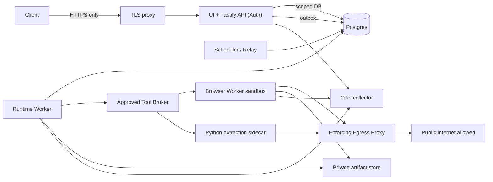

# Docker Deployment and Runtime Isolation — Detailed Specification (10-03)

> Owner CHAT_10 | `docs/10-infrastructure/docker-deployment.md` | Draft / PROVISIONAL CHAT_00/04/09/10-05 | Rev 0.1 | 2026-10-30 JST | main `b45d4e989998663a00ef09673e69ae1f4191f00d`. No containers launched or security controls tested.

## 0. 採用構成

Ubuntu単一ホストを前提にDocker Composeを**配置と再起動管理のみ**に使用し、LLMへホストShell/SSH/Docker socketを絶対に与えない。外部公開は認証とTLSの入口だけ。`api`/`runtime-worker`/`scheduler-relay`/`browser-worker`/`python-extraction-sidecar`/`postgres`/`artifact-store`/`egress-policy-proxy`/`telemetry-collector`を**別プロセス権限・ネットワーク**へ分ける。BrowserWorkerだけがChromium context/pageを所有し、CDPをホストにpublishしない。Postgres DB schema `agent`はCHAT_10-01、Job Queue `pgboss`は10-02、認可/egress policyはCHAT_09。**ComposeはSSRF防止機構ではない**。DNS/redirect/IP/networkアクセスをアプリTool Gatewayと強制egress層で制御する。

採用候補: rootless Docker (可能なら)、非root UID/GID、`cap_drop: [ALL]`、`security_opt: [no-new-privileges:true]`、`read_only: true`、限定`tmpfs`、`pids_limit`、`mem_limit`、`cpus`、init/restart、immutable digest images、secrets mount、DB volume/Artifact volume。Chromium sandboxは明示有効化し、Playwrightのroot+no-sandbox便法を**採用しない**。Sandboxとの相性はHost kernel/LSM(seccomp/userns/AppArmor)の実機試験で判定。できなければproduction readinessはブロック。`ipc: host`、`network_mode: host`、`privileged`、`cap_add: SYS_ADMIN`を採用しない。

## 1. Scope / Non-scope / Scenarios

- Scope: コンテナ境界、リソース制約、DB/Browser所有、起動/停止/drain、operatorによるデプロイ/更新、health、ボリューム、公開ポート、CDP/egress隔離。
- Non-scope: Tool Policy (CHAT_03)、BrowserSession semantics (CHAT_04)、Auth/SSRF/credential policy (CHAT_09)、具体RPO/RTO (10-05)、DB DDL (10-01)、Run State (CHAT_01/02)。
- SC-06/07/08/09を必須。SC-10〜16は新Connector/Event/Multimodalを同じ境界に追加し権限拡大しないこと。
- Trust: 外部Web→reverse proxy（唯一公開）→API、API→DB/Queue、Runtime→Broker→Browser/Egress、Pythonはraw HTML/Officeをuntrusted inputとして扱う。Browser内部はhostより低信頼。

## 2. OSS / Official Sources / Adoptions

| Source/pin | 実際に確認したコードと挙動 | 採用/拒否 |
|---|---|---|
| **Playwright** `microsoft/playwright@62d25ac221370f6fc5e26c600823792b83c67f1e` | `utils/docker/Dockerfile.noble` がpwuserを作成、ブラウザ依存を配置。`utils/docker/seccomp_profile.json` にclone/unshare等が明示。`packages/playwright-core/src/server/chromium/chromium.ts` と`docs/src/docker.md`のsandbox設定。[S1-S4] | Browser専用ユーザー＋kernel sandbox必要性。公式公開Docker imageはuntrusted browsingの本番用安全保証でない。Docker docsの`ipc=host`や`SYS_ADMIN`開発回避策は当プロジェクトで拒否。Apache-2.0。 |
| **Langfuse** `langfuse/langfuse@71ddcb9094f53d19176a262f107871d8b2950fb0` | `worker/Dockerfile`でBuild/Runtimeの別stageと数値UID非root (`USER` line 248)、`ENTRYPOINT` initの採用を確認。[S5] | 多段ビルド、UID固定、PID1管理を参考。Langfuseの巨大な運用構成をコピーしない。Repo LICENSEは要個別確認（プロジェクト本体の特許/商用条件等が関係するため採用コードなし）。 |
| **Docker Compose Specification** | `depends_on.condition: service_healthy`、`cap_drop`、`security_opt`、`read_only`、`mem_limit`、`pids_limit`、`secrets`が仕様上提供。[S6-S7] | 記法確認のみ。Compose単体はアプリ認可やNetwork Egressへの安全な強制denylistにならない。 |
| **Moby Engine** `moby/moby@ed01f3a432cb0f901dd3aa3a1377bb6781950d93` | Engine repository構成とApache-2.0 license。具体的sandbox設定の実コード詳細は**未検証**、本件では公式Compose/Playwrightの実例で仕様を導く。[S8] | Host daemonをAgentに接続しない。Engine未検証APIを実在として参照しない。 |

**代替案:** A Compose+separate Browser/Egress (採用候補)、B one all-in-one privileged container (却下: compromise時blast radius)、C Kubernetes (初期却下: single Ubuntuで運用・Secrets・RBAC等の追加負担が大きい)、D Browserをhost上で直接動作 (却下: session/cookie/脆弱性境界が薄い)。初期設定のRAM等は実機測定で調整。

## 3. Component graph / owner / ports



- Only Proxy publishes 443 (optional localhost 127.0.0.1 binding for home LAN proxy). Internal API, PG 5432, CDP 9222, Browser Adapter socket, Prometheus/OTLP ports **not published**.
- DB internal credential is available only to bounded API/worker roles; Browser and untrusted extraction do **not** receive owner DB credentials.
- Egress proxy to enforce allowlist/blocked private IP including IPv6, DNS revalidation, redirects and non-HTTP protocols is a separate minimal-privileged network gateway. Network design must be approved by CHAT_09; no claim ordinary Compose `internal: true` with one extra egress connection automatically prevents bypass. All egress-capable service paths must be tested for fail-closed behavior.
- Operator migration/backups run from a dedicated management path outside Agent Tool registry; no raw Docker APIs to running Agent.

## 4. Requirements / Traceability summary

| ID | Level | Measurable invariant | SC |
|---|---|---|---|
| DEP-001 | MUST | Host shell/SSH/Docker socket/API never reachable by LLM/runtime/tool requests | 06,08 |
| DEP-002 | MUST | Browser, API, Worker, PG, Sidecar isolated in separate containers and network policies | 06,08 |
| DEP-003 | MUST | Browser Chromium launched non-root with sandbox enabled; if unsupported, readiness fails | 06,08 |
| DEP-004 | MUST | No privileged, SYS_ADMIN, host networking, host PID/IPC; security options enforced | 08 |
| DEP-005 | MUST | CDP/remote debugging and internal DB port never published to host/LAN | 06,08 |
| DEP-006 | MUST | All processes finite CPU/RAM/PIDs/storage/time and concurrent sessions; OOM recovers safely | 07,09 |
| DEP-007 | MUST | Secrets mounted with least privilege and not logged/env exported to LLM | 06,08 |
| DEP-008 | MUST | Egress enforcement covers redirect DNS rebinding IPv6 and private nets; fail closed | 08 |
| DEP-009 | MUST | Workers restart from durable DB lease/intent, no automatic unsafe external replay | 02,07 |
| DEP-010 | MUST | DB and Artifact volumes survive `compose down` and container restarts; no automatic -v | 02,07 |
| DEP-011 | MUST | Startup migration one-shot and app-schema compatibility checks; no arbitrary worker DDL | 07 |
| DEP-012 | MUST | Health distinguishes liveness/readiness/degraded queue/egress/auth state | 07,09 |
| DEP-013 | MUST | UI and internal access authenticated; proxy forwarded-header trust explicit | 08 |
| DEP-014 | MUST | Browser human handoff remains bound to tenant/owner/session and revalidated after restart | 06,08 |
| DEP-015 | SHOULD | Rootless/UID mapping supported, readonly FS and image SBOM/digest/provenance verified | 08 |
| DEP-016 | SHOULD | Graceful drain stops new claims but lets committed jobs survive and fence | 07 |
| DEP-017 | LATER | Horizontal worker deployment after fencing / owner load tests | 07 |
| DEP-018 | EXPERIMENT | Lightweight Browser runtime (Lightpanda) isolated as Adapter, not a shortcut around Browser ACL | 06,09,13 |

## 5. Compose contract & illustrative config

**This is NOT production-ready deployment YAML.** Runtime image digests, secrets locations, ingress TLS implementation, egress and network policy implementation require CHAT_09 acceptance and integrative tests. Sample explicitly lacks direct browser internet connectivity (enforced proxy wiring outside snippet); an incomplete egress adapter must prevent browser launch.

```yaml
name: personal-agent
services:
  postgres:
    image: postgres:18@sha256:REPLACE_WITH_VERIFIED_DIGEST
    restart: unless-stopped
    user: "999:999" # image UID must be verified against pinned image
    cap_drop: [ALL]
    security_opt: ["no-new-privileges:true"]
    pids_limit: 256
    mem_limit: 2g
    cpus: "2.0"
    networks: [db]
    volumes: [pgdata:/var/lib/postgresql]
    secrets: [db_password]
    healthcheck:
      test: ["CMD-SHELL","pg_isready -U $$POSTGRES_USER -d $$POSTGRES_DB"]
      interval: 10s
      timeout: 3s
      retries: 5
  api:
    image: registry.local/personal-agent/api@sha256:REPLACE
    user: "10001:10001"
    init: true
    read_only: true
    cap_drop: [ALL]
    security_opt: ["no-new-privileges:true"]
    pids_limit: 128
    mem_limit: 768m
    cpus: "1.5"
    tmpfs: ["/tmp:rw,noexec,nosuid,size=64m"]
    networks: [frontend, db]
    depends_on:
      postgres: {condition: service_healthy}
    restart: unless-stopped
  runtime-worker:
    image: registry.local/personal-agent/worker@sha256:REPLACE
    user: "10002:10002"
    init: true
    read_only: true
    cap_drop: [ALL]
    security_opt: ["no-new-privileges:true"]
    pids_limit: 128
    mem_limit: 1g
    cpus: "2.0"
    networks: [db, broker]
    restart: unless-stopped
  browser-worker:
    image: registry.local/personal-agent/browser@sha256:REPLACE
    user: "10003:10003"
    init: true
    read_only: true
    cap_drop: [ALL]
    security_opt: ["no-new-privileges:true"]
    pids_limit: 512
    mem_limit: 2g
    cpus: "2.0"
    shm_size: 512m
    tmpfs: ["/tmp:rw,nosuid,size=256m"]
    networks: [broker, egress_restricted]
    # no ports, no host network, no privileged, no SYS_ADMIN
    restart: unless-stopped
  egress-gateway:
    image: registry.local/personal-agent/egress@sha256:REPLACE
    read_only: true
    cap_drop: [ALL]
    security_opt: ["no-new-privileges:true"]
    networks: [egress_restricted, external]
    # not deployable until DNS/IP/redirect policy and bypass tests approved
networks:
  frontend: {}
  db: {internal: true}
  broker: {internal: true}
  egress_restricted: {internal: true}
  external: {}
volumes:
  pgdata: {}
secrets:
  db_password:
    file: ./secrets/db_password # host operator provisioned, NEVER in repo
```

**Important correctness:** An internal-only network plus a dual-homed proxy is **not sufficient** if browser is allowed alternate external routes, if proxy trusts client destination/IP unchecked, or if DNS can resolve private IP. Docker Compose YAML is a service topology illustration, **not an implemented security policy**. A host-level egress firewall or deliberately isolated namespace plus compulsory proxy must prove no bypass in DEP-T07. Do not deploy until verified.

Image's Postgres UID, data directory permissions, `pg_isready` role, secrets env var startup mechanism, chromium sandbox compatibility, `shm_size` interaction with `read_only` and particular Compose Engine must be integration-tested and corrected. Placeholder digests MUST fail CI and never release. `POSTGRES_PASSWORD_FILE`/secrets read by official image startup rules requires pinned image verification. For Chromium rootless sandbox, seccomp profile and userns capability must be tested **without broad capability escalation**; if kernel blocks user namespace creation, do not silently run `--no-sandbox`.

## 6. Lifecycle / sequence / state

```text
Operator deploy -> check image digest/SBOM/config schema/secrets permissions
  -> start postgres + durable volumes
  -> one-shot migration preflight (no Agent privileges)
  -> schema version compatible + health
  -> start API/Broker/Worker/Browsers (no new run until ready)
  -> API accepts durable Task -> worker claims Run lease -> tools via broker
Rolling update:
  disable new job claims -> checkpoint at safe boundary -> fence/drain
  -> replace worker image -> worker reauth+reclaim from Postgres
Browser Worker crash:
  Context lost => mark browser session unknown / rebuild only with
  owner proof & protected profile per CHAT_04/09; no shared default context.
Rollback:
  roll back image only if reader/writer schema contract compatible,
  otherwise stop writes and restore from tested backup (10-05).
```

States `BOOTING/READY/DEGRADED/DRAINING/STOPPED` are **deployment health categories**, not CHAT_01 Task/Run states. Do not map OOM to Task failed without reading persistent ledger. Graceful termination deadline (proposal 30s, benchmark needed), DB connection retry bounded with jitter. Restart policy does not replace watchdog or lease fencing.

## 7. Algorithms / operator validation

```ts
async function validateDeployment(manifest, composeRendered, hostFacts) {
 assertSignedImagesAndPinnedDigests(manifest);
 assertNoPublish(["5432","9222","otlp","browser-worker"],composeRendered);
 for (const svc of restrictedServices) {
   assert(svc.user !== "0:0" && svc.privileged !== true);
   assert(svc.network_mode !== "host" && svc.pid !== "host" && svc.ipc !== "host");
   assert(!svc.volumes.some(isDockerSocketOrHostRootMount));
   assert(svc.cap_drop.includes("ALL") && !svc.cap_add?.length);
   assert(svc.security_opt.includes("no-new-privileges:true"));
   assertFinite(svc.mem_limit,svc.pids_limit,svc.cpus,svc.healthTimeout);
 }
 assertEgressPolicyVerifiedByFaultTests(hostFacts);
 assertChromiumSandboxReadyOrRefuse();
 assertCompatibleDbSchemaAndSecretMounts();
 return {readiness:"ready"}; // only if all gates pass
}
async function drainWorker(deadline) {
 stopClaimingNewJobs();
 markLivenessButNotReadiness();
 await checkpointAtSafeBoundaries(deadline);
 releaseOwnedSessionsAfterDurableState();
 // force kill on deadline; recovery uses leaseEpoch + Tool ledger
}
```

A single unhealthy container cannot cause repeated unbounded expensive model calls. Restart loop should cap rate and mark status, not create new Task. Operator-controlled secret rotation triggers worker revalidation, no automatic LLM access to new credential. All container-to-container Browser requests include server-verified tenant/task/session binding; browser cannot open by name alone.

## 8. Failure matrix

| Fault | Detection | Decision / side effect | Visible state |
|---|---|---|---|
| PG down on boot | readiness check | do not start new run; accepted requests fail 503 unless durable accept possible | degraded |
| migrations incompatible | schema version mismatch | stop writes; no down migration blind | maintenance |
| worker SIGKILL | missing heartbeat + lease expire | another worker reclaim with epoch++/ledger inspect | resumable/uncertain |
| browser SIGKILL | page lost | handoff state reauth, profile locked, do not reuse tenant context | waiting/uncertain |
| Chromium OOM | cgroup memory event | cap concurrency; checkpoint/recover; no resource increase automatically | partial |
| Browser sandbox disabled | launch attestation | production fail closed, no `--no-sandbox` fallback | blocked |
| open CDP debug port | image/compose policy scan | reject deployment | blocked |
| egress proxy unreachable | connect fail | no direct fallback to raw internet | blocked |
| DNS rebinding/redirect to private IP | network filter | deny and audit, not retry unbounded | unsafe target |
| hostile HTML causes fork bomb | no subprocess ability + PIDs quota | worker killed, DB survives | partial |
| secrets mount missing | startup preflight | fail closed, no value in logs | unavailable |
| cert expired | proxy TLS monitoring | no downgrade to plain HTTP | maintenance |
| compose down -v | operator-only destructive action | release gates prohibit automation, restore drill | outage; possible loss |

## 9. Security / privacy

Prohibit sockets: `/var/run/docker.sock` and Podman service; no systemd credential over Chat. Host bindings only operator-owned backup paths. No container mounted `/` host, no device passthrough, no `CAP_SYS_ADMIN`, no host PID/IPC. Browser Worker never receives database superuser or raw connector secrets. Browser profile encrypted/owner-scoped as per CHAT_04/09, no public CDP. Egress gateway policy must deny metadata service `169.254.169.254`, RFC1918, IPv6 ULA/link-local, loopback, special-purpose CIDRs, DNS rebinding and post-redirect targets unless operator allowlists a verified local service for a **separate non-browser** capability after review. Pin dependencies, scan SBOM, rotate credentials, redact logs. Compose 'read_only' alone doesn't secure writable volumes.

## 10. Observability / budget

Track `container_cpu_seconds`, `memory_working_set_bytes`, `pids`, `OOMKill count`, `worker_restart_total`, `browser_session_rehydration_failures`, `db_reconnection_ms`, `egress_denied_total`, `CDP_public_port_violation`, `queue_backlog`. Secret-free trace IDs correlate Task/Run/BrowserSession IDs. Proposed admission defaults: browser max 2 contexts/host, 4 tabs/context, 512MiB shared memory, 2GiB memory/browser, runtime-worker 1GiB; model/queue budgets remain CHAT_02/07 authoritative. These are bounded **initial hypotheses**, not measured capacity targets. SC-09 profiles must choose actual values.

## 11. Persistence / upgrades

Postgres durable volume, immutable artifacts outside ephemeral rootfs, secrets never in image layers. A `compose down` operation alone must not destroy volumes; `down -v` operator-only destructive path. Upgrades use preflight backup+manifest with schema version; migration role separate and short-lived. Running Run and Watch survive release via database, not by retaining container memory. Keep older checkpoint decoder during rolling releases. Exact backup/restore/wal archiving in 10-05. Never start two migrators without advisory lock and schema-control checks.

## 12. UI / API effects

CHAT_08 dashboard distinguishes BrowserUnavailable / WorkerDraining / OutboxPending / DBUnavailable; does not assert "Task failed" on container restart; displays currently durable Task ID and evidence status. Health endpoints minimal, no secrets or internal topology. Human Takeover ticket never grants CDP raw port access. CHAT_09 should review proxy TLS/CORS forwarded-header trust, egress network enforcement, non-root sandbox gate. CHAT_04 owns browser storage/adapters. CHAT_11 owns E2E fault tests.

## 13. Proposed implementation PR sequence

1. **DEP-A:** Compose schema, immutable image builds, pinned UID, config validator, health probe; no public Browser ports.
2. **DEP-B:** DB/Artifact persistent volumes and migration gate + least-privileged secrets, restore smoke.
3. **DEP-C:** Browser Worker nonroot/sandbox/Context limits + seccomp kernel compatibility CI.
4. **DEP-D:** Mandatory egress gateway integration with DNS/redirect rebinding and fail-closed testing; cannot enable Browser until pass.
5. **DEP-E:** Graceful drain, upgrade/rollback, OOM/restart fault test, metrics and operator runbook.

## 14. Test matrix (designed, not executed)

| ID | Level / setup & action | Expected |
|---|---|---|
| DEP-T01 | Config: render compose, inspect all services | no privileged, SYS_ADMIN, host network/PID/IPC or host mounts |
| DEP-T02 | Security: run as nonroot, attempt write outside tmpfs | denied |
| DEP-T03 | Security: inspect all published ports/networks from host/LAN | only configured TLS endpoint; CDP/DB/OTLP unreachable |
| DEP-T04 | Integration: kernel/Chromium sandbox probe | enabled sandbox; if unavailable refuse production |
| DEP-T05 | Fault: Browser crash/OOM with active handoff | no cookie sharing, run state remains durable |
| DEP-T06 | Fault: kill Worker mid-Tool | lease epoch moves, unknown effect not blind replayed |
| DEP-T07 | Security: redirect/IPv4/IPv6/DNS rebinding/proxy bypass/localhost/metadata | every disallowed connection blocked even from Browser and Sidecar |
| DEP-T08 | Security: malicious HTML attempts host shell/socket/device | no host system access |
| DEP-T09 | Integration: restart stack without -v | Task/Watch/Artifact persistent and same ID |
| DEP-T10 | Migration: schema mismatch after image rolling upgrade | old/new reader compatible or health fails closed |
| DEP-T11 | Security: forged proxy forwarded headers, bad cookie, direct API | denied, no owner confusion |
| DEP-T12 | Benchmark: 2 browsers heavy tabs and model worker load | bounded CPU/memory/PID and p95 report; no invented SLO |
| DEP-T13 | Security: secret file absent/incorrect rights | deny startup and redact logs |
| DEP-T14 | Upgrade: SIGTERM followed by SIGKILL inside accepted Run | no lost Task, stable effect ledger |
| DEP-T15 | Config: try root/no-sandbox/broad seccomp/SYS_ADMIN | CI fails, no successful rollout |
| DEP-T16 | Retention: `down -v` not triggered by normal update | volumes remain and recovery passes |

## 15. REQ→TEST→SC

| REQ | TEST | SC |
|---|---|---|
| DEP-001,004 | T01,T08,T15 | 06,08 |
| DEP-002,005 | T01,T03,T11 | 06,08 |
| DEP-003 | T04,T15 | 06,08 |
| DEP-006 | T05,T12 | 07,09 |
| DEP-007 | T02,T13 | 06,08 |
| DEP-008 | T07 | 08 |
| DEP-009 | T06,T14 | 02,07 |
| DEP-010 | T09,T16 | 02,07 |
| DEP-011 | T10 | 07 |
| DEP-012 | T03,T12 | 07,09 |
| DEP-013 | T11 | 08 |
| DEP-014 | T05,T11 | 06,08 |

All tests designed, **none executed**. No live browser crawl/real auth performed.

## 16. Open decisions / Cross-team

| ID / Owner | Severity | Required decision |
|---|---|---|
| DEP-X01 CHAT_09 | **P0** | network namespace/egress enforcement actually cannot be bypassed, DNS/redirect/private IP + IPv6. Need runnable threat test |
| DEP-X02 CHAT_04/09 | **P0** | Chromium non-root userns/seccomp for target Ubuntu Docker kernel, sandbox attestation; no unsafe fallback |
| DEP-X03 CHAT_00 | P1 | selfhost deployment target, Postgres/Compose/Engine version lock, ingress exposure choice, budget |
| DEP-X04 CHAT_10-01/05 | P1 | runtime schema check, one-shot migration, upgrade-drain and backup guarantee |
| DEP-X05 CHAT_11 | P1 | container fault injection and 2 worker concurrency, CI environment matrix |
| DEP-X06 CHAT_08 | P1 | Browser handoff UI/status and opaque health handling |
| DEP-X07 CHAT_15 | P1 | Python document parser jail, no scripts/macros/formula evaluation; media artifact limit |

## 17. Evidence / Sources

Research date 2026-10-30 JST. Code read; container integration untested.

[S1] `https://github.com/microsoft/playwright/blob/62d25ac221370f6fc5e26c600823792b83c67f1e/utils/docker/Dockerfile.noble` — pwuser/dependencies, **Code verified**, Apache-2.0.  
[S2] `https://github.com/microsoft/playwright/blob/62d25ac221370f6fc5e26c600823792b83c67f1e/utils/docker/seccomp_profile.json` — sandbox-related syscalls, **Code verified**, Apache-2.0.  
[S3] `https://playwright.dev/docs/docker` and `https://github.com/microsoft/playwright/blob/62d25ac221370f6fc5e26c600823792b83c67f1e/docs/src/docker.md` — root Chrome no sandbox, development-only caution, official recommendation for untrusted browsing; **Docs verified**.  
[S4] `https://github.com/microsoft/playwright/blob/62d25ac221370f6fc5e26c600823792b83c67f1e/packages/playwright-core/src/server/chromium/chromium.ts` — Chromium launch code path identified in GitHub code search; **Code location verified; full implementation not exhaustively audited**.  
[S5] `https://github.com/langfuse/langfuse/blob/71ddcb9094f53d19176a262f107871d8b2950fb0/worker/Dockerfile` — multi-stage image and USER uid, **Code verified**, reuse code not planned; project license audit pending.  
[S6] `https://docs.docker.com/reference/compose-file/services/` — `cap_drop, read_only, security_opt, pids_limit, mem_limit, secrets`, **Docs verified**, Compose specification.  
[S7] `https://compose-spec.github.io/compose-spec/workload_spec.html` — `depends_on` health readiness condition, **Docs verified**.  
[S8] `https://github.com/moby/moby/tree/ed01f3a432cb0f901dd3aa3a1377bb6781950d93` — Apache-2.0; **Unverified** in source specifics, no implementation claim.  
[S9] `https://github.com/choko510/aiagent-md/pull/9` / `/pull/10` / `/pull/1` — dependency Drafts **Docs verified**, not Locked.

The YAML is intentionally illustrative; it contains placeholders and is not a copy-paste production deployment.


### 17.1 Failure report reviewed (not a guaranteed current defect)
[S10] https://github.com/microsoft/playwright/issues/2437 — **Issue report**, opened 2020-06, closed 2020-06; user reported non-root Docker browser binary unavailable because install path was root-owned (Playwright v1.0.2). Historical issue is not evidence the current Playwright Dockerfile still suffers the bug. This specifically motivates DEP-T04/DEP-T15 to probe the pinned browser binary path, UID-readable cache and sandbox on the actual host rather than assuming `USER` alone works.
