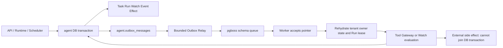

# Job Queue & Transactional Outbox — 詳細実装仕様 (10-02)

> Owner: CHAT_10 | Status: **Draft / [PROVISIONAL: CHAT_01/02/03/07/08/09]** | Rev: 0.1 | Research: 2026-10-30 JST | Based on main: `b45d4e989998663a00ef09673e69ae1f4191f00d` | Canonical: `docs/10-infrastructure/job-queue-and-outbox.md`  
> Agent本体未実装・試験未実行。この文書はphysical job/relayの正本**提案**。JobをTask/RunやWatchの意味論として再定義しない。

## 0. 採用案と設計不変条件

**採用:** Agent業務の正本は`agent.tasks/runs/task_events/tool_intents/side_effect_records/watches/notification_records/outbox_messages`（10-01、Draft）。実行待ち・再試行のトランスポートはPostgreSQL永続Queue（第一候補pg-boss、独立`pgboss` schema）。**同じPostgres内でも別transactionでQueueへのpublishが発生するため、Outbox relayは重複送信を許容し、受信側をfence/idempotent化する**。Event/User-visible通知のExactly-once外部配達は一般には不可能。ユーザーを誤解させない。

**Hard invariants (MUST):** (1) ドメイン変更・Event・Outbox recordを一つのDB commitで保存。(2) Outbox未publishを必ず再列挙可能。(3) Queue job payloadは不透明なPointer+generationでありauthorityではない。(4) Run leaseEpoch、Tool attempt fence、Schedule revisionは**別値**。(5) 既に外部実行したか不明なTool/NotificationはACK喪失だけを理由に盲目再実行しない。(6) pause/cancel/steer後の旧JobをTool Gatewayへ通さない。(7) CAS結果0行は「成功扱い」しない。(8) Queue障害でもTask/Watch正本を削除しない。

## 1. Scope / Non-scope / Scenario

**Scope:** Postgres queue, transactional Outbox, producer/relay/consumer, at-least-once, stale lease fencing, due job dispatch, retry/cap/DLQ, idempotent checkpoints and delivery reconciliation, schema migration hooks, operations and metrics.

**Out of scope:** Task/Run state machine (CHAT_01/02)、Watch時刻/DST/missed policies (CHAT_07)、Tool認可とEffect Ledger (CHAT_03)、通知宛先/判定/静音時間 (CHAT_07/13)、Web/SSE配信意味論 (CHAT_08)、tenant+owner認可 (CHAT_09)、Docker (10-03)、Trace (10-04)。SC-02/07/08/09とSC-10/11/12/13/14/15/16へ連結。

## 2. 既存OSS Source Code Audit / 代替比較

| upstream / pinned ref | 実コードとテスト、確認した動作 | 採否とライセンス |
|---|---|---|
| **pg-boss 12.38.0** `timgit/pg-boss@71ea068b144c75b014a1eb90327aaa4a92da1cf2` | `src/plans.ts` `fetchNextJob()` (2606以降)でPostgres `FOR UPDATE ... SKIP LOCKED` を利用。`src/plans.ts` `attemptFence`関連、`test/attemptFenceTest.ts` の古いWorkerのcomplete/fail/touch排除と`test/retryTest.ts`。`src/migrationStore.ts`と`test/migrationTest.ts`のschema updates。[S1-S4] | **第一候補、採用スパイク**。Job transporterとTimeout/Retry/partition機能を借りるが、アプリRunのfencingと外部effectの意味論を委譲しない。MIT。Node >=22.12を別途満たす。 |
| **Graphile Worker** `graphile/worker@7a2405bdd3b6322fb6b0d48dc0543bcc89166930` | `src/sql/getJobs.ts`: acquisitionで`locked_at/by`、`src/sql/resetLockedAt.ts` で時効化したlockの再設定、`__tests__/resetLockedAt.test.ts`で新旧lockの解放差を検証。`src/runner.ts`にWorker lifecycle。[S5-S8] | 比較候補。DBにjob lockを持つが、古いHandlerが外部操作を実行済みかの判定は依然アプリが必要。MIT。 |
| **Temporal PostgreSQL schema** `temporalio/temporal@3eb5fb80523443d8583bcec463843275908f1bbc` | `schema/postgresql/v12/temporal/schema.sql`は複数のtask queue/history/timerを分け、durable executionを保持。[S9] | 主体のWorkflow service追加は初期Ubuntu単一hostに過剰。設計観察のみ、MIT。 |
| pg-boss Issue **#925** | stale workerが再claimされたattemptの結果を上書きできたという再現と修正議論。**Issue report**であり自Harnessの現象ではない。`test/attemptFenceTest.ts`で後続のfence testsをコード確認。[S10] | fencing条件を**必須設計**に採用。修正済みとされるバージョンを将来の統合で再テストする。 |

**選択肢:** A pg-boss専用schema+agent独立outbox（採用候補）/ B Graphile Worker（fallback）/ C すべてAgent DB自作Queue（初期は却下: claim/heartbeat/cleanup保守増）/ D Temporalをagent lifecycleの正本にする（初期は却下: 二重状態モデルとサーバー運用コスト）。いずれもQueueを**認可者と見なす設計は却下**。Job APIバージョン差は実装時に再検証する。

## 3. Ownership / Boundary / Dependency



**Canonical pointers:** CHAT_01 UUIDv7 IDs (server generated), `tenantId`, `recordVersion` initially 1; CHAT_02 Run.`leaseEpoch` / `goalRevision` / activeRunId; CHAT_07 occurrenceId + schedule revision; CHAT_03 execution intent/effect idempotency. `[PROVISIONAL]` until their Draft owners approve. No independent enum states published here.

## 4. Requirements / measurable condition

| ID | Priority | Invariant / observable result | SC |
|---|---|---|---|
| JQ-001 | MUST | Domain mutationとOutbox insertは1 Postgres transactionでatomic | 02,07 |
| JQ-002 | MUST | Relay crash後未ack recordが再取得される、lost publishなし | 02,07 |
| JQ-003 | MUST | Queue pointerにtenant/task/run/occurrence/expected generationだけ、Cookie/secret/raw user inputなし | 06,08 |
| JQ-004 | MUST | consumerはDB principal ownerとRun activeRunId/leaseEpoch/GoalRevision再検証 | 07,08 |
| JQ-005 | MUST | WorkerA/B重複claimでもstale handlerのcheckpoint・event・settleは0行 | 07 |
| JQ-006 | MUST | 非冪等Toolの不確定結果で盲目的re-enqueueを禁止 | 07,08 |
| JQ-007 | MUST | 同じWatch occurrence / notification keyはuniqueを持ち、同じドメインmutationを重複commitしない | 02,11,16 |
| JQ-008 | MUST | retryは有限回、bounded backoff・deadline・budget・pause/cancelに従う | 02,07,09 |
| JQ-009 | MUST | DLQからのOperator replayも現状態・許可・effect ledger再照合必須 | 07,08 |
| JQ-010 | MUST | accepted request後queue outageでもTask/Watch正本とOutbox残存、health degraded | 02,07 |
| JQ-011 | MUST | 外部通知ACK不確定は再照会またはuncertainで保持、二重配信ゼロを保証しない | 02,16 |
| JQ-012 | MUST | Queue schema/Agent schema migrationは別Versionとしてcompatibility gate付き | 07 |
| JQ-013 | MUST | queue deep backlogとdead lettersをmetricsとUI statusへ出す（秘密なし） | 09 |
| JQ-014 | MUST | outbox読取/更新はAuthを経た内部Worker roleのみ。tenant scopeを受信payloadから信用しない | 08 |
| JQ-015 | SHOULD | Postgres LISTEN/NOTIFYは起床ヒントに使い、polling backstopでloss耐性 | 07,09 |
| JQ-016 | SHOULD | per-tenant fairness/concurrency、過負荷時backpressure | 09,11 |
| JQ-017 | LATER | Queue adapter切替可能なconformance tests | 07 |
| JQ-018 | EXPERIMENT | 高負荷時partitioned queueを試験。初期は単一DB、測定前には採用しない | 09 |

## 5. Internal contracts [PROVISIONAL] / validation

```ts
type OutboxPointer = Readonly<{
  outboxId: string; tenantId: string; topic: "task"|"run"|"watch"|"notification"|"sse"|"external_event";
  schemaVersion: 1; dedupeKey: string; payloadHash: string;
}>; // local physical dispatcher metadata, not public Event type
type RunJobPointer = Readonly<{
  kind:"run"; tenantId:string; taskId:string; runId:string;
  expectedLeaseEpoch:number; expectedGoalRevision:number;
  schedulerOccurrenceId?:string; expiresAt:string;
}>;
type NotificationPointer = Readonly<{
  kind:"notification"; tenantId:string; notificationId:string; outboxId:string;
  deliveryKey:string; expiresAt:string;
}>;
type JobPointer = RunJobPointer | NotificationPointer; // CHAT_07 may propose watch pointers
interface QueuePort {
  publish(queueName:string, pointer:JobPointer, jobKey:string):Promise<string>;
  consume(queueName:string, maxBatch:number, signal:AbortSignal):AsyncIterable<{jobId:string; pointer:JobPointer; queueAttempt:number}>;
  ack(jobId:string, queueAttempt:number):Promise<"settled"|"stale">;
  nack(jobId:string, queueAttempt:number, backoffMs:number):Promise<void>;
}
interface OutboxRelay {
  claimBatch(max:number, now:string):Promise<OutboxPointer[]>;
  publishPointer(record:OutboxPointer):Promise<void>;
  acknowledge(record:OutboxPointer, fenceEpoch:number):Promise<void>;
  reconcile():Promise<void>;
}
```

**Validation:** UUIDv7 v1 public IDs（CHAT_01）、integer safe ``0..9007199254740991`` for leaseEpoch、size`<=8KiB` pointer, allowlisted topic/version, validated schema, signed/verified internal hop if crossing process boundary, no executable code or SQL. Queue name is hardcoded allowlist. Queue adapter does not accept arbitrary network command. DB-owned `outbox_messages` remains authoritative; internal queue job expiry does not delete Task.

## 6. Sequence and lifecycle

```text
CREATE:
  auth/policy/budget → begin TX → domain row + event + outbox + idem receipt
  → COMMIT → API returns durable ID (never "job completed")
RELAY:
  SELECT pending outbox FOR UPDATE SKIP LOCKED, acquire own relay fence
  → COMMIT → queue publish (may be repeated)
  → BEGIN TX mark dispatched only if fence same → COMMIT
CONSUME:
  dequeue pointer → reload tenant/run/owner/lease/goal/cancel/budget
  → if stale, ack pointer WITHOUT external Tool
  → else claim Run lease CAS (same run ID resume increments leaseEpoch)
  → checkpoint/reconcile Tool Intent Ledger → execute allowed safe step
  → persist checkpoint+result+event+outbox under same epoch
  → ack queue AFTER durable domain completion
RESTART:
  expired relay claims are reclaimable; queue attempts may duplicate
  → same stable domain keys prevent duplicate business transition
CANCEL/STEER:
  increment domain revision, revoke admission / active generation
  → old pointer is discarded at next safe boundary; completed external
    action remains UNKNOWN until gateway reconciliation
```

**Relay state** internal only: `PENDING → CLAIMED → (publish) → DISPATCHED`; lease expiry `CLAIMED → reclaimable`. Queue acknowledged/failed is separate from domain done/uncertain. **Do not mark Outbox dispatched for unknown queue publish response unless confirmed by queue query; otherwise reclaim**. Duplicate publish is acceptable, duplicate external effect is not.

## 7. Algorithms / precise SQL operations

### 7.1 Relay Claim (same DB, no long network Tx)

Propose adding to `agent.outbox_messages` physical columns `relay_lease_epoch bigint NOT NULL DEFAULT 0`, `relay_owner_ref text`, `relay_lease_until timestamptz`, `relay_status`, `last_error_code` (CHAT_10 physical owner). Migration `0002` depends on PR #10. Index `(next_attempt_at,id) WHERE dispatched_at IS NULL` already present.

```sql
BEGIN;
WITH candidates AS (
 SELECT tenant_id,id FROM agent.outbox_messages
 WHERE dispatched_at IS NULL
   AND next_attempt_at <= now()
   AND (relay_lease_until IS NULL OR relay_lease_until <= now())
 ORDER BY next_attempt_at,id
 LIMIT $1 FOR UPDATE SKIP LOCKED
)
UPDATE agent.outbox_messages o
 SET relay_lease_epoch=o.relay_lease_epoch+1,relay_owner_ref=$2,
     relay_lease_until=now()+interval '30 seconds'
 FROM candidates c
 WHERE o.tenant_id=c.tenant_id AND o.id=c.id
 RETURNING o.tenant_id,o.id,o.relay_lease_epoch,o.topic,o.dedupe_key;
COMMIT;
-- publish ONLY after COMMIT, do not send external notification from relay.
```

If publish returns proven success, use `UPDATE ... WHERE id=$id AND relay_lease_epoch=$epoch AND relay_owner_ref=$worker` and mark dispatched in a short transaction. If zero rows, old relay must not overwrite newer attempt. If publish ACK lost: do not pretend success; retry pointer with stable key, consumer deduplicates based on domain id. Finite retry/queue outage increments bounded failure audit but **does not erase outbox**.

### 7.2 Run lease CAS (domain authoritative, separate from Queue attempt)

```text
claimRun(tenant, taskId, runId, expectedEpoch, owner):
 BEGIN
 SELECT task FOR UPDATE WHERE tenant_id=tenant AND id=taskId
 SELECT run FOR UPDATE WHERE tenant_id=tenant AND id=runId AND task_id=taskId
 require task.active_run_id===runId, state eligible, goalRevision compatible
 require authorization.currentOwnerValid & notPaused & budget & deadline
 require run.leaseEpoch===expectedEpoch
 UPDATE run SET lease_epoch=lease_epoch+1, lease_owner_ref=owner,
   lease_expires_at=db_clock+leaseTTL, record_version=record_version+1
 COMMIT; return newEpoch
settleCheckpoint(...):
 BEGIN; SELECT task/run FOR UPDATE
 require run.leaseEpoch===expectedEpoch AND leaseOwner current
 require current goal/approval/cancel decision allows checkpoint
 INSERT immutable checkpoint + task Event + outbox; COMMIT
```

**Uncertain effect rule:** DB lease CAS is not external execution fencing. Tool/Notification Side-effect ledger might remain unknown even when Queue attempt was retried. A new Worker MUST inspect that ledger; if it cannot prove safe retry, settle Task as uncertainty/needs approval, not execute again.

### 7.3 Job backoff and limits (configuration proposal; not empirical SLO)

Initial sandbox config: 1 DB cluster, API pool 8 + worker 8 + relay 2 + migration 2 connection max; relay batch <=100, scan interval <=5s and >=0.5s, lease=30s, heartbeat=10s, queue max attempts 5, base exponential 2s cap 5min jitter; Run wall deadline owner-policy; outstanding per tenant 1000 and active per tenant 2 / total 8; polling concurrency 2; no indefinite AI loops. Exact thresholds require CHAT_02/07/10-04/11 load and fairness tests; **do not inherit pg-boss defaults silently**. Queue retry only on classified transient DB/network errors for idempotent state transitions, not on purchase/post/notification uncertain outcome.

## 8. Failure matrix

| Failure window | Persistent truth | Recovery | Externally observable |
|---|---|---|---|
| process crash before domain commit | none | reaccept with idem Key | no ghost Task |
| commit succeeds / API ACK lost | Task+outbox+receipt | receipt lookup | same task ID |
| relay claim after commit / before publish | pending fenced lease | expiry reclaim | no lost event |
| publish success / mark dispatched ACK lost | job exists + outbox unconfirmed | republish same domain key | consumer idempotent; queue duplicates |
| 2 relay workers / same outbox | DB row lock and fencing | 1 valid claim; old mark affected0 | exactly one durable domain transition |
| queue claim expires / old handler active | newer Run leaseEpoch | old checkpoint CAS=0 | no stale overwrite |
| worker crashes after external HTTP request | ledger may be UNKNOWN | provider receipt query or approval | no blind retry |
| notification provider sent / response lost | uncertain delivery | no promise of exactly-once | user sees status 'uncertain' |
| watch paused/steered before job executes | revision different | ack stale pointer, no Tool | no new watch action |
| Queue migration incompatible | schema compatibility guard | stop dispatch, retain rows | degraded health |
| DB unreachable | no trusted authority | fail closed, capped retries | 503/deferred, not 'completed' |
| DLQ manual requeue | old pointer not authority | current policy/effect/owner check | replay may be denied |

## 9. Security and trust boundary

- `pgboss` schema credential must not be accessible to Agent tools, MCP, Browser worker or LLM. Dispatcher & consumer least privilege, separate migration role. Raw queue input from Web/X/HTML/PDF is untrusted data, never a SQL fragment.
- Pointer UUID is not a bearer authorization token. Worker queries owner/tenant/current authVersion from DB and uses CHAT_09 owner guard at **each irreversible Tool boundary**.
- Error/audit log contains topic, job ID, trace ID and reason code, not raw body, provider secrets, Cookie, full HTML or destination secret.
- PostgreSQL relay reads across tenant rows using narrowly scoped internal role only; per-user API never queries global outbox.
- A forged external webhook cannot directly enqueue unrestricted Tool; subscription + authenticated source + egress + budget approval apply. Scheduled events SC-11 require verified actor/provider and original source/provenance.
- Sensitive runtime metadata: no provider token in job payload, no signed object URL in queue. max payload 8KiB, hash-bound idempotency for all external effects.
- Storage/delivery TTL for evidence follows CHAT_09 retention; DLQ is not a permanent secret archive.

## 10. Observability and cost

`relay_pending_count`, `relay_oldest_pending_seconds`, `relay_claim_stale_total`, `queue_wait_duration_ms`, `queue_attempt_total`, `job_reclaim_total`, `run_fence_rejected_total`, `notification_uncertain_total`, `dead_letter_count`, `job_dispatch_latency_ms` and per-tenant coarse fairness gauge (tenantId not high-cardinality metric label). Span joins `taskId/runId/traceId/jobAttempt/outboxId` without secret. Work queue query uses `EXPLAIN (ANALYZE,BUFFERS)` with realistic backlog; evaluate WAL/index costs. No numerical SLO guaranteed until measured SC-09.

## 11. Persistence / migrations

`agent.outbox_messages` proposal to PR #10: add relay lease/owner/fence and status audit, compare async migration ordering; keep same workspace=tenant not dual naming. `pgboss` library schema version is managed only by the queue migration owner, **not** by arbitrary Agent start. If queue DB schema incompatible, API may accept Task while durable outbox remains; do not pretend workers are running. Worker drain must be done before breaking queue upgrade. Add indices for `(next_attempt_at,id) WHERE dispatched_at IS NULL` and `(tenant_id,topic,dedupe_key) UNIQUE`; heartbeat scheduled jobs never replace Watch state.

## 12. API / UI / other modules

CHAT_08: display Queued/PendingDispatch/Blocked/Uncertain independently of Task state; return accepted ID only after domain commit, expose redacted Queue health, never queue implementation IDs as resource ACL. CHAT_07: scheduler occurrence key and Watch definition revision mapping; sender's notification idempotency strategy, quiet hours and provider acknowledgment. CHAT_03: effect ledger reconciliation and tool capability revalidation; CHAT_02: Run leaseEpoch/activeRun goalRevision CAS; CHAT_01: event envelope/recordVersion and state; CHAT_09: owner security context. New event ingestion CHAT_13: provider Event dedupe and bounded job pointers must reuse this relay, not build another independent dispatch Queue.

## 13. Suggested implementation PRs (separate code repo)

1. **JQ-A:** QueuePort interface, pg-boss adapter behind feature flag, migrations + queue conformance tests, limited worker concurrency.
2. **JQ-B:** Outbox lease/fence columns & relay claim/publish/ack loop, crash-window harness. No external providers.
3. **JQ-C:** Consumer revalidation and Run leaseEpoch fencing, canonical Event/Checkpoint Tx, Cancel/Steer tests.
4. **JQ-D:** Watch occurrence/notifications with provider mock and uncertain receipt policy, DLQ operator tooling.
5. **JQ-E:** Auth/egress/metrics, deployment restart benchmark, schema/queue compatibility and rollback drill.

## 14. Tests designed (no tests executed in this Harness)

| ID | Type / setup/action | Pass condition |
|---|---|---|
| JQ-T01 | Integration: create Task + Event + Outbox with forced crash before/after COMMIT | all-or-none, same durable Task after ACK loss |
| JQ-T02 | Fault: kill relay immediately after claim | unacknowledged row eventually reclaimed |
| JQ-T03 | Fault: kill after queue.publish succeeds before mark dispatched | at least one consumer sees pointer; domain transition exactly once |
| JQ-T04 | Concurrency: two relay claim same row | only one fence currently valid |
| JQ-T05 | Concurrency: old worker claim expires, new worker settles, old worker attempts checkpoint | stale write 0, new result unchanged |
| JQ-T06 | Contract: Task goal revised after job enqueue | old pointer never executes new tool |
| JQ-T07 | Contract: scheduler occurrence replay (same watch/slot/revision) | single occurrence and Task, no phantom additional trigger |
| JQ-T08 | Fault: external provider commits side effect, response lost | UNKNOWN retained, no blind second execution |
| JQ-T09 | Notification: provider ACK lost | status uncertain with dedupe/reconciliation, not falsely delivered |
| JQ-T10 | Security: forged pointer tenant/user or reused taskId | cross-owner access denied |
| JQ-T11 | Security: injected HTML requests queue type 'admin' | rejected, no arbitrary queue |
| JQ-T12 | Load: 1m outbox seeded, 8 workers, queue outage/recovery | finite backlog & bounded pool, latency/WAL report (SLO provisional) |
| JQ-T13 | Resilience: queue unavailable 10min | Domain API commit possible if DB healthy; outbox retained |
| JQ-T14 | Upgrade: incompatible queue schema while Runs active | new dispatch paused; no data deletion or unversioned retry |
| JQ-T15 | DLQ: old canceled job operator replay | no new external action, audited rejection |
| JQ-T16 | Budget: retry exhaustion or expired deadline | no further scheduled attempt, distinct user-visible status |

## 15. Acceptance traceability

| Requirements | Tests | SC |
|---|---|---|
| JQ-001,002,010 | T01,T02,T03,T13 | 02,07 |
| JQ-003,004,014 | T06,T10,T11 | 06,07,08 |
| JQ-005,006 | T05,T08 | 07,08 |
| JQ-007,011 | T07,T09 | 02,11,16 |
| JQ-008,009 | T15,T16 | 02,07,09 |
| JQ-012 | T14 | 07 |
| JQ-013 | T12,T13 | 09 |

All `JQ-Txx` tests **designed, not run**. Acceptance values such as throughput and p95 are only to be set after environment-defined benchmark. No external Telegram/X/Amazon action in fixtures.

## 16. Unresolved / Cross-team proposals

| ID / owner | Severity | Proposal & decision gate |
|---|---|---|
| JQ-X01 CHAT_01/02 | P0 | Canonical Run/Task statuses, event sequence, lease epoch mapping, checkpoint and steer safety; freeze only after PR #2/#1 reconciliation |
| JQ-X02 CHAT_03 | P0 | Side-effect receipt UNKNOWN/attempt fencing vs external action idempotency; recovery fixtures without duplicated purchase/post |
| JQ-X03 CHAT_07 | P0 | OccurrenceKey, missed event policy, notification provider dedupe/uncertain ACK; SC-02/11/16 trace |
| JQ-X04 CHAT_09 | P0 | Internal queue role vs tenant/user owner identity, revoked owner check and cross-tenant threat model |
| JQ-X05 CHAT_10-01 | P1 | Outbox relay lease columns, migration names & same Tx semantics; add after main DB contract approved |
| JQ-X06 CHAT_08/13 | P1 | User status on stuck queue, external event dispatch via same outbox |
| JQ-X07 CHAT_11 | P1 | Fault-kill matrix, 2 worker race, actual integration targets under PostgreSQL pinned major |
| JQ-X08 CHAT_00 | P1 | Queue library adoption/license/operation costs and finite budget policy as ADR |

Remain Draft while P0 contracts are unresolved. Avoid a second Queue/event source of truth.

## 17. Sources / evidence (2026-10-30)

[S1] `https://github.com/timgit/pg-boss/blob/71ea068b144c75b014a1eb90327aaa4a92da1cf2/src/plans.ts` `fetchNextJob` and `attemptFence` — **Code verified**, MIT.  
[S2] `https://github.com/timgit/pg-boss/blob/71ea068b144c75b014a1eb90327aaa4a92da1cf2/test/attemptFenceTest.ts` stale job complete/fail/touch — **Code verified**, tests **read not run**.  
[S3] `https://github.com/timgit/pg-boss/blob/71ea068b144c75b014a1eb90327aaa4a92da1cf2/src/migrationStore.ts` + `test/migrationTest.ts` — **Code verified**, schema handling.  
[S4] `https://github.com/timgit/pg-boss/blob/71ea068b144c75b014a1eb90327aaa4a92da1cf2/package.json` v12.38.0, Node floor, MIT — **Code verified**.  
[S5] `https://github.com/graphile/worker/blob/7a2405bdd3b6322fb6b0d48dc0543bcc89166930/src/sql/getJobs.ts` lock acquisition — **Code verified**, MIT.  
[S6] `https://github.com/graphile/worker/blob/7a2405bdd3b6322fb6b0d48dc0543bcc89166930/src/sql/resetLockedAt.ts` — **Code verified**, 4h stale lock reset implementation. **Not our proposed lease duration**.  
[S7] `https://github.com/graphile/worker/blob/7a2405bdd3b6322fb6b0d48dc0543bcc89166930/__tests__/resetLockedAt.test.ts` — **Code verified**, recent/old lock fixtures.  
[S8] `https://github.com/graphile/worker/blob/7a2405bdd3b6322fb6b0d48dc0543bcc89166930/src/runner.ts` — **Code verified**, worker lifecycle.  
[S9] `https://github.com/temporalio/temporal/blob/3eb5fb80523443d8583bcec463843275908f1bbc/schema/postgresql/v12/temporal/schema.sql` — **Code verified**, MIT.  
[S10] `https://github.com/timgit/pg-boss/issues/925` stale worker overwrite bug/repro/fix discussion — **Issue report**, 2026-09, no claim that Harness inherits upstream fix.  
[S11] `https://www.postgresql.org/docs/18/sql-select.html` FOR UPDATE SKIP LOCKED; `https://www.postgresql.org/docs/18/transaction-iso.html` — **Docs verified** (target major provisional).  
[S12] `https://github.com/choko510/aiagent-md/pull/2` `/pull/1` `/pull/9` `/pull/10` `/pull/11` — **Draft contract evidence**, not Locked.

**Unsupported until tested:** pg-boss API exact method signatures under pinned package lock, transactional interaction with custom ORM, long worker network partition recovery performance, external notification exactly-once, deployment benchmark. No app code was built.
