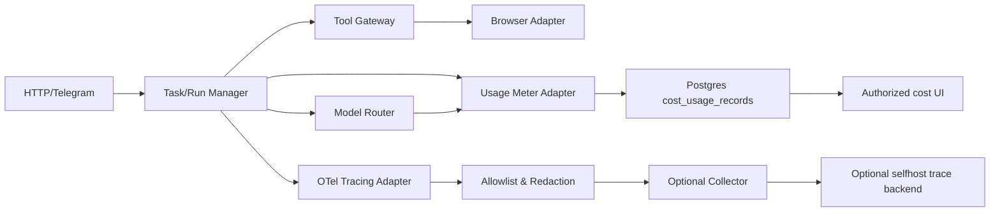

# Observability, Model Usage & Cost Tracing — Detailed Specification (10-04)

> Owner CHAT_10 | Path `docs/10-infrastructure/observability-and-cost-tracing.md` | Status **Draft / PROVISIONAL** | Revision 0.1 | Research date 2026-10-30 JST | main `b45d4e989998663a00ef09673e69ae1f4191f00d` | Runtime/Provider/DB code NOT implemented or tested.

## 0. Conclusion / adoption

採用: **OpenTelemetry API/SDKをinstrumentationのadapter正本**とし、`traceId/spanId`と`tenantId/taskId/runId`を構造化相関、個人データは**collectorへ出す前にallowlist/redact**。Token/costの業務正本はCHAT_02のBudget・model router、Provider adapterが計測事実を返し、CHAT_10の`cost_usage_records`はimmutable usage ledgerとして重複のないphysical保存を提供する。Traceの受信サービスやLangfuseのUIは**任意・交換可能**。Langfuseはselfhost可能な候補だが運用DB/ClickHouse/Worker等のコスト、License、PII threatを先に検証する。Collector障害はTaskの正本を破壊しない。ただし**予算ガードが必須のモデル呼出を、Telemetry lossだから無制限に許すことはない**。

Model/Tokensの『見積』『Provider報告』『請求確定』、cache reads/writes、usage時刻と価格表の有効区間、通貨と外貨換算時刻を別フィールドとし、価格の混同禁止。Providerがusageを返さない場合は未知のまま。API料金とユーザーに示す予想費用/実費を混ぜない。

## 1. Scope / non-scope / scenarios

**Scope:** Trace/correlation propagation; instrumented query/model/tool/browser/watch/relay; budget meters; cost record idempotency; trace export allowlist/filter/sampling; secrets redaction; SLO definition procedure; health and data retention; alerting/fault injection.

**Non-scope:** Provider pricing source/real-time rates (CHAT_02/05)、Spend authorization (CHAT_02/03)、User-visible metrics UX (CHAT_08)、privacy retention/encryption (CHAT_09)、Agent state or Event payload (CHAT_01)。SC-01/02/05/07/08/09, plus SC-10/11/12/13/14/15/16 via new component metrics.

## 2. Source audit / alternatives

| upstream & ref | inspected code/tests | decision / caveat |
|---|---|---|
| **OpenTelemetry JS** `open-telemetry/opentelemetry-js@4667c0a5caeb8c887803fca90aeb5276d0432dd6` | `packages/sdk-trace/src/Span.ts`: `setAttribute`, `recordException`, `setStatus`, `end()`; `packages/sdk-trace/src/TracerProvider.ts`: sampler initialization, `forceFlush`, `shutdown`; `packages/sdk-trace/src/export/BatchSpanProcessorBase.ts`: queue size and batch/export timeout limits; `packages/sdk-trace/test/common/Span.test.ts` contains span validation cases.[S1-S4] | **採用候補** for tracing; OpenTelemetry **does not implement** Agent usage ledger/PII policy. Apache-2.0. |
| **Langfuse** `langfuse/langfuse@71ddcb9094f53d19176a262f107871d8b2950fb0` | `worker/src/instrumentation.ts` configures OpenTelemetry NodeSDK/OTLP exporter; `worker/src/features/otel-ingestion/prepareOtelBatch.ts` preprocesses inbound batch, `prepareOtelBatch.unit.test.ts` exercises invalid JSON and no fallback path.[S5-S7] | Optional trace backend; OTel ingestion itself does not prove content secrecy. License repo is NOASSERTION via API, **full dependency/edition license audit before adoption**, no code copy. |
| **PostgreSQL** 18 docs | transaction/`NUMERIC` decimal and integer, `timestamptz`, indexing and ACID fundamentals [S8]. | Physical usage ledger/backfill, no external OTel dependency for correctness. |
| **OpenTelemetry official JS Sampling** | `TraceIdRatioBasedSampler` and env sampler; default instrumentation/export dynamics described [S9]. | Sampling lowers telemetry cost, **never sample critical audit/usage ledger**. Docs verified; integration untested. |

**Choice A** OTel SDK + optional collector + Postgres ledger (proposed). **B** vendor-only Langfuse as sole truth (rejected: lock-in and telemetry loss can destroy authoritative billing/budget history). **C** all metrics full text in Postgres (rejected: PII and growth risk). **D** logs only (rejected: can't join nested model+tool+Run and measure critical path). OSS benchmarks not transferred.

## 3. Dependency / ownership / authority



- CHAT_01 canonical Run/Task/Event IDs UUIDv7. `tenantId` and owner are Auth/DB scoping, never metrics labels with high cardinality.
- CHAT_02 owns reservation/deny before each model call, maximum daily/Run budget and routing, and reconciling provider usage; this MD stores meter facts atomically but does not independently approve models.
- CHAT_03 owns pre-execution policy/side effect. Logs and trace signals are untrusted observation, not permission.
- CHAT_10-01 owns physical DB and `cost_usage_records`; this MD proposes additional columns/migrations and queries.
- CHAT_08 owns public UI; raw Trace/LLM input/prompt, credentials and internal URLs never exposed.

## 4. Requirements

| REQ-ID | Priority | Observable result | SC |
|---|---|---|---|
| OBS-001 | MUST | Every accepted Task/Run has stable trace correlation; retries identifiable separately | 07,09 |
| OBS-002 | MUST | API/queue/model/tool/browser/watch/outbox spans form bounded causal trace | 02,07,09 |
| OBS-003 | MUST | Raw prompt/HTML/Cookie/token/credentials/PII never exported in trace/log/metrics | 06,08 |
| OBS-004 | MUST | Usage rows append per logical provider attempt once, independent of telemetry export | 01,09 |
| OBS-005 | MUST | Tokens input/output/cache hit/cache write/reasoning where reported are individually represented | 01,09 |
| OBS-006 | MUST | Estimate/observed provider usage/billed amount distinguished; unknown never becomes zero | 01,09 |
| OBS-007 | MUST | Effective price revision/currency/unit/time/provider/model used for amount preserved | 01,09 |
| OBS-008 | MUST | Usage pending/confirmed cost + reservation reconciled without bypassing pre-call budget | 07,09 |
| OBS-009 | MUST | Duplicate or late provider usage receipt cannot double-charge physical ledger | 07,09 |
| OBS-010 | MUST | Exporter backpressure/downtime cannot crash task or unlock budget; bounded queue | 07,09 |
| OBS-011 | MUST | Metrics have bounded cardinality, sample limits, retention and alert thresholds | 08,09 |
| OBS-012 | MUST | Failure/uncertain outcome and evidence freshness tracked without asserting task success | 01,07 |
| OBS-013 | MUST | Human takeover and browser failures carry sanitized correlation but no session credentials | 06,08 |
| OBS-014 | MUST | Audit/approval/security denials are durable via owned DB record, never solely sampled trace | 08 |
| OBS-015 | MUST | Deterministic watch checks with zero LLM calls measured independently | 02,09,11 |
| OBS-016 | SHOULD | Model/provider/strategy/prompt version can be compared with same fixture and source accuracy | 05,09 |
| OBS-017 | SHOULD | OTel backend remains replaceable and opt-out possible without changing usage ledger | 08 |
| OBS-018 | LATER | Summaries/exported reports with no raw PII and irreversible aggregation | 09 |
| OBS-019 | EXPERIMENT | Tail-sampling/error-biased traces with volume tests before production | 09 |

## 5. Internal contracts, values and validation [PROVISIONAL]

```ts
type TraceLink = Readonly<{
  traceId: string; spanId: string; parentSpanId?: string;
  tenantId: string; taskId?: string; runId?: string;
  logicalAttemptId?: string; stepOrdinal?: number;
}>;
type UsageKind = "estimated" | "provider_reported" | "invoice_reconciled";
type CostCurrency = "USD" | string; // authoritative ISO 4217 validated by provider/pricing
type TokenUnits = Readonly<{
  input?: string; output?: string; cachedInputRead?: string;
  cachedInputWrite?: string; reasoningOutput?: string; // DECIMAL integer strings for JS precision
}>;
type UsageReceipt = Readonly<{
  schemaVersion:1; tenantId:string; taskId:string; runId:string;
  logicalCallId:string; providerAttemptId:string;
  provider:string; modelId:string; modelRevision?:string;
  kind:UsageKind; tokenUnits:TokenUnits;
  amountMinorUnits?:string; amountScale?:number; currency?:CostCurrency;
  priceSnapshotId?:string; priceEffectiveAt?:string;
  observedAt:string; billedAt?:string;
  uncertaintyReason?:string;
  sourceReceiptHash:string;
}>;
interface UsageRepository {
  appendIfAbsent(r:UsageReceipt):Promise<"inserted"|"same"|"conflict">;
  sumAuthorizedTaskCost(tenantId:string,taskId:string):Promise<{estimated?:string; reported?:string; billed?:string; currency:string}>;
}
```

**NOT approved shared types**: CHAT_01 owns Event; CHAT_02 owns ModelUsage, reserve/budget, CHAT_09 authorization, CHAT_10 physical ledger. Use SHA256 of canonical serialized receipt as conflict detector. Missing inputUnits is NULL/unknown, not zero. Any reported numeric field is nonnegative decimal integer and bounded by provider reference. Null currency implies unknown cost (no summation to USD). Negative credits/refunds need a separate reversal entry linked to original; do not break immutable positive usage semantics.

### 5.1 Physical schema extension proposal to CHAT_10-01

`agent.cost_usage_records` presently has ``input_units`/`output_units` bigint default0, which destroys absent-vs-zero semantics. Migration proposal: nullable exact`input_units`, `output_units`, `cached_input_units`, `cached_write_units`, `reasoning_output_units`, `usage_kind`, `source_receipt_hash`, `provider_attempt_id`, `logical_call_id`, `price_snapshot_id`, `currency_code`, `amount_minor_units NUMERIC(38,0)`, `amount_scale smallint`, `usage_reported_at timestamptz`, `observed_at timestamptz`. A constraint must reject negative units and unsupported scale; uniqueness proposed `(tenant_id,provider,provider_attempt_id,usage_kind,source_receipt_hash)` with stable adapter idempotency and conflict detection. **Never UPDATE a prior billed amount silently**; append a correction/reversal record with link. Reservation/budget tracking is separate from actual usage and must be coupled by CHAT_02's enforceable cap.

### 5.2 Span and attribute taxonomy

- Root ``agent.request`, child `agent.task`, `agent.run`, `model.attempt`, `tool.prepare`, `tool.execute`, `browser.action`, `watch.evaluate`, `outbox.publish`, `notification.attempt`, `checkpoint.commit`. These are instrumentation names, not Event types.
- span attributes are allowlisted: service, operation, route *template* (not URL), model ID from allowlist, connector class, outcome category, error code, attempt number, duration, token counters **only if not content revealing**. Never raw Tool args, text, headers, cookies, usernames, source URLs with tokens, destination addresses, request bodies or prompt.
- IDs allowed only in **secured traces**, not public metric labels. Event correlation robust across queue: on publish include sanitized W3C traceparent (validated length and trusted origin), not arbitrary Web-provided parent context. Reset trace on boundary if incoming third-party trace untrusted.
- Canonical trace correlation is persisted via safe`trace_id`/`span_id` optionally in Task/Event metadata, but collector loss must not change Task semantics.

## 6. Lifecycle / sequence

```text
HTTP authenticated request -> root span + trace ID
  -> Task commit (DB + Event + Outbox) [trace correlation durable]
  -> Queue pointer carries safe trace link, Run claim fence
  -> ModelRouter pre-flight budget reservation (authoritative)
  -> model attempt span & provider call
  -> usage partial result: source time + provider receipt
  -> idempotent usage ledger commit, budget reconcile
  -> tool / browser spans; checkpoint + evidence / state
  -> OTel export (sampled, asynchronous, bounded)
  -> dashboard requests authorized ledger aggregate
If provider usage unknown:
  keep pending estimated reservation; mark uncertainty,
  never insert "0 tokens / $0" as observed.
If exporter fails:
  drop/retain bounded spans according policy; alert; never drop usage ledger.
```

Span emission itself must **not hold SQL transaction open**, and callback spans after cancel/run switch cannot mutate Task state. A Retry attempt gets a new providerAttemptId and child span, while stable logicalCallId links attempts. Cached input/response reuse must not be logged as paid output unless provider reported. Costs billed by provider outside request timeline must reconcile using accepted immutable correction events.

## 7. Algorithms & calculations

```text
onProviderAttemptStart(ctx, expectedCost, priceSnapshot):
  require Auth+BudgetManager authorization (CHAT_02)
  reserve finite upper bound atomically; if can't reserve => no model call
  emit sanitized start span
onProviderAttemptEnd(ctx, report):
  validate source receipt / units / price version, bounded numeric representation
  if absent -> persist usage_kind='estimated', unknown actual fields as NULL
  else -> BEGIN; insert with canonical receipt hash and unique provider attempt key
          on collision compare exact receipt; inconsistent => reconciliation needed
          commit; signal budget reconciliation
  end span; batch exporter may fail without touching usage transaction
aggregate(tenant,task,kind,currency):
  SQL SUM only rows of known same currency, known scale & valid price snapshot
  dedupe logical receipt, include adjustments as distinct entries
  return {amount,kind,asOf,hasUnknown,priceSource}
```

Money precision: never JS float for spend aggregation. Provider per-million token rates converted into decimal minor units with explicit rounding, unit, priceEffectiveAt, currency and request timestamp. Different currencies cannot sum without FX source/time. Provisional upper limits: OTel batch queue 2048 spans/process, batch 512, exporter timeout 5s, sample 10% success traces, 100% error traces **only if tail-sampler capacity allows**; otherwise bounded error events/metrics. These differ from OTel implementation defaults; configuration/admission must be measured. Usage ledger and security audit always 100% durable; no sampling. Metrics label cardinality cap preflight and allowlist, no arbitrary URL/source fields.

## 8. Failure matrix

| Fault | Detection | Recovery / effect |
|---|---|---|
| Provider success but usage response lost | missing receipt | keep estimation/uncertainty, reconcile later; don't call provider again merely for accounting |
| provider sends duplicate usage event | unique provider attempt+receipt | identical no-op, divergent event quarantined |
| provider changes price table during Run | snapshot effective date | old attempt retains previous snapshot; new attempt uses effective price |
| late invoice contradicts estimate | reconciliation version | adjustment record, never overwrite old evidence |
| OTel exporter down | bounded failed exports | usage ledger unaffected, alert/degraded monitoring |
| OTel buffer overflow | dropped span count | bounded drop for noncritical traces; audit/usage persist |
| malicious HTML inserts secret in error string | sanitizer allowlist | secret not logged or exported, controlled error code |
| worker crash between usage and checkpoint | committed usage ledger persists | restart doesn't duplicate bill or effect |
| model budget exhausted mid-stream | authoritative Budget owner | cancel/stop safe boundary, persist partial and accurate consumed usage |
| different currency in report | currency mismatch | return separately or unknown, no implicit FX |
| old Run emits span after lease lost | stale identity | trace observational only; no Task mutation |
| massive user-supplied URL labels | cardinality validation | aggregated route template, no unbounded labels |

## 9. Security / privacy / trust boundary

Sensitive text and credential filtering happens **in-process before any exporter**; collector processors are second line of defense, not first. URL path fragments, client IP, source snippets, message content, arbitrary attributes, model prompts and Tool arguments are opt-out by default, use explicit allowlist. OTel propagation across external Web origin must be scrubbed: cannot accept malicious remote traceparent to change access rights, even if syntactically valid. Trace backend has separate private operator-only auth, not public Internet. Data deletion/retention per CHAT_09, minimal audit access. Model usage reporting cannot be used by untrusted sources to inflate user's budget. Agent has no direct access to telemetry backend queries, billing credentials, DB superuser or arbitrarily configured OTLP endpoint.

## 10. Metrics, SLO & performance experiment

| Metric/Span | Tags (bounded) | Meaning |
|---|---|---|
| `agent_request_duration_ms` | route_template,outcome | latency to accepted durable Task, not completion |
| `task_e2e_duration_ms` | kind,result_class | start to verified finish/partial |
| `model_attempt_duration_ms` | provider_family,model_class,cache_status | raw model latency |
| `tool_execution_duration_ms` | tool_class,outcome | gateway+actual Tool |
| `browser_startup_ms` | browser_engine,outcome | cold vs warm |
| `outbox_oldest_age_s` | queue_class | backlog |
| `usage_tokens_total` | provider_family,kind | tokens (not actual price) |
| `cost_reported_usd_micro` | provider_family | confirmed cost when actually reportable |
| `budget_reservation_exhausted_total` | budget_class | prevented call |
| `redaction_reject_total` | source_class | prevented unsafe attribute |
| `trace_export_drop_total` | exporter_class | dropped span; no usage loss |
| `evidence_stale_warning_total` | data_kind | provenance/freshness |

SLO targets are **not yet selected**. Benchmark with identical fixture, provider revision, cache policy, sample size, concurrency, CPU/RAM, egress and input size; measure p50/p95/p99 end-to-end, success-with-correct-evidence, security violation=0 and cost per completed Task. Cost prediction error requires known billed truth; if missing, record unknown and exclude from accuracy denominator with exclusion counts. Compare baseline without optional backend to determine actual overhead. Mandatory alerts: cost unexpected >budget, exporter outage, usage ledger insert failures, rate-limit spikes and unknown side-effect count; thresholds provisional and config bounded.

## 11. Persistence / API/UI / migration

Tables in 10-01 Draft: `agent.cost_usage_records` is business ledger, `agent.audit_records` security evidence (policy CHAT_09). Trace backend stores only sanitized sampled spans with finite retention. Migration must be additive, old readers accept absence of newer token fields; new rows preserve units+priceSnapshot+source provenance. Backfill may not manufacture cache token values or zero costs from nulls. No broad raw prompt retention for "debug."

CHAT_08 Dashboard view: Task spending broken into estimated / reported / billed with explicit unknown count and "as-of" timestamps; show request cost guard separately. REST projection never includes tenant IDs for user-facing metrics or raw trace content, and needs owner/tenant check on download/export. CHAT_11 generates fixtures: fake provider usage, variable billing snapshots, exporter slow/drop, traces with seeded secret tokens.

## 12. Implementation PR phases

1. **OBS-A:** OTel instrumentation adapter and sanitized allowlist, contract fixture, exporter shutoff without task impact.
2. **OBS-B:** usage receipt Schema + immutable Postgres ledger + unique idempotency and correct null handling; add migration to 10-01.
3. **OBS-C:** ModelRouter reservation→provider usage→reconciliation integration with CHAT_02 Budget, crash & duplicate tests.
4. **OBS-D:** Browser/Tool/Watch/Queue trace propagation, error categorization, sampling and bounded collector queue.
5. **OBS-E:** optional Langfuse/OTel backend PII/license review, dashboard, SLO benchmark and replay tests.

## 13. Tests (design only, zero executed)

| ID | Type / setup/action | Expected |
|---|---|---|
| OBS-T01 | Unit: trace from HTTP→queue→Run→tool | stable traceId, separate attempt/span, bounded attrs |
| OBS-T02 | Security: insert fake API secret, Cookie, long HTML into trace attrs | not exported/logged |
| OBS-T03 | Integration: Provider response reports cache input separately | ledger units correct, no double counting |
| OBS-T04 | Integration: unknown Provider tokens vs real zero | null distinct from zero |
| OBS-T05 | Concurrency: replay identical receipt 100 times | one usage row per identity, same total |
| OBS-T06 | Concurrency: conflicting receipt same identity | conflict quarantine, existing truth unchanged |
| OBS-T07 | Fault: exporter disconnect, infinite-retry simulation | bounded queue/drop, task ledger unaffected |
| OBS-T08 | Fault: Worker kill after receipt persisted before checkpoint | same usage after resume |
| OBS-T09 | Budget: no reservation/limit exceeded | no model call even if telemetry down |
| OBS-T10 | Price: tariff changes between calls | preserve effective snapshot, correct decimal |
| OBS-T11 | Price: unknown currency or invoice | do not claim USD amount |
| OBS-T12 | Security: injection through malicious URL/header/log error | no new span attrs or privileges |
| OBS-T13 | UI: another tenant/owner requests Cost report | no counts/values leaked |
| OBS-T14 | Benchmark: load with tracing on/off same fixture | recorded overhead/p95/WAL, SLO remains provisional |
| OBS-T15 | Sampling: 10% head sampling | no usage/audit row sampled away |
| OBS-T16 | Async late invoice correction | append-only adjustment, matching original provenance |
| OBS-T17 | Watch no LLM deterministic fixture | model_usage_count=0, watch latency measured |
| OBS-T18 | New event + multimodal fixture (SC-11/15) | separate source/model/tool spans, never embed raw file |

## 14. REQ → TEST → SC traceability

| MUST | Tests | SC |
|---|---|---|
| OBS-001,002 | T01,T08,T18 | 02,07,09,11,15 |
| OBS-003,013 | T02,T12,T13 | 06,08 |
| OBS-004,005 | T03,T05,T08 | 01,07,09 |
| OBS-006,007 | T04,T10,T11,T16 | 01,09 |
| OBS-008,009 | T05,T06,T09,T16 | 07,09 |
| OBS-010,011 | T07,T14,T15 | 07,09 |
| OBS-012 | T01,T04,T18 | 01,07 |
| OBS-014 | T02,T13,T15 | 08 |
| OBS-015 | T17 | 02,09,11 |

## 15. Unresolved issues / Cross-team proposals

| ID / Owner | Priority | Needed answer and verification |
|---|---|---|
| OBS-X01 CHAT_02 | **P0** | Budget reserve/commit and provider usage receipt canonical types; unknown invoice handling |
| OBS-X02 CHAT_01 | P1 | Event/Task/Run identifiers and optional trace correlation without duplicating Event contract |
| OBS-X03 CHAT_09 | **P0** | Redaction/retention, operator telemetry backend access, right-to-delete scope |
| OBS-X04 CHAT_10-01 | P1 | Proposed `cost_usage_records` migration from default0 to nullable, new precise usage columns, unique |
| OBS-X05 CHAT_08 | P1 | Cost projection displays estimated/confirmed/billed separately with source time |
| OBS-X06 CHAT_11 | P1 | Benchmark methodology baseline/sampling/accuracy and seeded sensitive fixtures |
| OBS-X07 CHAT_00 | P1 | Optional Langfuse operational impact and complete license audit, do not claim adoption before test |

## 16. Sources and evidence grades (2026-10-30 JST)

[S1] `https://github.com/open-telemetry/opentelemetry-js/blob/4667c0a5caeb8c887803fca90aeb5276d0432dd6/packages/sdk-trace/src/Span.ts` — `setAttribute/recordException/end`, **Code verified**, Apache-2.0.  
[S2] `https://github.com/open-telemetry/opentelemetry-js/blob/4667c0a5caeb8c887803fca90aeb5276d0432dd6/packages/sdk-trace/src/TracerProvider.ts` — sampler & lifecycle, **Code verified**.  
[S3] `https://github.com/open-telemetry/opentelemetry-js/blob/4667c0a5caeb8c887803fca90aeb5276d0432dd6/packages/sdk-trace/src/export/BatchSpanProcessorBase.ts` — queue max/batch/export, **Code verified**.  
[S4] `https://github.com/open-telemetry/opentelemetry-js/blob/4667c0a5caeb8c887803fca90aeb5276d0432dd6/packages/sdk-trace/test/common/Span.test.ts` — span tests, **Code verified**, not executed.  
[S5] `https://github.com/langfuse/langfuse/blob/71ddcb9094f53d19176a262f107871d8b2950fb0/worker/src/instrumentation.ts` — NodeSDK/OTLP exporter, **Code verified**.  
[S6] `https://github.com/langfuse/langfuse/blob/71ddcb9094f53d19176a262f107871d8b2950fb0/worker/src/features/otel-ingestion/prepareOtelBatch.ts` — preparer, **Code verified**.  
[S7] `https://github.com/langfuse/langfuse/blob/71ddcb9094f53d19176a262f107871d8b2950fb0/worker/src/features/otel-ingestion/prepareOtelBatch.unit.test.ts` — reject malformed JSON / no fallback, **Code verified**; LICENSE is not yet fully audited, so optional only.  
[S8] `https://www.postgresql.org/docs/18/datatype-numeric.html` and `https://www.postgresql.org/docs/18/transaction-iso.html` — numeric/transaction, **Docs verified**.  
[S9] `https://opentelemetry.io/docs/languages/js/sampling/` — sampling official docs, **Docs verified**.  
[S10] `https://github.com/choko510/aiagent-md/pull/1`, `/pull/2`, `/pull/9`, `/pull/10` — project Draft contracts.  
Unknown: OTel version installed in future implementation, SDK exporter compatibility, billed-vs-reported precision for providers, Langfuse backend resource cost, performance measurements, and real receipt availability. **No test run**.
