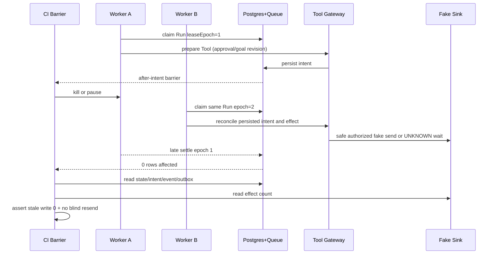

# Fault Injection and Concurrency — Detailed Implementation Specification

> Owner: CHAT_11 | Path: docs/11-qa/fault-injection-and-concurrency.md | Status: Draft / Provisional | Revision: 0.1 | Research 2026-10-30 JST | Base main b45d4e989998663a00ef09673e69ae1f4191f00d

## 0. 結論・採用案

**採用：実Postgres/Queueと分離したWorker上の決定的Barrier注入＋外部操作Fake Sink＋副作用台帳検証。** モデルやAgent本体にShell/SSH/Docker権限を与えず、テスト制御プロセスがkill/遅延/ネットワーク遮断を実施する。Postgres CASにより旧leaseの**保存**は拒否できても、すでに送ったHTTP/APIの**外部操作を取消すことはできない**。したがってExactly-once external effectsを保証せず、証拠不十分ならUNKNOWNを維持し、無承認再実行0を受け入れ基準とする。

## 1. Scope / Non-scope / Scenario

Owner CHAT_11: fault plan schema、barrier orchestration、mock external-effect counter、recovery oracle、test matrix、fault CI gates、再現report。非Owner：CHAT_01 Task/Run/Event/Error状態、CHAT_02 checkpoint/lease/Steer、CHAT_03 Tool Gateway・approval、CHAT_04 BrowserSession、CHAT_07 Watch、CHAT_09 security、CHAT_10 DDL/Queue、CHAT_13 ExternalEvent。QAは共有契約を再定義せず参照する。SC-02/04/06/07/08/09/11/13/16を直接検査、SC-01/03/05/10/12/14/15も共通Gateに依存。実サービス購入/予約/通知/投稿は一切実行しない。

## 2. OSS実コード・テスト・Issue調査

| OSS / Commit | 実見したsource/test | 確認事実と限界 | 採否 / license |
|---|---|---|---|
| pg-boss 71ea068b144c75b014a1eb90327aaa4a92da1cf2 (master) | test/attemptFenceTest.ts: staleWorker, expectNewerAttemptUntouched, newer attempt completion/fail/heartbeat/shutdown cases; src/migrationStore.ts migrateCommands | Queue job attempt fencingを検証。ただしjob.retryCountとAgent Run.leaseEpoch/approvalは別物 | DB Queueの試験パターン採用。MIT（要導入時再点検） |
| Mastra ec3ba11dad428caeb3b4afae77d1669462e8c129 | packages/core/src/agent/run-lease-fence.ts verifyRunLease/startRunStep、packages/core/src/agent/__tests__/thread-lease-loss-abort.test.ts lease backend blipと旧run停止のテスト | Tool呼出前にlease確認、in-flightと新規開始を区別。[issue #27543]はlease喪失の旧runがtoolを続ける報告 | 実装は自前のDB業務境界、テストパターン採用。Apache-2.0（ee/別条件、LICENSE.md確認） |
| LangGraph ffc3336367e8139668d11e5f0b0e6def57e7c762 | libs/checkpoint-postgres/langgraph/checkpoint/postgres/__init__.py PostgresSaver.put/put_writes、libs/checkpoint-postgres/tests/test_sync.py | checkpoint/pending writeのDB永続化・migrationとrecord replayの参考。外部送金/予約 exactly-onceの証明ではない | checkpoint耐久性テスト参考。license導入時確認 |
| Playwright 38fb53bf4c181abb91f1ca2a2ab741983c5d177c (1.65.0-next) | tests/library/browsercontext-har.spec.ts HA-068/071/090、BrowserContext.routeFromHAR | Browser network replay/miss試験。Service WorkerはHARの対象外となる制限 | Browser検証候補、Apache-2.0 |

**Issue report**: https://github.com/mastra-ai/mastra/issues/27543 のタイトルはSession runがleaseを失っても後続toolsを実行する競合を報告。上記の現行コード・テストを確認したが、このAgentで同じ障害を再現したわけではない。OSSのissue報告/実ソース/当プロジェクトHypothesisを区別。

**代替比較**: A Queue retryだけ→Task/Tool副作用・GoalRevisionを保護しないので却下。B in-memory fake DBだけ→SQL CAS/Transactionの不具合を検出不能で却下。C 実DB + test-only barrier + mock sink→採用。D 実外部購入でChaos→危険・非可逆で不採用。

## 3. Dependencyと所有権 / Trust boundary

```text
[CI fault orchestrator (QA only; outside Agent capability)]
  | fault schedule, seeded clock, test-only barrier, isolated worker kill
  v
[CHAT_02 Run manager] -> [CHAT_03 Gateway] -> [Fake external sink]
        |                        |
        v                        v
[CHAT_10 DB/Queue]     [Tool intent/result/approval ledger]
        |                        |
        +----> [QA read-only oracle] <---+
[CHAT_04 Browser Worker owns Page; CHAT_09 owns egress/tenant]
```

CIがbarrier/killするのはテスト専用プロセスに限定し、Agent Toolのcapabilityを増やさない。外部HTTP成功扱いはFake Sinkのdurable effect recordのみ。Tool resultをOracleが生成して本番DBへ差し込まない。

## 4. 要件 / REQ-ID

| REQ | Level | Observable condition | SC | TEST |
|---|---|---|---|---|
| QA-FT-001 | MUST | Tool intentのbefore/afterと外部send/ACK/result commitの間に独立Barrierを設計 | SC-07 | QA-FT-T01〜07 |
| QA-FT-002 | MUST | Postgresとqueueの実transactionでKill/drop/duplicateを検証 | SC-02/07 | QA-FT-T01〜07,15 |
| QA-FT-003 | MUST | 古いleaseEpochのWorkerによるDB更新・Tool新規開始0を証明 | SC-07 | QA-FT-T08,11 |
| QA-FT-004 | MUST | lost ACKのnon-idempotent effectをUNKNOWNとして盲目的再送0 | SC-07 | QA-FT-T04,05,07,19 |
| QA-FT-005 | MUST | Cancel/Steer/Policy revoke後の新規Tool実行0 | SC-04/07/08 | QA-FT-T03,09,10,20 |
| QA-FT-006 | MUST | 同時claimで同Taskに有効active Runは高々1 | SC-07 | QA-FT-T08,13,23 |
| QA-FT-007 | MUST | goalRevision/activeRunId/recordVersion/leaseEpochの組を再照合 | SC-07 | QA-FT-T08,09,17,24 |
| QA-FT-008 | MUST | Watch/ExternalEvent/Notificationの重複配達を論理鍵で検査 | SC-02/11/16 | QA-FT-T13,14,19,22 |
| QA-FT-009 | MUST | BrowserSession/Pageのowner fencingとuser isolationを検証 | SC-06/08/13 | QA-FT-T11,12,21 |
| QA-FT-010 | MUST | 部分失敗・不明・認証待ち・環境障害を成功に昇格しない | SC-06/07 | QA-FT-T04,12,15,25 |
| QA-FT-011 | MUST | Barrier/fault/worker実行に有限上限・可視timeout・必須cleanup | SC-07/09 | QA-FT-T25 |
| QA-FT-012 | MUST | worker kill/HTTP/SSE/BrowserからのResumeはcanonical persisted stateのみ使用 | SC-06/07 | QA-FT-T01〜08,18 |
| QA-FT-013 | MUST | 秘密・Prompt injection・SSRF/egressはretry pathでも遮断 | SC-06/08/11 | QA-FT-T12,16,26 |
| QA-FT-014 | MUST | UUIDv7/v4、Conversation null、revision 1/0、JS bigint境界、workspace mapping driftを検出 | SC-02/07/08 | QA-FT-T16,17,24 |
| QA-FT-015 | MUST | seed/fixtureHash/fault order/fencing/DB時刻を再現レポートに保存 | SC-07/09 | QA-FT-T25 |
| QA-FT-016 | MUST | UI/SSE状態とDB/Outboxの正本の食い違いを検出 | SC-07/08/16 | QA-FT-T18,19,22 |
| QA-FT-017 | MUST | SC-10〜16のEvent/learned browser/feedbackも同一停止条件を満たす | SC-10〜16 | QA-FT-T14,21,22 |
| QA-FT-018 | MUST | Discovery/Entity/TrendとSnapshot差分の処理中Kill/重複イベントで、不明値やsource reputationを勝手に変えない | SC-10/12/14 | QA-FT-T27,28 |
| QA-FT-019 | MUST | Multimodal ingestionの部分書込/失敗後もページ/セル出典とアクセス制御を保護 | SC-15/08 | QA-FT-T29 |
| QA-FT-020 | MUST | SC-10〜16の全てに少なくとも1つの故障耐性/安全性テストを配置する | SC-10〜16 | QA-FT-T14,21,22,27〜30 |

## 5. Test-only型/APIとvalidation

```ts
type FaultKind = 'kill-worker'|'db-fail-before-commit'|'db-drop-commit-ack'|
 'drop-request'|'drop-response'|'drop-queue-ack'|'duplicate-delivery'|
 'delay'|'lease-expire'|'page-owner-collision'|'revoke-credential'|
 'sse-disconnect'|'budget-exhaust';
interface FaultPoint {
  id:string; target:'db'|'tool'|'worker'|'queue'|'browser'|'event'|'outbox';
  barrier:string; phase:'before'|'after'; kind:FaultKind;
  ordinal:number; maxHits:1|2; delayMs?:number;
}
interface FaultPlanV1 {
  schema:'qa-fault/v1'; fixtureId:string; fixtureSha256:string;
  seed:number; logicalNowUtc:string; maxDurationMs:number; maxWorkers:number;
  points:FaultPoint[]; invariantIds:string[];
}
interface FaultOutcome {
  schema:'qa-fault-result/v1'; planSha256:string; firedPoints:string[];
  result:'PASS'|'PRODUCT_FAIL'|'CONTRACT_FAIL'|'INFRA_ERROR'|'UNCERTAIN';
  reason:string; redactedSnapshotRefs:string[];
  oldLeaseWrites:number; unapprovedNewEffects:number;
}
interface QAFaultControl {
  waitForBarrier(id:string,timeoutMs:number):Promise<'HIT'|'TIMEOUT'>;
  inject(point:FaultPoint):Promise<void>;
  resumeOrSpawnWorker():Promise<void>;
  readPersistedOwnerState():Promise<unknown>;
}
```

SchemaVersion未知・point重複・未許可target・非整数ordinal/seed・body secretをreject。初期CI上限はmaxDurationMs 1..120000、maxWorkers 1..4、points 1..32、delayMs 0..10000、同一point命中最大2（提案値・実測ではない）。IDはCHAT_01の型Validator、DB leaseEpochはCHAT_01/02/10の正式型（int64をunsafe JS numberに自動変換不可）。barrierをproduction buildへ公開しない。

## 6. Linearization、状態、sequence

**Cancelボタン押下**と**Cancel commandが永続化/認可されたcommit**は別。停止境界は後者。Tool呼出準備と外部sendの間のin-flight requestが取り消せない場合はUNKNOWN保持。Steerの旧goalRevision approval/args hashの新規Tool開始は禁止。



QA状態 PLANNED→SEALED→ARMED→BARRIER_HIT→FAULT_FIRED→RECOVERING→ASSERTING→REPORTED。未到達BarrierはINFRA_ERRORでありPASSではない。旧WorkerのDB writeをCASで阻止しても外部in-flightの結果照会は別途必要。RunのleaseEpoch・Task.activeRunId・GoalRevision・Policy epochをGateway開始時に照合。

## 7. Fault algorithm / race-safe pseudocode

```ts
async function runFaultPlan(plan:FaultPlanV1):Promise<FaultOutcome> {
  validateFiniteAndSafe(plan);
  const env=await createIsolatedRealPostgresQueueAndFakeSink(plan);
  try {
    await env.assertOutboundBlocked();
    await env.applyProductionMigrationsAndSeed();
    await env.armTestOnlyBarriers(plan.points);
    await env.submitViaPublicPort();
    for(const point of plan.points){
      const hit=await env.waitForBarrier(point.barrier,5000);
      if(hit!=='HIT') throw new InfraError('BARRIER_NOT_REACHED');
      const before=await env.snapshotCanonicalState();
      await env.injectExactlyOnce(point);
      await env.recordRedactedFaultTrace(point,before);
      await env.releaseOrRestartAfter(point);
    }
    await env.waitForQuiescenceOrFail(plan.maxDurationMs);
    await env.assertFencedOldWorkersHaveZeroWritesAndNewEffects();
    await env.assertIntentEffectLedgerReconcilesOrExplicitUNKNOWN();
    await env.assertNoUnauthorizedEffectsOrTenantLeaks();
    await env.assertSseUiMatchesDbState();
    return env.report();
  } catch(e){ return env.failCategorized(e); }
  finally{ await env.killTestOnlyProcessesAndCleanNamespaces(); }
}
```

**順序固定**：barrierはlog順序でなく処理境界のAckをawait。fire exactly onceの印をQAコントローラー側で付け、Workerが死んでも2度injectしない。sleepだけで競合を再現しない。seed/clock/worker count/DB time/fixture hash/code commitを保存。状態不明なら成功を宣言せず再実行の承認状態へ。

## 8. Fault matrix — setup, action, expected

| Test | Trigger / setup | Required oracle | SC |
|---|---|---|---|
| QA-FT-T01 | before intent TX | DB tool intent=0、前提を再検証すれば安全再計画可 | SC-07 |
| QA-FT-T02 | after intent commit, before external send | intent exists; external effectは未確認。台帳が安全と認定するまでblind retry 0 | SC-07 |
| QA-FT-T03 | after fence check, before send / Cancel commit | cancel commit後の新規send 0、Tool開始線形化点を監査 | SC-07 |
| QA-FT-T04 | external fake sink success, before response ACK | effectを取り消せない。UNKNOWNとして再照会、重複effect 0 | SC-07 |
| QA-FT-T05 | ACK received, before DB result commit | DB結果不明でもfake sinkにeffectあるので再実行0 | SC-07 |
| QA-FT-T06 | DB result transaction middle | result/evidence/event/outboxのrollbackか正本Ownerのatomic区間に従う | SC-07 |
| QA-FT-T07 | result commit, before queue ACK | redeliveryでlogical result 1、無断副作用再送0 | SC-02/07 |
| QA-FT-T08 | A lease失効しBが同Runをepoch+1でclaim | 復帰AのDB更新0、Tool開始0、BはactiveRunId再照合 | SC-07 |
| QA-FT-T09 | Tool prepare後SteerでgoalRevision上昇 | 旧goal approval/args hashでの新規Tool 0 | SC-04/07 |
| QA-FT-T10 | cancelとHTTP/Browser action in-flight | cancel後未開始Tool 0、既送信はunknown/partialとして記録 | SC-06/07 |
| QA-FT-T11 | 2 Browser workersが同じPageで並列click | 1所有者のみ実行、異tenant cookie/Artifact leak 0 | SC-06/08 |
| QA-FT-T12 | OAuth/Cookie expiry or revoke during Handoff | WAITING_INPUTまたはdenied、秘密出力0、無許可retry 0 | SC-06/08 |
| QA-FT-T13 | 4 Schedulersが同一slot claimしpause race | Occurrence一意1、旧revision新規開始0 | SC-02/07 |
| QA-FT-T14 | 同じX postを5重delivery、disable同時 | stable actorId+postIdでTask一意1、disable後0 | SC-11 |
| QA-FT-T15 | DB commit result unknown / ACK lost | 成功を推定しない、UNKNOWN/INFRA判定、finite retry | SC-07 |
| QA-FT-T16 | tenantId/ownerUserIdとworkspace_id混線 | 越境書込/読取0、認可エラーで分離 | SC-06/08 |
| QA-FT-T17 | UUID, nullable Conversation, revision initial mismatch | 契約相違をfail、ID再発行や無断Conversation作成なし | SC-02/07 |
| QA-FT-T18 | SSE disconnect, duplicate lastEventId | DB正本を再照合、旧eventでstate rollbackなし | SC-07/08 |
| QA-FT-T19 | notification sent, outbox ACK lost | delivery unknownを成功済と偽らず、可能ならprovider id照合 | SC-02/16 |
| QA-FT-T20 | deadlineとbudget exhaustionの競合 | commit後の予算外Tool開始0、理由と順序を記録 | SC-07/09 |
| QA-FT-T21 | Cached learned Browser recipe、DOM/policy変化 | 旧selector実行0、fresh planning | SC-13 |
| QA-FT-T22 | feedback Undoとnotification rank再配信競合 | Evidence不変、利用者明示優先度適用、dedup | SC-16 |

| QA-FT-T23 | 2Worker/1Task、100 iteration × seed 1..5 | active Runは高々1、旧fence write 0 | SC-07 |
| QA-FT-T24 | goalRevision/activeRunId/leaseEpochがJS safe integer境界に達するwire/DB往復 | overflowはrejectまたは無損失符号化。old epoch settlement 0 | SC-07 |
| QA-FT-T25 | Barrierへ到達しないfixture、DB構築失敗、cleanup fail | INFRA_ERROR、PASS禁止、漏洩Resource検出 | SC-07/09 |
| QA-FT-T26 | HTTP故障復旧時、Webにtool実行命令とmetadata redirect | secret leak 0、権限昇格0、外部egress 0 | SC-08/11 |

**故障クラス分類**：product-fail=不正effect/誤Run、contract-fail=UUID/FK/CAS/tenant mismatch、infra-error=Barrier不達/fixture/DB停止、uncertain=外部side effect未照会、expected deny=権限拒否が正しいassertionの一部。UNKNOWNを「再試行成功」としてpassにしない。

## 9. Security、secret、SSRF、費用上限

- すべて架空Cookie/Token/Account、fake side-effect service。Agentへprivileged Container、host shell/SSH/Docker socket付与なし。テストcontrol-planeはCI実行者のみに許可。
- Prompt injectionをWeb/SNS/MCP tool resultへ混ぜてもTool Gateway policy/Approvalは非変更。SecretはMock transcript・snapshot・SSE・Browser HARに出さずsentinelで検査。
- DNS rebinding/redirect/IPv6/direct TCP/WebSocket等のNetworkGuard否認を別Assertionとして扱い、Mock設置だけでは外部接続遮断と判断しない。
- 試行回数、Worker同時数、budget、wallclock deadline、DB/HTTP timeoutは有限。リトライ後UNKNOWNを再送しないことを最優先。CIリソース超過はinfra-errorとして集計除外（product successへ含めない）。

## 10. 永続化、Migration、UI/API、Monitoring

DBの本番DDL/Task状態を再定義しない。[PROVISIONAL: CHAT_01/08/10] UUIDv7 validator vs gen_random_uuid default、Task.conversationId null vs NOT NULL、recordVersion初期1 vs DB revision0をContract Testとして検証する。[PROVISIONAL: CHAT_01/02/10] leaseEpoch/goalRevision/activeRunId物理永続化、CASとsafe number/bigint encoding。[PROVISIONAL: CHAT_09/10] tenantId+ownerUserId vs workspace_idにより異tenant越境0。[PROVISIONAL: CHAT_03/07/10] Tool intent/result/outboxとACK lossの原子境界を決める。

Trace fields: fixtureHash、seed、testRunId、taskId/runId、leaseEpoch、goalRevision、recordVersion、tenant scope、barrierId、fault ordinal、queueAttempt、toolIntent/outcome、outboxId、observedAt、before/after snapshotHash（secret redacted）。SSE disconnect後のイベント重複/欠落、UIの誤った完了・未認可副作用もfail。DB clockとvirtual timeを混同しない。

## 11. 実装PR分割案

FAULT-PR1 Test-only typed fault plan/Barrier API/fixtures; FAULT-PR2 実Postgres/Queue integration/worker kill/recovery; FAULT-PR3 Tool Gateway intent/ACK loss/UNKNOWN Fake Sink; FAULT-PR4 Browser ownership/credential expiry/tenant & SSRF; FAULT-PR5 Watch/X duplicate, learned-action, feedback/notifications, CI report。段階ごとに実施済み試験を更新するが、現時点はいずれも**未実装・未実行**。

### Round2拡張シナリオの追加故障注入（すべて未実行）

| TEST-ID | Setup / Action | Expected | SC |
|---|---|---|---|
| QA-FT-T27 | Opportunity discovery候補列挙中にWorker killし復帰、同時に旧entity mapping revisionを再配送 | candidate/taskの論理重複0、false merge 0、uncertain候補を確定へ昇格0 | SC-10 |
| QA-FT-T28 | 差分snapshot commit前後でkill、同時にsource reliabilityが低下、古い観測を重複再配信 | latest sourceAt/evidence不変、有意diff重複0、source correlation誤増幅0 | SC-12/14 |
| QA-FT-T29 | PDFページ/XLSXセル抽出後、Artifact保存とイベントcommitの間でkillし他tenant workerがreclaim | 不完全な出典を成功にせず、page/cell provenanceとtenant隔離、添付コード実行0 | SC-15/08 |
| QA-FT-T30 | X event trigger / snapshot / feedback notificationが同一Runで異なる順序にreplayされる | disable以降実行0、Preference Undoはuser scopeのみ、優先通知のsilent dropなし | SC-11/12/16 |


## 12. Requirement → Test → Scenario追跡

| REQ-ID | TEST-ID | SC |
|---|---|---|
| QA-FT-001 | QA-FT-T01〜07 | SC-07 |
| QA-FT-002 | QA-FT-T01〜07,15 | SC-02/07 |
| QA-FT-003 | QA-FT-T08,11 | SC-07 |
| QA-FT-004 | QA-FT-T04,05,07,19 | SC-07 |
| QA-FT-005 | QA-FT-T03,09,10,20 | SC-04/07/08 |
| QA-FT-006 | QA-FT-T08,13,23 | SC-07 |
| QA-FT-007 | QA-FT-T08,09,17,24 | SC-07 |
| QA-FT-008 | QA-FT-T13,14,19,22 | SC-02/11/16 |
| QA-FT-009 | QA-FT-T11,12,21 | SC-06/08/13 |
| QA-FT-010 | QA-FT-T04,12,15,25 | SC-06/07 |
| QA-FT-011 | QA-FT-T25 | SC-07/09 |
| QA-FT-012 | QA-FT-T01〜08,18 | SC-06/07 |
| QA-FT-013 | QA-FT-T12,16,26 | SC-06/08/11 |
| QA-FT-014 | QA-FT-T16,17,24 | SC-02/07/08 |
| QA-FT-015 | QA-FT-T25 | SC-07/09 |
| QA-FT-016 | QA-FT-T18,19,22 | SC-07/08/16 |
| QA-FT-017 | QA-FT-T14,21,22 | SC-10〜16 |
| QA-FT-018 | QA-FT-T27,28 | SC-10/12/14 |
| QA-FT-019 | QA-FT-T29 | SC-15/08 |
| QA-FT-020 | QA-FT-T14,21,22,27〜30 | SC-10〜16 |

## 13. 未決事項 / Cross-team proposals

| ID | Owner | Level | 必要な決定 / test |
|---|---|---|---|
| FT-X01 | CHAT_01/10/08 | P0 | UUID生成、nullable Task、recordVersion/DB revisionの意味とMigration; T17 |
| FT-X02 | CHAT_01/02/10 | P0 | Run leaseEpoch/Task activeRunId/goalRevision列、CAS、integer wireとvalidity epoch; T08/09/24 |
| FT-X03 | CHAT_03/10 | P0 | Intent→external send→result/UNKNOWN→outboxのTX境界とapproval binding; T02〜07 |
| FT-X04 | CHAT_09/10 | P0 | Tenant principal / workspace mapping、クロステナントFK+query isolation; T16 |
| FT-X05 | CHAT_04 | P1 | BrowserSession/Page ownerとHandoff retry/expiry test hook; T11/12 |
| FT-X06 | CHAT_07/13 | P1 | Watch occurrence, ExternalEvent, Notification outbox dedup + disable linearization; T13/14/19 |
| FT-X07 | CHAT_08 | P1 | SSE cursor gap/duplicate, partial/unknown/waiting representation; T18 |
| FT-X08 | CHAT_10 | P1 | 本番migrationを適用したDB test harnessへのfault control API。特権をAgentへ渡さない; T25 |

P0未解決、OSSのテストを実行せず、実Harness未存在なので**Draft維持**。

## 14. Sources (2026-10-30 JST)

- [S1 Code verified] pg-boss master 71ea068b144c75b014a1eb90327aaa4a92da1cf2: [attemptFenceTest.ts](https://github.com/timgit/pg-boss/blob/71ea068b144c75b014a1eb90327aaa4a92da1cf2/test/attemptFenceTest.ts)、[migrationStore.ts](https://github.com/timgit/pg-boss/blob/71ea068b144c75b014a1eb90327aaa4a92da1cf2/src/migrationStore.ts)。MIT (導入時再確認)。
- [S2 Code verified] Mastra ec3ba11dad428caeb3b4afae77d1669462e8c129: [run-lease-fence.ts](https://github.com/mastra-ai/mastra/blob/ec3ba11dad428caeb3b4afae77d1669462e8c129/packages/core/src/agent/run-lease-fence.ts)、[lease loss tests](https://github.com/mastra-ai/mastra/blob/ec3ba11dad428caeb3b4afae77d1669462e8c129/packages/core/src/agent/__tests__/thread-lease-loss-abort.test.ts)、[Issue #27543](https://github.com/mastra-ai/mastra/issues/27543) (Issue report、実環境の再現ではない)。
- [S2b PR verified] [Mastra PR #28847](https://github.com/mastra-ai/mastra/pull/28847) merged: 300ms lease TTL依存のrace testが実timer上のrunner stallでflakyになり、fake Date/timersで10ms段階進行+I/O yieldへ変更したと記載。実ソース/テストの本Harness導入ではDB time・virtual clock・I/O progressを別途検査し、fake timerだけで真のWorker crashを模擬したとは扱わない。2026-10-30にPR本文確認、上流CI結果は本プロジェクトで再実行していない。
- [S3 Code verified] LangGraph ffc3336367e8139668d11e5f0b0e6def57e7c762: [PostgresSaver put/put_writes](https://github.com/langchain-ai/langgraph/blob/ffc3336367e8139668d11e5f0b0e6def57e7c762/libs/checkpoint-postgres/langgraph/checkpoint/postgres/__init__.py)、[tests](https://github.com/langchain-ai/langgraph/blob/ffc3336367e8139668d11e5f0b0e6def57e7c762/libs/checkpoint-postgres/tests/test_sync.py)。
- [S4 Code verified/Docs verified] Playwright 38fb53bf4c181abb91f1ca2a2ab741983c5d177c: [browser HAR tests](https://github.com/microsoft/playwright/blob/38fb53bf4c181abb91f1ca2a2ab741983c5d177c/tests/library/browsercontext-har.spec.ts)、[Service Worker restriction](https://github.com/microsoft/playwright/blob/38fb53bf4c181abb91f1ca2a2ab741983c5d177c/docs/src/api/class-browsercontext.md)。Apache-2.0。
- [S5 Draft project docs] [Core #2](https://github.com/choko510/aiagent-md/pull/2)、[AgentLoop #1](https://github.com/choko510/aiagent-md/pull/1)、[REST #8](https://github.com/choko510/aiagent-md/pull/8)、[Auth #9](https://github.com/choko510/aiagent-md/pull/9)、[DB #10](https://github.com/choko510/aiagent-md/pull/10)、[Scheduler #11](https://github.com/choko510/aiagent-md/pull/11)。
- [S2a License verified] [Mastra LICENSE.md](https://github.com/mastra-ai/mastra/blob/ec3ba11dad428caeb3b4afae77d1669462e8c129/LICENSE.md) は一般コードApache-2.0・ee/別条件。[LangGraph LICENSE](https://github.com/langchain-ai/langgraph/blob/ffc3336367e8139668d11e5f0b0e6def57e7c762/LICENSE) はMIT。2026-10-30確認。
- [S6 Hypothesis] 本書のfault control schema、時間上限、barrier、sink oracle、CI rolloutは独自設計で未実測。OSS tests はソース閲覧のみで**実行していない**。

## 15. Round 3 — Common Contract P0/P1 Regression Cases（2026-10-30）

**対象PRのHeadを再取得し、実装前に最低限次のFault/Contract Fixtureを実行可能にする。** これは試験の**設計**であり、現Harnessは未実装・実行0件。

| Test ID | Setup / injected fault | Strict oracle |
|---|---|---|
| FIC-R3-T01 | One tenant, Task/Run/Watch/Tool aggregate 100 concurrent committed events | `deliveryOffset` unique and monotonic in commit serialization; aggregate sequence separately monotonic; Task-less Watch events accepted |
| FIC-R3-T02 | Kill at domain mutation, aggregate counter, tenant counter, Event insert, Outbox insert and commit ACK-loss | Mutation+Event+Outbox all-or-none; rollback consumes no visible offset; successful commit replays exactly same eventId |
| FIC-R3-T03 | Task snapshot creation, concurrent Event commit, SSE subscription delayed with hidden other-user Event | authorized visible events 0 omissions, no unauthorized leakage, no false 'gap' from filtered offset |
| FIC-R3-T04 | 1 Run with 5 checkpoint phases at same step, kill between append and Run.head CAS | all completed head phases recoverable, old snapshot still immutable, no missing phase/extra Tool execution |
| FIC-R3-T05 | Run lease epoch N expires, N+1 reclaimed; old Worker writes late checkpoint + Tool settlement | stale row changes 0; new head/ledger unaffected; uncertain external effect NEVER blind retried |
| FIC-R3-T06 | DB int64 event offset > Number.MAX_SAFE_INTEGER; serializing via JSON/HTTP/driver | canonical decimal string remains exact; JSON number rejected; `recordVersion` and `leaseEpoch` follow CHAT_01 lossless canonical codec |
| FIC-R3-T07 | Terminal Task retry against POST /tasks/{id}/runs, and POST /tasks/{id}/retry | first 409, second creates new Task with retry lineage; existing historical Task/Run unchanged and new approval required |
| FIC-R3-T08 | Nonterminal Task with terminal FAILED Run, concurrent Cancel/Steer/Run retry | CAS permits exactly one effective transition, no stale-goal dispatch |
| FIC-R3-T09 | Outbox two publishers reverse delivery, duplicate delivery, ACK lost | persistent Event log orders by tenant deliveryOffset, SSE eventually consistent, duplicate notifications/effects not retried blindly |
| FIC-R3-T10 | Two tenants and two owners: altered HMAC cursor, wrong viewer, role revoked mid-stream | denied with safe status/close, zero cross-scope bytes, expired cursor 410 and fresh snapshot |

**Setup:** Deterministic PostgreSQL and time-controlled test driver; each killpoint repeat with fresh DB schema, masked fake credentials, no real network side effects; record exact commit/run/event/intent IDs and DB row counts. Oracle checks SQL rows as source of truth, not only HTTP success. All tests MUST be run against the same chosen PostgreSQL major as deployment. Retention, idempotency window and 64bit max are documented per fixture.

**Owner cross-links**: CHAT_01 #23 canonical Event, CHAT_02 #27 Checkpoint, CHAT_02 #21 Retry, CHAT_08 #17/#8 SSE/REST, CHAT_10 #10 DDL, CHAT_10 #22 Queue, CHAT_09 auth. This test suite must fail if any incompatible old Task-only Event schema or single-Step checkpoint uniqueness returns. Until executed: status **DESIGNED ONLY / NOT VERIFIED**.

