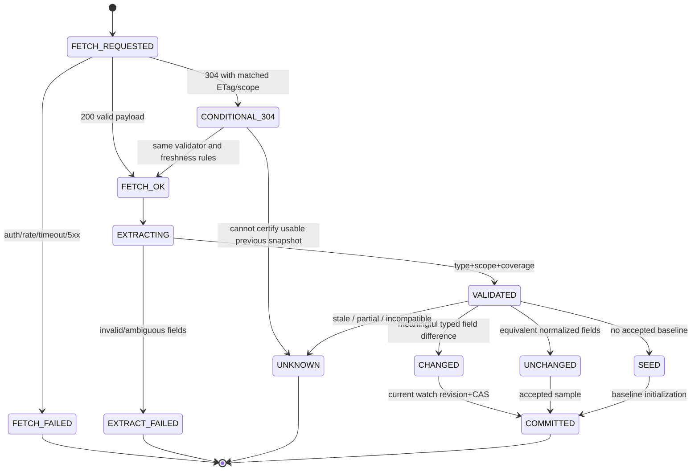
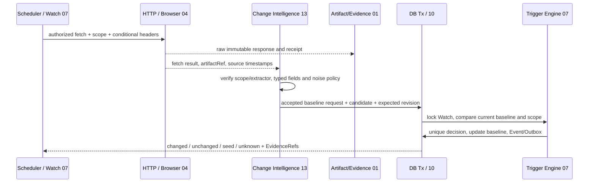

# Change Intelligence — Detailed Implementation Specification (13-02)

> Owner: **CHAT_13** | Canonical path: `docs/13-event-ingestion/change-intelligence.md` | Status: **Draft / [PROVISIONAL] / NOT LOCKED** | Revision: 0.1 | Research date: 2026-10-30 JST | Baseline main: `3044c046b1caeea70c5ef6edfea7c57387c6c6da`.
>
> 依存する未マージDraft: CHAT_01 #2/#23/#33、CHAT_04 #12/#37、CHAT_07 #16、CHAT_09 #41、CHAT_10 #10/#22、CHAT_12 (entity/source profile)。本MDも実装未着手、テストは**すべて設計のみ・実行0**。

## 0. 結論・採用案

HTMLの全テキスト差分をTriggerとする方式は却下。**認可済み取得→不変Snapshot→バージョン固定の抽出器→型付き正規化→同一系列の有効Baseline比較→意味的ChangeDecision→CHAT_07のTrigger/Outbox** を採用する。URL、locale、通貨、地域、Cookie/session profile、商品・宿泊条件、型番、抽出器version、Entity mapping revisionが異なれば「同じページの変化」と推定しない。結果が取れないことを「値が0になった」「在庫なし」と同一視しない。

ページの広告、時刻、セッション識別子、画面幅差による差分はノイズに分類し、価格・在庫・キャンペーン有効期間・条件など**ユーザー指定対象の意味**を厳格に検出する。初回の基準観測は変更通知を発火させない。スナップショットの鮮度・抽出信頼度が閾値外なら `unknown/stale` とし、有効Baselineを変更しない。AI抽出は補助的 `needs_review` として許容するが、値の真偽や通知条件の最終判定は決定的実装と出典Evidenceに基づく。

## 1. 目的・ユースケース・非責務

- **SC-12**: 同一価格ページの「¥44,000→¥45,000」と広告/時刻表示変更を入力→意味的価格差分1件、無関係diff0件。取得失敗/古いcacheは `unavailable/stale` として見分けられる。
- **SC-02/01**: 商品の買取価格・条件と前回値を比較。数値の差だけでなく価格の適用条件・送料/会員クーポンなどの相違を保持。
- **SC-07/08**: Worker再起動、到着順逆転、ログインセッション変更、Cookie偏り、Prompt Injection、SSRFで誤通知を出さない。
- **SC-09/14**: 差分精度・APIコスト・抽出エラー・sourceの信頼度を監視。

Owner CHAT_13: Snapshot→正規化済み比較入力、semantic diff、noise classification、ChangeDecisionとその証拠・version、baseline受け渡し。**Owner外**: HTTP/Browser取得、Page/Session所有 (CHAT_04)、Watch predicate/TriggerとAccepted Baselineの正本(CHAT_07)、Schema/Evidence/Event (CHAT_01)、Entity同一性/Source Reliability(CHAT_12)、Network/Secret Policy(CHAT_09)、DDL(10)、UI/REST(08)、通知配送(07)。この文書は独自Watch state/Notification senderやBrowser implementationを作らない。

## 2. 一次資料・OSS実コード調査 (2026-10-30)

| 対象 | 実コード/テスト・原典と確認できた動作 | 採否 |
|---|---|---|
| **changedetection.io** `dgtlmoon/changedetection.io@11c7ca8719bfc59a4ffa8cd06dd5d0c5d090a82b` / **Apache-2.0** | `changedetectionio/notification_service.py` の `FormattableDiff/FormattableExtract` はテキスト差分を描画、`watch_will_send_content_changed_notification` はmuted/destinationを確認。`changedetectionio/conditions/default_plugin.py` `contains_regex` はPython `re.search`、`Price.fromstring`→float抽出。テスト `changedetectionio/tests/unit/test_watch_model.py::test_watch_get_suggested_from_diff_timestamp` は履歴timestamp選択。[S1-S4] | Snapshot historyとノイズ除去を参考。**生float/regex/HTML diffを金銭の真実にしない**。複数条件とrevision/fencingを追加 |
| **Huginn** `huginn/huginn@2b1eb20cb657b86ca52378c75fc4176a3815c524` / **MIT（採用時再検証）** | `app/models/agents/attribute_difference_agent.rb` `calculate_integer_difference`, `calculate_decimal_difference`, `calculate_percentage_change`, `update_memory` を直接閲覧。初回値なし→差0/float、nil入力→0に強制する経路もあり。[S5] | Attribute-specific previous/current比較は参考。欠測をゼロにし、単一memory last_valueを無条件更新する方式は却下 |
| **Firecrawl Change Tracking / Monitor** | 公式 `changeTracking` はJSON diff/line diffを説明。Monitorはmanaged API/スケジュールと通知機構。セルフホストMonitorやpricingを単純に同一とはみなさない。[S6-S8] | SaaS監視依存は非採用。許可済みConnectorとして資格があれば外部差分を参照し、正本Compareをローカル実施。**Firecrawl実内部ソース/テストは未検証** |
| **CHAT_07 観測仕様 Draft #16** | `observations-and-trigger-evaluation.md` はObservation `valid/not_modified/unavailable/extraction_failed/access_denied/unknown`、Baselineのentity/source/revision固定、同一Tx Trigger Decision+Outbox、失敗はbaseline不変を提案。[S9] | **消費側の正本**。本MDはChangeDecisionを提案し、Trigger自体を二重に定義しない |

**代替評価:** raw HTML文字列shaだけを比較 (安いが広告・時刻・A/B testで偽陽性→採用不可)、DOM semantic selectorsのみ (抽出器変化と認可差に弱いがfallback)、LLMで全文比較 (費用/非決定性とPrompt Injectionで判定正本に不可)、**型付き字段＋versioned extractionとprovenance＋deterministic comparer** (採用)。画像・PDF・動的Canvasのみの値はCHAT_15 Multimodal抽出との合意前には信頼度を上げない。価格の単位とconditionが異なると異系列にするため、誤警報率低下を目的とするが効果数値は未測定。

## 3. 正本/Trust Boundary/所有権

```text
approved Watch (07-02) + policy/credential (03/09)
  -> SourceRouter/HTTP/Browser (04; BrowserSession exclusive)
  -> Artifact receipt + fetch status + timestamps (01/04)
  -> Change Intelligence normalization / diff (13-02)
  -> immutable candidate Observation / Evidence (01; contract proposal)
  -> accepted baseline + trigger decision (07-03; transaction 10)
  -> notification intent/outbox (07-04) -> Telegram/REST (08)
```

`sourceAt` (HTTP Last-Modifiedなどソースが主張する更新時刻), `retrievedAt` (実際のfetch完了), `observedAt` (有効サンプルとして解釈した時刻), `committedAt` (DB確定)は**混同しない**。Last-Modified/ETagはHTTPの弱い検証ヒントであり内容正確性/リアルタイム性や一意性の証明ではない。304 Not Modifiedも、既知の同じ認証スコープ/条件でvalidatorが合致した場合にのみ前回Snapshot reuse可能、かつ**現時点価格を検証した証明ではない**。Cache未期限切れのreadをリアルタイム取得と表示しない。

## 4. Requirements

| REQ | Level | 可観測な要求 |
|---|---|---|
| CHG-001 | MUST | フェッチ成功/失敗/認証拒否/304/抽出失敗/古い観測を独立状態とする。失敗は数値0へ変換しない |
| CHG-002 | MUST | tenant, target, entity, locale, region, session profile, user condition, extractor revisionをシリーズIDへ正規化 |
| CHG-003 | MUST | snapshotはraw/source meta/field Evidence参照とtimeを不変として保存し、比較結果で元値を書換えない |
| CHG-004 | MUST | priceは正規最小単位**十進整数文字列**+ ISO通貨+条件。NaN/丸め・違う商品系列で比較を許さない |
| CHG-005 | MUST | noisy DOM/広告/時計/rotating token差はmeaningful `changed`の根拠にならない |
| CHG-006 | MUST | product/stock/status/validUntil/termsのfieldごとにtyped before/after/delta分類と根拠を提供 |
| CHG-007 | MUST | baseline無/不確実/too old/incompatibleなら `seed` または `unknown`。verified changeを発火しない |
| CHG-008 | MUST | valid observationとbaseline更新と下流trigger intentがCHAT_07/10境界で原子的に扱われる |
| CHG-009 | MUST | 非同期/重複/順不同のWorker結果は旧revision/lease/fenceで現在baselineを上書きしない |
| CHG-010 | MUST | stale cache/Personalization/A-B/cookie条件不一致を `scope_mismatch` として確定diffから除外 |
| CHG-011 | MUST | retention/tombstone/削除時、参照残存とプライバシーを両立。古い証拠を再び最新扱いしない |
| CHG-012 | MUST | 取得したHTML/SNSは非信頼データ。URL/redirect/regex/prompt/secretに安全制約を課す |
| CHG-013 | MUST | payload/time/extractor versionsを検証、未知major/未対応単位はfail closed |
| CHG-014 | MUST | request/fetch/parse/diff/triggerの各費用・件数・時間・保存上限を持ち障害時にも守る |
| CHG-015 | MUST | false change/unknown/partial/provenance/latencyを診断しユーザーに根拠付き表示できる |
| CHG-016 | SHOULD | fieldごとのnoise rule自動推奨はレビュー候補にとどめ、承認済み条件を黙って変えない |
| CHG-017 | LATER | DOM構造変更時のLLM-assisted schema migrationはReview承認後のみ適用 |

## 5. 型・Schema・Validation（**CHAT_13内の提案**、共通型は再定義しない）

```ts
type FetchOutcomeV1 =
 | "ok" | "not_modified" | "network_error" | "timeout" | "rate_limited"
 | "auth_required" | "access_denied" | "source_missing" | "parse_error";
type FieldValueV1 =
 | {kind:"money";minorUnits:string;currency:string;taxMode:"included"|"excluded"|"unknown"}
 | {kind:"stock";availability:"in_stock"|"out_of_stock"|"preorder"|"unknown";quantity?:string}
 | {kind:"instant";value:string;tz:string|null}
 | {kind:"text";value:string}
 | {kind:"boolean";value:boolean};
interface SeriesScopeV1 {
  targetRef:string; tenantId:string; ownerUserId:string;
  entityId:string|null; mappingRevision:string|null;
  canonicalUrlHash:string; extractorId:string; extractorRevision:string;
  sourceRegion:string|null; locale:string; currency:string|null;
  sessionProfileId:string|null; authScopeFingerprint:string;
  productVariantKey:string|null; conditionFingerprint:string;
}
interface SnapshotCandidateV1 {
  schemaVersion:"1.0"; snapshotId:string; series:SeriesScopeV1;
  fetch:{outcome:FetchOutcomeV1;httpStatus:number|null;etagHash:string|null;
         sourceAt:string|null;retrievedAt:string;observedAt:string|null;
         cacheStatus:"fresh_fetch"|"revalidated_304"|"cached"|"unknown"; maxAgeSeconds:number|null};
  artifactRef:string|null; responseHash:string|null;
  fields:Array<{fieldPath:string;value:FieldValueV1|null;status:"valid"|"missing"|"ambiguous"|"stale";
    sourceLocator:string;confidence:"verified_extraction"|"estimated"|"unknown";}>;
  coverage:{expectedFields:number;validFields:number;complete:boolean};
}
interface SemanticChangeV1 {
  schemaVersion:"1.0"; seriesKey:string; previousSnapshotId:string|null;
  currentSnapshotId:string; outcome:"seed"|"unchanged"|"changed"|"unknown"|"stale"|"scope_mismatch"|"blocked";
  changedFields:Array<{fieldPath:string;before:FieldValueV1;after:FieldValueV1;
    classification:"price_increase"|"price_decrease"|"stock_change"|"terms_change"|"period_change"|"text_change";
    deltaMinorUnits?:string;confidence:"confirmed"|"estimated";evidenceRefs:string[]}>;
  noiseFields:string[]; reasonCodes:string[]; extractedAt:string;
  compareRevision:string; baselineVersion:string|null;
}
```

`FieldValueV1`の共通Schema化は[PROVISIONAL: CHAT_01/07/12/10]。金額はUnicode数字/区切りをlocale別の厳密文法でparse、integer minor unitsに固定し、JPYに小数を見つけたらunsupported。分割/税条件/会員価格/容量/購入時の個数等が不明なら正式 `money` ではなく `ambiguous`。抽出されたフィールドに未定義path/二重path/型不一致があればreject。JSON Schema version unknown major拒否。objectの余計なpropertyは原則reject、raw artifactには別保管。Canonical seriesKeyは上記Scopeを安定順序で直列化しSHA-256; URL queryのtokenはhashする前にcredential-aware URL正規化、異認証レベルを同一hashへ統合しない。Source URL全体をmetrics labelに置かない。

**Field identity**: fieldPath `price.current`, `price.buyback`, `stock.availability`, `campaign.validUntil`, `terms.shipping` 等は抽出テンプレートに事前登録。表示文は元URL+source locator（CSS selector/structured JSON pointer/DOM位置の検証済み参照）に結ぶ。EvidenceはCHAT_01の既存Referenceへアダプトする。[PROVISIONAL: CHAT_01]。

## 6. State machine / sequence





## 7. Deterministic algorithm / concurrency

```text
evaluate(candidate, watchDefinitionRef, workerFence):
  reject unknown schema major; require authz+tenant+owner and valid scope
  if fetch.outcome is error: record failure observation only; DO NOT change baseline
  if status=304: permit reuse only when source URL/credential/variant/extractor
                   and validator match; retain lastSourceAt, set new check time;
                   304 never fabricates fresh price assertion
  require artifact checksum verified and finite raw size; parse declared fields
  if incomplete/missing/uncertain: record UNKNOWN and retain baseline
  if sourceAt is future beyond clock tolerance: UNKNOWN
  if retrievedAt exceeds watch maxFreshness or stale cache: STALE
  seriesKey=sha256(canonical(scope))
  TX: lock Watch + accepted_baseline(seriesKey), check owner, defRevision, fence
      require candidate freshness and source-revision still current
      if no baseline: insert seed; store immutable snapshot; no changed notification
      else if candidate time older than last accepted: record out_of_order, keep baseline
      else: for each comparable field, compare typed normalized value and terms;
            if differ, materialize explainable ChangeDecision + refs
            update baseline to candidate; insert Observation and Trigger Decision
            insert notification/research intent ONLY via CHAT_07 atomic API
      append DomainEvent+outbox in same TX; COMMIT
  return decision receipt; retry DB serialization conflict only with fresh read/fence
```

**Comparison rules**:
1. `money`: `currency/taxMode/conditionFingerprint` fully match; signed `delta = BigInt(after)-BigInt(before)` with bounded decimal range. Unknown tax or missing costs→`unknown` not false positive. Negative values for nonrefund retail price reject.
2. `stock`: `unknown`→`out_of_stock` 不可、`out_of_stock`↔`in_stock`は同条件・同地域の時のみmeaningful。Quantity unknownから0への推定不可。
3. `instant`: 必須のIANA TZで厳密UTC変換。期限の消滅は `unknown`、観測済み終日/期間の明確な変更なら `period_change`。
4. `text`: 編集距離だけで発火しない。user-approved regex/text predicateを持つfieldだけ対象。正規化はUnicodeと連続空白の畳み込みまで、意味が変わり得る文言・数字/単位は残す。
5. `noise`: 静的allowlistの広告locator、現在時刻、nonce、CSRF tokenをdiff対象から除外。ただしignored fieldに価格や期限を含める場合はrule author reviewが必要。Auto-learningから本番抑止ルールに昇格しない。
6. Source側のCookie/variantが不明ならscope `unknown` としてsafe comparisonを拒否。同一URLでもログインユーザー/キャンペーン/regionにより値が変わる。

**Baseline更新:** `changed` と `unchanged` の両方で有効なサンプルに進めるのが原則。ただしCHAT_07 crossing/hysteresis policyの正本に従い `armed` stateとtriggerは同じTXでのみ更新。セッション/フィールド定義変更時は**新シリーズをseed**、旧baselineを既定で引き継がない。Crash後はsnapshot ID uniqueとWatch revision/fenceを照会して再実行し、providerの新しい取得を不要に繰り返さず既存immutable artifactから再parse。

## 8. Failure matrix

| Situation | Detection | Recovery/terminal & impact |
|---|---|---|
| HTTP 500/429, DNS/SSL/timeout | explicit fetch status | `unavailable`; retry Scheduler policy; baseline不変; 429 Retry-After |
| Session 401/login challenge | authenticated profile invalid | `auth_required` / Human handoff Owner04, no bypass |
| 304 but validator/scoped cache missing | metadata mismatch | `unknown`, request new authorized fetch if budget |
| Page changes DOM / selector 0 hits | extraction coverage incomplete | `extraction_failed`, prior value not 0 |
| Same URL geo, A/B, cookies diverge | seriesScope differs | `scope_mismatch`; new baseline seed |
| Fee/tax/promo terms differ | condition fingerprint changes | separate series; no direct delta |
| rotating banner/timestamp differs | ignored noise fields only | `unchanged`, no Trigger |
| Worker killed before TX commit | no change persisted | resume from snapshot receipt; one decision |
| Worker killed after TX before ACK | same snapshot and unique decision key | same receipt, duplicate Trigger0 |
| Old watch revision/wrong owner | expected revision mismatch | `blocked`, stale worker 0 updates |
| Concurrent 2 jobs different observed times | row lock + monotonic sequence | latest valid wins, old sample audit only |
| Cost budget exhausted or file over limit | pre-admission strict cap | no new fetch/parse, explicit cost/block state |
| Artifact TTL elapsed or data deleted | immutable link missing | `unverifiable`; no resurrect stale proof |
| LLM or HTML injected "change threshold" | untrusted parser output | instruction ignored, policy unchanged |
| Diff text includes secret | restricted artifact/redaction | no logs, previews sanitized |

## 9. Security / privacy / trust boundary

HTML, X content, embedded JSON-LD, third-party scripts, PDF references, LLM candidates are **untrusted data**. Change Intelligence may not call Shell, arbitrary network or change policies. Extraction uses allowlisted selectors/structured field mappings, HTML sanitization and parser resource limits; avoid `eval`, injected JS or HTML rendering in server logs/UI. Browser Page/Cookie/credential owner04/09 only, privilege-scoped Artifact read. SSRF and egress are enforced before each redirect, DNS resolution and browser fetch by CHAT_09 owner; no automatic new URL follow from source-provided text. Any user-defined regex must use linear-time RE2-compatible engine with CPU budget; never execute Python-style catastrophic regex from remote HTML. Evidence store avoids query auth token retention; delete/export/retention use CHAT_09 privacy rules. Cross-tenant or different user baseline access denies, including cache hits. Financial values are never inferred from confidence alone. Notification URLs displayed are sanitized and never trigger automatic purchase.

## 10. Limits, observability, benchmark

**Initial finite design limits** [PROVISIONAL: CHAT_00/02/04/07/09/10/11]: 1 Watch max1 concurrent extraction and 5 pending receipts; candidate raw HTML cap 2MiB decompressed (compressed response/ratio cap delegated owner04); max200 typed fields, max5,000 DOM nodes inspected, max16KiB per field, max1,024B string after normalization, max10 semantic change fields per alert, max2 CPU seconds parse/comparison, no LLM by default, optional model budget max1 invocation/low-confidence sample only with explicit policy. Baseline hot value max 1; immutable snapshot raw retention 30d and field history 90d **proposed, pending privacy owner**; max hourly crawls and site rate CHAT_04/07/09 lower caps. On limit breach `unknown/too_large`; never treat empty as unchanged.

Metrics: `change_fetch_total{status}`, `change_extract_total{error}`, `semantic_change_total{kind}`, `noise_suppressed_total`, `scope_mismatch_total`, `baseline_rejected_stale_total`, `snapshot_age_seconds`, `diff_cpu_ms`, `artifact_bytes`, `watch_ttl_violation_total`, `trigger_false_positive_review_total`; trace uses hash Watch/series/snapshot IDs and defRevision, never raw URL/tokens. Benchmark fixture: 1000 watches×100 captures with rotating banners/clock, 10% transient fetch failure, 20% region variants, 30% out-of-order, budget-capped and 1/4/16 workers; report p50/p95/P99, RSS, false positive/negative, accepted baseline correctness and cost. No SLO claimed before measurements.

## 11. Storage, TX, migration proposal — [PROVISIONAL: CHAT_10]

Tables or canonical columns not invented here. Request logical data: `snapshot_record` (immutable, tenant, scope hash, source URL credential-safe ref, fetch status, times, artifact hash, parser revision, fieldRefs, contentDigest), `source_series` (tenant+scope hash+extractor revision+entity version, accepted snapshotID/version), `semantic_change_decision` (unique watch+defRevision+currentSnapshotId+comparisonRevision; previousSnapshotId, changedFields, noise reasons), and `retention_tombstones`. **Physical DDL/foreign keys/transaction indexes/CAS strictly CHAT_10.** Adopt CHAT_07's existing accepted baseline and trigger_decision, not a parallel baseline that can disagree.

Migration: feature flag default off→shadow ingest/compare with no notification→format converter `v1` rejects old float/unknown locale/old sessions as baseline→seed from verified typed observation only→enable subset of Watches→Monitor false positives→roll back by pausing decision writes, preserving receipts. No dual active trigger from old raw-text engine; migration tests for revocation/retention and old snapshot rehydrate. Version major incompatible implies new Series, not silent semantics switch.

## 12. API/UI proposals — [PROVISIONAL: CHAT_08]

Expose Watch change feed: `GET /api/v1/watches/{watchId}/changes` with scoped page cursor and semantic change refs; detail shows `previous`, `current`, currency/conditions, direct Evidence links, `sourceAt`, `retrievedAt`, `cacheStatus`, `lastSuccessfulObservationAt`, `lastFailedCheckAt`, `scopeMismatch`, noise reasons and coverage. Rendering of diff must HTML-escape content. Source timestamps are not verification timestamps. Changes to selectors/fields require `If-Match` and explicit rebaseline consent; no automatic historical reinterpretation. Notification sent by CHAT_07 only.

## 13. Implementation work decomposition (future runtime PRs)

CHG-I1 extraction field schema, exact money/date parsing and series key; CHG-I2 immutable snapshot/history/Artifact refs and no-error-to-zero; CHG-I3 semantic diff rules/noise filtering/Watch scope; CHG-I4 CHAT_07 baseline/trigger atomic bridge, same-TX unique decisions; CHG-I5 multiworker CAS, stale out-of-order/crash and privacy/retention; CHG-I6 API/UI/evidence/benchmark/canary. No runtime code is committed by this docs-only author.

## 14. Test plan — **all DESIGNED, NOT EXECUTED**

| TEST | Type / Setup → Action | Expected |
|---|---|---|
| CHG-T01 | Unit: 500,429,401,304,200,timeout fixtures | distinct statuses, failure baseline unchanged |
| CHG-T02 | Unit: same URL but user A/B, locale, product size, extractor rev | unique scoped series hashes, no cross comparison |
| CHG-T03 | Unit: prior/new raw HTML + checksum + source coords | immutable source/candidate ref chain; later mutation rejected |
| CHG-T04 | Unit: 45,000 JPY vs 44,999; "44.1" JPY, $ currency, condition mismatch | exact minor-unit delta 1; invalid/unknown rejected |
| CHG-T05 | Unit: only rotating banner/time/CSRF change | semantic `unchanged`, no Trigger |
| CHG-T06 | Contract: price and explicit shipping/promo validity change | typed before/after, reason and Evidence fields exact |
| CHG-T07 | Unit: first sample, missing extractor, stale previous snapshot | seed/unknown, not misleading changed |
| CHG-T08 | SQL integration: Observe+baseline+trigger+outbox kill before/after commit | all-or-none, same unique idempotency key |
| CHG-T09 | Race: 4 Workers in reverse source arrival, Watch edit mid-parse | old writer 0 baseline updates/notifications |
| CHG-T10 | Security: cookie/login/geo variant A and B price | cross-scope change 0, explicit mismatch |
| CHG-T11 | Retention/fault: raw snapshot GC and deletion concurrent ref | no stale Evidence reuse; consent and tombstones |
| CHG-T12 | Security: HTML prompt injection, malicious href, catastrophic regex | no privilege or leak, bounded CPU, SSRF denied |
| CHG-T13 | Contract: unknown major, NaN price, missing currency and duplicate fields | fail-closed, no changed |
| CHG-T14 | Benchmark: 100k snapshots, 16 Workers, 30% noise and 10% errors | budgets honoured; p95/RSS/FPR measured, not invented |
| CHG-T15 | E2E: old44,000→new45,000, ad+clock change, failed next crawl | one meaningful change alert with source times; failed sample doesn't overwrite valid baseline |
| CHG-T16 | UI: mismatched region, stale revalidate, source partial | status/freshness and provenance visibly separate |

## 15. MUST traceability REQ → TEST → SC

| REQ | TEST IDs (prefix CHG-) | SC |
|---|---|---|
| CHG-001 | T01,T15 | SC-02,SC-12 |
| CHG-002 | T02,T10 | SC-01,SC-12 |
| CHG-003 | T03,T11 | SC-07,SC-12 |
| CHG-004 | T04,T13 | SC-01,SC-12 |
| CHG-005 | T05,T15 | SC-12 |
| CHG-006 | T06,T15 | SC-01,SC-12 |
| CHG-007 | T07 | SC-02,SC-12 |
| CHG-008 | T08 | SC-07,SC-12 |
| CHG-009 | T09 | SC-07 |
| CHG-010 | T10 | SC-08,SC-12 |
| CHG-011 | T11 | SC-07,SC-08 |
| CHG-012 | T12 | SC-08 |
| CHG-013 | T13 | SC-05,SC-12 |
| CHG-014 | T14 | SC-09,SC-12 |
| CHG-015 | T15,T16 | SC-02,SC-12,SC-14 |

## 16. Cross-team proposals / Open issues

| ID / Priority | Owner target | Contract proposal; tests; outcome needed |
|---|---|---|
| CHG-P01 P0 | CHAT_01 `evidence-artifact-contracts.md` | Typed Observation w/ versioned fields, extracted source locator, raw Artifact+time+outcome separate. T03/T13 |
| CHG-P02 P0 | CHAT_07 `observations-and-trigger-evaluation.md` | CHG candidate→accepted baseline only after valid/series match; no second Trigger engine; atomically unique decision and notification intent. T07/T08/T15 |
| CHG-P03 P0 | CHAT_10 `database-schema-and-migrations.md` | unique series + snapshots, tenant FK, CAS/fence, retention GC/Outbox same-TX; migration for old string/float samples, no reinterpretation. T08/T09/T11 |
| CHG-P04 P1 | CHAT_04 `http-fetch.md`/`data-extraction-and-normalization.md` | Credential/locale/cookie/variant scope metadata and cache revalidate; immutable Artifact, no uncontrolled browser Page concurrency. T01/T02/T10 |
| CHG-P05 P0 | CHAT_09 `network-egress-and-ssrf.md`/`privacy-audit-and-retention.md` | Egress validation and tenant isolated private artifacts; retention 30/90d numbers need owner approval. T11/T12 |
| CHG-P06 P1 | CHAT_12 Entity/Source profiles | `entityId+mappingRevision`, similarity uncertainty, signal reliability separate from measured price, no false merge. T02/T06 |
| CHG-P07 P1 | CHAT_08 Dashboard/UI | typed diff and scope mismatch/last failure/last valid timestamps/nullable values, source links. T16 |
| CHG-P08 P1 | CHAT_11 E2E | SC-12 noisy HTML multiworker fixture, manual oracle of meaningful changes, FPR / FN evaluation. T14/T15 |
| CHG-P09 P1 | CHAT_00 policy and CHAT_07 Watch | whether changes must be double-confirmed before alert per provider, region / locale disclosure, freshness SLA and price alert hysteresis are per-watch policy, not invented default |

**P0:** canonical Entity/Evidence/Observation, accepted baseline and domain transaction, tenant/owner mapping and retention remain in Draft; this MD stays Draft. Required physical DB changes and UI routes are proposals only. Neither Firecrawl managed billing/retention nor live site compatibility has been benchmarked.

## 17. Source bibliography / evidence grades

Accessed **2026-10-30**. “Code verified” means repository text actually read; runtime integration/tests were NOT executed.
- [S1] **Code verified**, changedetection.io @ `11c7ca8719bfc59a4ffa8cd06dd5d0c5d090a82b`, `notification_service.py` `FormattableDiff` and `watch_will_send_content_changed_notification`: https://github.com/dgtlmoon/changedetection.io/blob/11c7ca8719bfc59a4ffa8cd06dd5d0c5d090a82b/changedetectionio/notification_service.py
- [S2] **Code verified**, same ref `conditions/default_plugin.py`, `contains_regex`, `Price.fromstring`: https://github.com/dgtlmoon/changedetection.io/blob/11c7ca8719bfc59a4ffa8cd06dd5d0c5d090a82b/changedetectionio/conditions/default_plugin.py
- [S3] **Test code read (not executed)**, same ref `changedetectionio/tests/unit/test_watch_model.py` `test_watch_get_suggested_from_diff_timestamp`: https://github.com/dgtlmoon/changedetection.io/blob/11c7ca8719bfc59a4ffa8cd06dd5d0c5d090a82b/changedetectionio/tests/unit/test_watch_model.py
- [S4] **License code verified**, Apache-2.0: https://github.com/dgtlmoon/changedetection.io/blob/11c7ca8719bfc59a4ffa8cd06dd5d0c5d090a82b/LICENSE . **Issue report**, reported empty diff notification #962 https://github.com/dgtlmoon/changedetection.io/issues/962 (not locally reproduced).
- [S5] **Code verified**, Huginn `app/models/agents/attribute_difference_agent.rb`, `calculate_decimal_difference/last_value/update_memory`, pin `2b1eb20cb657b86ca52378c75fc4176a3815c524`: https://github.com/huginn/huginn/blob/2b1eb20cb657b86ca52378c75fc4176a3815c524/app/models/agents/attribute_difference_agent.rb . README/license prior owner note; licence pin must be verified before copying anything (we propose no code copy).
- [S6] **Docs verified**, Firecrawl official change tracking semantics https://docs.firecrawl.dev/features/change-tracking and https://docs.firecrawl.dev/features/scrape .
- [S7] **Docs verified**, Firecrawl Monitor SaaS introduction https://www.firecrawl.dev/monitor , price/retention/availability per account unknown.
- [S8] **Docs verified**, Firecrawl monitoring changelog https://www.firecrawl.dev/changelog/monitoring ; self-host managed Monitor parity unverified.
- [S9] **Owner Draft contract**, CHAT_07 #16 https://github.com/choko510/aiagent-md/pull/16 , accepted baseline and unknown handling; CHAT_01 #23 https://github.com/choko510/aiagent-md/pull/23 ; CHAT_10 #10 https://github.com/choko510/aiagent-md/pull/10 .

## 18. Round-2 primary-source reconciliation (2026-10-30 / Draft)

**Firecrawl contract examined against official [Change Tracking docs](https://docs.firecrawl.dev/features/change-tracking)**: the base algorithm compares markdown snapshots of the same team, exact URL and optional `tag`; differing `includeTags/excludeTags/onlyMainContent` may make the result unreliable. `changeTracking` bypasses index cache and ignores `maxAge`. Initial snapshot is `new`, not an observed `changed` event; `changeStatus` can be `new|same|changed|removed`; `json` mode uses **LLM extraction, adds 5 Firecrawl credits per page** (as documented on 2026-10-30), while base tracking and `git-diff` have no incremental credits beyond the scrape. Firecrawl's snapshot retention is currently described as persistent/non-expiring; if used, apply CHAT_09 data protection and provider contract review rather than assuming 30-day raw snapshot deletion on the vendor. These are **official docs observations, not SDK/source/test verification**, and managed Monitor is not default architecture.

**Additional audit cases**: `CHG-T17` official Firecrawl fake provider response with same page but changed tag/extraction parameter/credential scope, `status=new|removed`, and quoted 5-credit `json` bill: never accept a false comparison across contexts, missing field is UNKNOWN, and pre-request quota includes the quoted provider units. `CHG-002/007/010/014 MUST → CHG-T17 → SC-09/12`. Existing source fields and outbox remain CHAT_07/01/10 owned.

**Issue/PR/changelog prior art (negative evidence, not harness reproduction):** [changedetection.io issue #4063](https://github.com/dgtlmoon/changedetection.io/issues/4063) reports that a `diff_changed_to` notification template caused a failure on an affected version; [PR #4364](https://github.com/dgtlmoon/changedetection.io/pull/4364) proposes preventing empty diff fallback. These support treating notification formatting errors, empty diff, and extraction failures as distinct states, not a proof of all-version current bugs. [Releases](https://github.com/dgtlmoon/changedetection.io/releases) and vendor [Firecrawl Monitor changelog](https://www.firecrawl.dev/changelog/monitoring) are version-dependent evidence; neither guarantees an identical self-host runtime. Code identity and tests pinned in §17 are the stronger static evidence.

**Cross-repo reconciliation:** All 49 earlier Draft PR changed-file patches were scanned on their own HEAD diffs. CHAT_04 #12/#37 retains HTTP/BrowserSession and extraction ownership; CHAT_05 #25 supplies buyback field adapter; CHAT_07 #16 controls accepted Observation/Trigger/baseline; CHAT_11 #7/#13 has SC-12 rotating ads/time then real price change. Remaining P0 canonical tenant/owner/version/CAS and Evidence contracts require owner acceptance. **No test run or licensed service call performed.**


## 19. Round 4 — Change baseline scope, CAS and Watch ownership
The **accepted baseline is CHAT_07's**; this CHAT_13 module only returns a deterministic `ChangeDecision` with reason/noise classification and immutable input Evidence. CHAT_10's proposed `change_baselines` key must include tenant, Watch, definitionRevision, scopeDigest (URL+origin, locale, cookie/auth, extractor/parser version), Entity/mappingRevision and field identity. When any dimension changes, compare as new/unverifiable series; never compare a logged-in price to an anonymous or different-tenant baseline. If collection failed, returned HTTP304 without matching original cache/ETag scope, or price required conditions are missing, baseline remains unchanged and result is `unknown`.
Atomic sequence: authorize and lock Watch, obtain previous accepted Evidence/Artifact and baseline CAS version, compute semantic diff independent of rotating ads/time, validate freshness/mapping revision, CAS-write accepted baseline and DomainEvent/Watch trigger in same DB transaction. Replay of old observation cannot regress baseline. New input with identical content still gets evidence link but no false alert. Tests CHG-R4-T01 ad timestamp noise; T02 proper scoped 304; T03 cross-locale cookie variant→separate baseline; T04 concurrent fetch versions→one accepted; T05 source failed/stale→no price trigger; T06 later Entity split→rebaseline. SC-12/02/07. Owner signoff CHAT_01/07/10; tests not run against Harness.

### 19.1 Round 4 physical baseline mapping and unknown treatment
CHAT_10's forward migration proposal introduces `source_attempt_receipts` and `change_baselines`. `scope_digest` must commit exact origin/URL, user credential scope, cookie/auth session, locale, extractor version and field conditions. Every baseline update needs a valid Observation Evidence ID and complete source attempt; a failed/partial/unknown fetch cannot be promoted to a verified price baseline solely because an HTTP status was successful. Out-of-order old extraction and stale `entityMappingRevision` fail baseline CAS. No notifications until CHAT_07's actual Watch trigger review.
Tests CHG-R4-T07 failed source attempt cannot satisfy price threshold; T08 two watchers same page but different session digest remain separate; T09 stale definitionRevision does not overwrite baseline. Draft.

