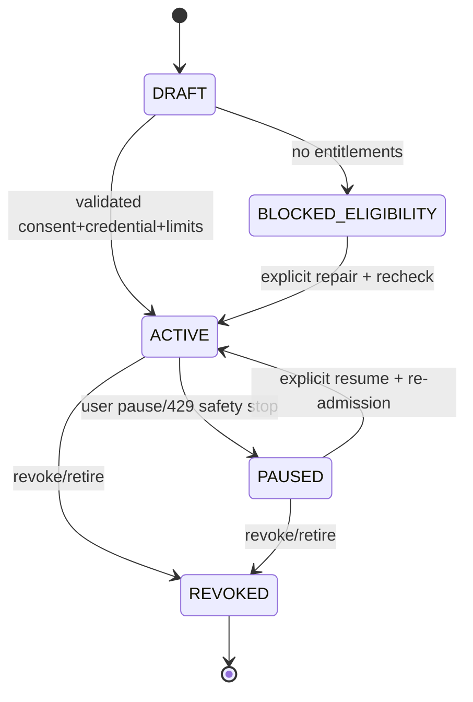

# Event-driven Agent — Detailed Implementation Specification (13-01)

> Owner: CHAT_13 | Path: `docs/13-event-ingestion/event-driven-agent.md` | Status: **Draft / [PROVISIONAL] / NOT LOCKED** | Revision: 0.1 | Research: 2026-10-30 JST | main baseline: `3044c046b1caeea70c5ef6edfea7c57387c6c6da`
> Upstream contracts read on their **Draft PR heads**, not merged main: CHAT_01 #2/#23, CHAT_05 #5/#34, CHAT_07 #11/#16/#32, CHAT_08 #8, CHAT_10 #10, plus foundation. This specification is not executable production code; tests below are designed, not run.

## 0. 決定

採用: **subscription state machine + provider-specific authorized transport + immutable ingress receipt + deterministic routing + fenced, bounded Task dispatch**。Composio型の署名検証と正規化、X公式の資格依存stream/timeline、PostgreSQL durable event/outboxパターンを参考にするが、特定SaaSを必須化しない。外部Webhook、Xのstream、ポーリング、承認済みGmail連携を同じ非信頼Event入力として扱う。外部EventとCHAT_01の内部`DomainEventEnvelopeV1`は**別型**。イベント到着だけでTool実行権限は生まれない。

「@shop_account が『買取増額』を投稿したら型番を調べ、実質利益3,000円以上なら通知」を、(1)署名/認可検証、(2)投稿者の**安定数値User ID**確認、(3)filter評価、(4)一意Task予約、(5)Gatewayで予算と権限照合、(6)Research Evidence、(7)CHAT_07 Outbox通知、の順で実施する。投稿を確認できなかった期間とAPI利用不可をUIへ明示。実際の配達時間・投稿取得の網羅性は保証しない。

## 1. Scope、非目標、契約境界

Own: EventSubscriptionの**外部取り込み側**の接続状態、Transport選択、認証済みIngress receipt、Provider Event→normalized candidate、dedup/routing、backfill gap、購読停止generation、Admission・防御的dispatch、Event lineage。Ownしない: XへのAPI実装/単価認可(CHAT_05)、Task/Run状態/Entity/Event型(CHAT_01/02)、認可/Tool/副作用(CHAT_03/09)、WatcherのTrigger評価と通知Outbox(CHAT_07)、ユーザー公開REST/UI(CHAT_08)、SQL/queueの物理設計(CHAT_10)。変更は全て後記Cross-team proposal。SC-03/05/07/08/09/11/16。

### Actorと投稿種別の規則

- UIで`@handle`入力→CHAT_05の認可されたUser Lookupで**decimal string**の`authorUserId`と表示handleを解決→同意・費用見積もり確認→購読登録。handleは別アカウントへ移動し得るのでactor照合キーには使用しない。解決不能なら`BLOCKED_ELIGIBILITY`。
- 対象投稿は自身のPost ID、author ID、post `created_at`、`referenced_tweets`、原文/引用情報を持つ。default: `original=true, replies=false, reposts=false, quotes=true`（初回同意で表示し編集可）。quoteは引用した**本人の投稿**を1 eventとして扱い、引用先の著者をすり替えない。repostはrepost authorと元postを別参照する。編集・削除や未公開/非表示は新たな投稿確定にはしない。
- 条件は`allOf`のみの決定的predicate、本文最大16KiB。keywordsはNFKC+casefoldの**照合用コピー**、原文は別のrestricted Evidenceに保持。regexはRE2互換・512文字以内・最大16KiB入力・時間上限。LLM抽出で一致を推定した場合は`needs_research`であり、Tool許可そのものにならない。

## 2. OSS/公式資料の比較 (調査2026-10-30)

| 比較対象 | 実際の位置・確認内容 | 採否と制約 |
|---|---|---|
| Composio `ComposioHQ/composio@55eefb43` | `ts/packages/core/src/models/Triggers.ts` `parse`, `verifyWebhook`。署名ヘッダとraw body、verifySecret未指定時は検証を省略可能。CHANGELOG `ts/packages/core/CHANGELOG.md` 0.6.0にasync/breaking記載。V1〜V3 payload対応。[S1-S3] | 外部変換と署名検証を参考。署名を省略できるSDK既定をサーバーへ流用しない。管理SaaS、公開Webhook URL、接続資格が必要な場合はoptional |
| X公式 Filtered Stream/Timeline | `GET /2/tweets/search/stream` と rules、`GET /2/users/:id/tweets`、Post ID/since_id、取得資格が必要。[S4-S6] | **資格のある場合に限りstream**、そうでなければ承認・予算内でtimeline polling。Unauthorizedなら停止。即時性を保証しない |
| Tweepy `tweepy@c1978d64` | `tweepy/client.py` `get_users_tweets/search_recent_tweets`, `tests/test_client.py` cassette case [S7] | Xのnative ID・pagination参考。Python SDKを必須依存にしない |
| node-twitter-api-v2 `PLhery/node-twitter-api-v2@d4ba72d` | `src/v2/client.v2.read.ts` `userTimeline`、`src/stream/TweetStream.ts` 再接続 [S8] | TSのAPI面とstream reconnect参考。常時接続権利や欠落ゼロを推測しない |
| pg-boss `timgit/pg-boss@master` | `src/plans.ts`, `docs/api/workers.md` `work/offWork`、SKIP LOCKEDとbackpressure/NOTIFY fallback [S9] | 物理Queue採否はCHAT_10。Queue ACKとTask発火のexactly-onceを混同しない |

Composioの公式docsはPolling triggerが最大約15分遅れ得ると説明するが、実アカウント/Toolkitごとの現在の遅延SLOを保証する資料ではない [S2]。X料金ページの2026-10-30表示はPost read **USD 0.005/returned resource**、User read **USD 0.010/resource**、別操作やstream消費はConsoleで実際のendpoint価格・権利を再確認する [S6]。Cost reserveはProvider返却件数とexpansionも含む上界に基づき、24h同一データの請求重複抑制を無料保証として扱わない。X Activity APIとX Webhooksは存在するが、指定第三者アカウントの**新規投稿**Triggerと同等であることは未検証。対応イベントの資格/対象ユーザー要件が適合しない限り選択しない。

**非採用:** 全ユーザーで常時streamを開く、公開サイトをスクレイプしてX公式APIの認可迂回、LLMに任意JS条件を実行させる、1件のpostに直接新規unbounded agent loop、SaaS webhook payloadを無署名で受理、SSE EventのIDを外部post IDと同一にする。

## 3. 安定要件（全MUSTは§15で追跡）

| ID | 種別 | 検証可能な条件 |
|---|---|---|
| EDA-001 | MUST | user-approved purpose/owner/credential/limit/stop controlなしでは購読ACTIVE不可 |
| EDA-002 | MUST | stable X user IDと本人post ID、引用/返信/転載分類を保持しhandle変更でretargetしない |
| EDA-003 | MUST | source transportは資格・料金・利用規約・rate/credential scopeを検証し違反時fail closed |
| EDA-004 | MUST | webhookはraw bytes署名・timestamp・bodyサイズ・provider subscription bindingを検証してからJSON parse |
| EDA-005 | MUST | tenant/subscription/revision/provider/nativeEventId/eventKindの論理重複を原子的に防止 |
| EDA-006 | MUST | receivedAt / sourceCreatedAt / fetchedAt / committedAtを分離し欠損はnull扱い |
| EDA-007 | MUST | cursorは完了ページをdurable保存した後だけ進め、gapとpartial coverageを可視化 |
| EDA-008 | MUST | 同一イベント・同一購読世代のbounded Task admissionは最大1回、outboxと同一TX |
| EDA-009 | MUST | stop/revoke/Steer/budget変更は接続とdispatchの世代を遮断し既存履歴を保持 |
| EDA-010 | MUST | untrusted contentはfilter dataだけ。Tool/approval/credential/external writeを拡張しない |
| EDA-011 | MUST | 429/401/5xx/timeout/unknown costとsilent stream gapを区別して有界復帰 |
| EDA-012 | MUST | owner/tenant/workspace mappingが曖昧ならTask admissionゼロ |
| EDA-013 | MUST | backpressureは新規dispatch停止・受信一時保留/安全拒否・gap記録、無制限queue禁止 |
| EDA-014 | MUST | sourcePost→Event→Task→Evidence→NotificationまでTraceとUI診断が追跡可能 |
| EDA-015 | MUST | scheduled/stream replayでもProviderイベントを重複送信・通知しない |
| EDA-016 | MUST | subscription自動化は明示の有限rate/event/Task/LLM/費用のhard limitsを持つ |
| EDA-017 | SHOULD | entitlementと費用条件が満たされる場合のみstreamをprefer、他はpollingを選べる |
| EDA-018 | LATER | 承認済みGmail/Webhook用のprovider adapterを同じ契約へ追加 |

## 4. プロトコルと型（**adapter-owned proposal**; 共有型は変更しない）

```ts
type ExternalTransportV1 = "x_timeline_poll"|"x_filtered_stream"|"signed_webhook"|"provider_trigger";
type IngressOutcome = "accepted"|"duplicate"|"ignored"|"quarantined"|"blocked";
interface SubscriptionDraftV1 { // [PROVISIONAL: CHAT_01/07/08/10]
  schemaVersion:"1.0"; subscriptionId:string; tenantId:string; ownerUserId:string;
  provider:"x"|"gmail"|"webhook"; connectorCredentialRef:string; transport:ExternalTransportV1;
  identity:{kind:"x_user"|"connected_account"|"webhook_topic"; nativeId:string; displayHint?:string};
  types:{original:boolean; reply:boolean; repost:boolean; quote:boolean};
  condition:{allOf:({kind:"includes"; text:string}|{kind:"regex_re2"; pattern:string})[]};
  purpose:string; consentRef:string; destinationBindingRef:string;
  policy:{maxEventsPerDay:number; maxTasksPerDay:number; maxUSDPerDay:string; maxConcurrentTasks:number; pollSeconds:number};
  revision:string; generation:string; status:"DRAFT"|"BLOCKED_ELIGIBILITY"|"ACTIVE"|"PAUSED"|"REVOKED";
}
interface ExternalEventCandidateV1 { // adapter internal, NOT DomainEventEnvelope
  version:"1.0"; subscriptionId:string; subscriptionGeneration:string;
  provider:string; nativeEventId:string; eventKind:"post_created"|"resource_changed";
  actorNativeId:string; sourceCreatedAt:string|null; fetchedAt:string;
  receivedAt:string; sourceUrl:string|null; contentArtifactRef:string|null;
  contentExcerpt:string; references:{kind:"quoted"|"retweeted"|"replied_to"; nativeId:string}[];
  transport:ExternalTransportV1; coverage:"complete"|"partial"|"unknown"; receiptId:string;
}
interface DispatchDecisionV1 {
  subscriptionId:string; generation:string; eventReceiptRef:string;
  decision:"dispatch"|"no_match"|"blocked"|"unknown"; reasonCode:string;
  predicateVersion:string; taskCommandId:string|null; evidenceRefs:string[];
}
interface XCursorV1 {
  subscriptionId:string; generation:string; actorUserId:string;
  sinceId:string|null; nextToken:string|null; lastCompletePollAt:string|null;
  gapStartAt:string|null; coverage:"complete"|"partial"|"unknown";
}
```

**全ID:** app-owned IDはCHAT_01 proposed UUIDv7。X User/Post IDはnonempty decimal string（BigIntへ変換してもJSON numberへ戻さない）。`revision`/leaseEpochのwireはcanonical Owner決定待ち; 本書の`generation`は購読停止防止の独立世代。JSON `schemaVersion` unknown major→quarantine、unknown fields→reject。入力はmax64KiB/webhook、contentExcerpt max16KiB、purpose<=512文字、allOf<=10、URL tokenや署名をLogに保存しない。署名必須経路のmissing/empty secretは**reject**。

**Idempotency:** domain unique proposal `(tenant,subscriptionId,subscriptionGeneration,provider,eventKind,nativeEventId)`、cross-transport同一投稿のdedupはtransportを**keyに含めない**。Subscriptionの条件改定時の「既存Postを新条件で再評価」はデフォルト不可; ユーザーが明示replayする場合は別command/receiptで新revisionにリンクしてもTask重複を防ぐ。Native IDがないProviderはstable source message IDを必須にし、それも得られなければ`quarantined`、text hashだけで強制実行しない。

## 5. State machine / Sequence



Transport worker状態は `DISCONNECTED→CONNECTING→CATCHING_UP→RUNNING→BACKOFF→CONNECTING`、`AUTH_REQUIRED`は接続禁止、`STOPPING`は新規Job禁止。Subscription状態とRun/Watch状態は別。障害時の回復は`generation`照合により古い接続からの書込みをreject。

```mermaid
sequenceDiagram
 participant U as User UI
 participant S as Subscription Service
 participant X as X Connector 05
 participant I as Ingress/13
 participant D as DB/10
 participant W as Watch Trigger/07
 participant G as Gateway/03
 participant N as Notification Outbox/07
 U->>S: create (user consent + budget)
 S->>X: resolve handle + check entitlement
 X-->>S: stable user ID + eligible transport
 S->>D: commit subscription + generation
 X-->>I: post(candidate, source time/cursor)
 I->>I: verify provenance/auth; check stable actor
 I->>D: unique receipt + event + cursor(atomic)
 I->>W: evaluate deterministic condition
 W->>D: recheck generation, unique trigger Task intent + outbox
 D-->>G: durable bounded Task command
 G->>G: current owner, fence, budget, approval
 G-->>N: research Evidence + bounded notification intent
 N-->>U: transport accepted/unknown; evidence links
```

## 6. Algorithm and linearization

```text
register(request, principal):
 authenticate principal; authorize owner + tenant; validate purpose, consent, limits
 resolve X handle using CHAT_05; assert decimal stableId and entitlement
 quote estimated worst-case daily reads/cost; require explicit acceptance
 TX: lock owner quota; unique idempotency receipt + Subscription(generation=1)
      create metadata Event + Outbox; COMMIT
 start Worker asynchronously; never pretend registration means receiving events

ingest(raw, headers, transport):
 if signed: verify timestamp tolerance (default <=300s), HMAC/Ed25519 over raw bytes
              constant-time compare; signature scope provider+connection; reject before parse
 assert body <=64KiB; decode version strictly; authenticate Connector identity
 assert subscription is ACTIVE, same credentialRef, stable actor ID, current generation
 validate nativeEventId+source times; strip commands; retain restricted Artifact reference
 TX: lock subscription and budget rows in deterministic order
     verify current generation and ownership/entitlement
     insert immutable receipt unique(event identity); if conflict: return duplicate
     insert normalized external observation + cursor checkpoint only for complete page
     insert routing job pointer Outbox; COMMIT
 return ACK only after commit; any DB failure -> retryable non-2xx, no fake success

route(receipt):
 TX: lock subscription, recheck generation/owner/budget/condition version
     classify explicit matching type & keyword/RE2 rules; unknown -> review/no task
     atomically reserve maxTasks/day, maxUSD/day, concurrent task token
     insert unique trigger decision and durable Task command+outbox via owner service
     COMMIT
 worker renews fence before every Tool; no unapproved external write
```

**Cursor edge:** X timeline `since_id` alone is not proof of gapless coverage. Page traversal completes before committing high-water; if truncated/rate-limited, retain previous durable cursor and nextToken checkpoint. Next attempt replay overlapping interval and dedup each post by native ID. On first registration default **now-forward only**; no automatic historical posts. Manual backfill requires explicit date range, cost quote and idempotency. For stream disconnection, gapStartAt and resumedAt are shown; optional authorized timeline backfill never skips policy/budget.

**Stop semantics:** PAUSE/REVOKE updates generation under TX; ingress and routing check generation inside lock, so after committed change no **new Task admission**. In-flight approved Tool attempts may be irrevocable; cannot claim remote calls never completed. Worker stop ack and billing UNKNOWN are separately tracked. Steering creates new Task goalRevision only through CHAT_02; Event service doesn't change running goal.

## 7. Finite operating envelope (initial safe defaults, pending Ops review)

One subscription: poll no faster than **300 seconds** or provider minimum if slower; daily maximum 200 observed events, 20 admitted Tasks, 1 concurrent Task, 10 retriable ingress deliveries (after that quarantine/DLQ), 64KiB body, 10 predicates, 16KiB excerpt; max 5 concurrent incoming webhook requests per tenant; connection idle timeout 90s with bounded retries 1/2/4/8/16min + jitter, at most 5 reconnects per outage window then PAUSED/health alert. Default `maxUSDPerDay=0` until an explicit nonzero authorized budget and known endpoint cost model are supplied; provider read caps reserve upper bound **before** request. Global limits from CHAT_02/05/09/10 are stricter when lower. All values proposals, not measured performance guarantees. Capture event queue age, from sourceCreatedAt to receivedAt, without promising instant arrival.

## 8. Failure matrix

| Condition | Detection | Recovery & observable effect |
|---|---|---|
| invalid signature, missing secret, timestamp replay, wrong account | pre-parse verification | 4xx, audit hash, external fetch/task =0 |
| handle reassigned / wrong author ID | stable actor mismatch | ignored, keep original ID, UI warn |
| X 401/403, credential revoke, no stream entitlement | Connector explicit error | BLOCKED_ELIGIBILITY; no fallback scraping |
| 429/limited credit | Retry-After/quota ledger | PAUSED/BACKOFF, cost unknown remains reserved |
| 5xx/socket close midpage or stream gap | incomplete page receipt | partial coverage, never advance completed cursor |
| duplicate stream+poll/webhook delivery | unique key conflict | one receipt and one Task maximum |
| out-of-order posts | id independent of receivedAt | process allowed late posts, prevent high-water rollback |
| DB kill before COMMIT | tx rollback | retry same provider receipt |
| DB kill after COMMIT before ACK | receipt exists | reply duplicate; do not create another Task |
| stop/revoke while queued | generation mismatch | suppress Task/Tool, retain audit |
| Worker stale lease/Steer | Gateway fence mismatch | no new side effect; uncertain attempt through ledger |
| backlog exceeds cap | queue size and lag | pause admission and gap audit; never unbounded RAM |
| deleted post/unavailable original | API 404/410 or insufficient evidence | flag unverifiable; do not manufacture post |
| provider billing ACK lost | attempted read unknown | retain reserved cost; reconciliation, no zero-cost assumption |

## 9. Security, data protection, provenance

Signed webhook validation is distinct from user Authorization. Both required. Composio event metadata alone is not ownership proof: bind to saved `connected_account_id/trigger_id` and tenant after signature verification, never trust `user_id` claim as permission. For direct webhooks use provider-specific key rotation with active/past scoped keys, limited overlap and monotonic replay IDs; HMAC timestamp 300s is only preliminary, persistent event-ID uniqueness completes replay protection. Outbound endpoints are allowlisted origin/TLS/egress via CHAT_09; WebSocket handshake/redirect/DNS rebinding checked. Untrusted body cannot request host shell, changing destination, subscriptions, new credentials, purchases or public posts; prompt injection fixture required. Webhook may contain PII; raw stored as encrypted/restricted Artifact with TTL policy CHAT_09; never copy bearer, raw messages or URLs with tokens into logs/LLM. External post truth/untruth is independent of author's identity; results need verified independent Evidence.

## 10. Metrics / acceptance measurements

`ingress_received_total{provider,outcome}`, `signature_failed_total`, `subscription_active`, `ingress_duplicate_total`, `dispatch_admitted_total`, `coverage_gap_seconds`, `cursor_staleness_seconds`, `provider_429_total`, `backlog_age_seconds`, `provider_cost_reserved_usd`, `provider_cost_unknown_usd`, `research_task_accepted_total`; histogram `source_to_ingest_latency` only when sourceCreatedAt trustworthy. Metric labels exclude handle/postId/private URL. Trace: subscription opaque ID, native source hash, receiptId, TaskId, RunId, notification semanticEventKey. Benchmark fixture: 1/4/16 workers, 1k subscriptions, duplicate fraction 50%, gaps, rate-limits, killpoints and finite CPU/memory/cost; pass if no duplicate logical Task/denied operations, performance p50/p95 merely reported until ADR target.

## 11. Persistence/Migration proposal — [PROVISIONAL: CHAT_10]

Logical stores: subscription(owner/tenant/generation/revision/consent/credential/budget/status); transport_checkpoint(subscription,generation, cursor, coverage, gap); external_receipt(unique semantic event identity, source timestamps, receipt, artifactRef); evaluation_decision(unique receipt+subscription+generation); budget_reservation; Task command linkage; audit/tombstone. Transaction 1: subscription creation + idempotency receipt + outbox; transaction 2: authenticated event receipt + checkpoint + routing pointer; transaction 3: unique evaluation+Task command+budget reservation+outbox, all under owner/credential/revision/fence checks. **Do not** add physical tables/columns without CHAT_10 authorization. Data delete retains privacy-safe unique tombstones for replay horizon subject to CHAT_09 retention; old snapshots cannot be silently mapped across tenant.

Rollout: shadow Event adapter with mock transport → schema + validated credential staging → unique indexes before active ingest → opt-in per tenant → canary with no live Side Effects → enable reads only → enable bounded research; rollback pauses subscriptions, holds queue, preserves receipts and does not duplicate Task admission on reactivation. Version major reader refuses unknown; revised payload use v2 with migration, no implicit coercion.

## 12. UI/API proposal — [PROVISIONAL: CHAT_08]

`POST /api/v1/event-subscriptions` with Idempotency-Key, consent, provider/actor, preferences, purpose, validated budget; `GET /api/v1/event-subscriptions/{id}` returns `status`, actor stable ID, displayed handle hint, transport, eligibility result, lastReceivedAt, lastCompletePollAt, gap, approximate consumption, source lag, nextRetryAt, Task history and ETag; `POST .../{id}/commands` pause/resume/retire requires If-Match and idempotency key; no ambiguous DELETE. Saved user-approved destination binding only; no raw secret in projection. Show cost estimate before enable, polling coverage/latency as observed not guaranteed, and paused/revoked explicitly.

## 13. Implementation PR split (runtime repository, not this documentation PR)

EDA-I1 type guards and Mock signed ingress/invalid signature fixtures; EDA-I2 subscription lifecycle/credential eligibility/consistent version and UI commands; EDA-I3 X timeline cursor + stable actor/filter + dedup and source loss; EDA-I4 optional eligible stream + gap reconciliation; EDA-I5 fenced Task command transaction + CHAT_07 outbox; EDA-I6 security, concurrent kill tests, trace, canary/rollback. Block EDA-I5 production until CHAT_01/02/07/09/10 P0 contracts agreed.

## 14. Test cases — **DESIGNED, NOT RUN**

| TEST | Type; setup → action | Expected |
|---|---|---|
| EDA-T01 | Unit; no consent/budget/owner → create | ACTIVE=0, HTTP actor supplied tenant ignored |
| EDA-T02 | Contract; handle resolves A, rename/reassign B; send A/B post | only stable A admitted, repost/quote classification exact |
| EDA-T03 | Integration; no stream entitlement; poll credential valid → start | authorized timeline selected; never open stream |
| EDA-T04 | Security; malformed HMAC/raw-body changed/old timestamp/empty secret | 4xx, DB events 0 |
| EDA-T05 | Concurrency; same post stream+poll+replay 100x, 8 workers | one logical event receipt, one Task/outbox |
| EDA-T06 | Unit; dates out of order, huge IDs, missing createdAt | IDs lossless, null not fabricated, correct late handling |
| EDA-T07 | Fault; kill between fetched pages and cursor commit | complete cursor not advanced; replay recovers |
| EDA-T08 | DB fault; commit before webhook 2xx then sender retries | stable receipt, one Task |
| EDA-T09 | Race; revoke after receipt and before Task admission | Task admission=0; old generation rejected |
| EDA-T10 | Security; malicious post asks for token/purchase | capabilities unchanged, unsafe outbound=0 |
| EDA-T11 | Unit; 401,403,429,5xx and socket interruption | explicit availability/gap states, finite backoff |
| EDA-T12 | Auth; tenant A event with tenant B connected_account_id | 0 Task, audit deny |
| EDA-T13 | Load; 10k event flood at bound | bounded queue/credit/Task and explicit backpressure |
| EDA-T14 | E2E; @A posts matching price promotion; mock research | 1 Task+Evidence, value uncertainty preserved, outbox lineage |
| EDA-T15 | Fault; duplicate ACK, old Run leaseEpoch after Steer | no old write/side effect, UNKNOWN preserved |
| EDA-T16 | Quota; repeated 100/post responses, cost cap $0 | 0 billable API calls; verified cap nonzero permits bounded read |

Test suite covers unit/contract/integration/E2E/fault/security/load. All require fake clocks/providers and local Postgres; actual X credentials, live cost/stream latency, network and correctness remain **UNVERIFIED**.

## 15. Traceability (all MUST)

| REQ | TEST | SC |
|---|---|---|
| EDA-001 | T01 | 08,11 |
| EDA-002 | T02 | 03,11 |
| EDA-003 | T03,T16 | 09,11 |
| EDA-004 | T04 | 08,11 |
| EDA-005 | T05 | 07,11 |
| EDA-006 | T06 | 03,11 |
| EDA-007 | T07 | 07,11 |
| EDA-008 | T08,T14 | 07,11 |
| EDA-009 | T09,T15 | 07,11 |
| EDA-010 | T10 | 08,11 |
| EDA-011 | T11 | 03,11 |
| EDA-012 | T12 | 08,11 |
| EDA-013 | T13 | 09,11 |
| EDA-014 | T14 | 11,16 |
| EDA-015 | T05,T08 | 07,11 |
| EDA-016 | T13,T16 | 09,11 |

Prefix all abbreviated test IDs with `EDA-` and SC with `SC-`. Human confirmation is required for live account permissions, quota and pricing; no production tests have run.

## 16. Cross-team proposals / Open issues

| Proposal | Owner / Severity | Target and proposed contract | Migration/test |
|---|---|---|---|
| EDA-P01 | CHAT_01 P0 | `event-envelope-and-stream.md`: ExternalEvent must remain **observation/input**, not DomainEvent; add safe causation link and source ID without spoofable envelope | canonical adapter/validator + EDA-T05/T12 |
| EDA-P02 | CHAT_05 P0 | `x-research.md`: stable actor lookup, eligible timeline/stream interface, native refs, quota, source coverage, cost receipt | fake X API + entitlement/error tests EDA-T02/03/11/16 |
| EDA-P03 | CHAT_07 P0 | `watch-lifecycle.md`/`observations-and-trigger-evaluation.md`: EventSubscription→Watch Trigger identity, once-per-event Task + notification lineage; Outbox `sourceEventKey` semantic | EDA-T05/08/14 |
| EDA-P04 | CHAT_09 P0 | `authentication-and-user-isolation.md`, `secrets-and-credentials.md`: signed webhook provider binding, tenant-workspace owner check, deny-on-revoke and rotated keys | EDA-T04/T09/T12 |
| EDA-P05 | CHAT_10 P0 | `database-schema-and-migrations.md`: unique durable ExternalEvent receipts/cursors, generation CAS, atomic Task+outbox, cost reservation; no new physical schema asserted here | EDA-T05/T07/T08/T13 |
| EDA-P06 | CHAT_02/03 P0 | `task-run-manager.md`, `tool-approval-and-policy.md`: no implicit elevated approval, goalRevision/leaseEpoch current at dispatch, unknown external effects | EDA-T09/T10/T15 |
| EDA-P07 | CHAT_08 P1 | `rest-api.md`/`task-and-watch-dashboard.md`: subscription command DTO, eligibility, latency/gap and source evidence display | EDA-T01/T14 |
| EDA-P08 | CHAT_11 P1 | `end-to-end-acceptance.md`: SC-11 source/receipt Task chain, fake X quota, stream gap, killpoints | EDA-T03..16 |

Blocking: tenant↔workspace ACL+nullable conversation Task, UUIDv7 / recordVersion / goalRevision / leaseEpoch / outbox atomicity reconciliation remain unresolved in Draft owner PRs. **No Locked claim**.

## 17. Primary sources / evidence grade

All accessed 2026-10-30; pinned git SHA where known. Code verified means inspected text, not tested.
- [S1] **Code verified**, Composio `Triggers.parse/verifyWebhook`, `ComposioHQ/composio@55eefb43af95e6835fd6d154cab9bfa4b2a5830d` https://github.com/ComposioHQ/composio/blob/55eefb43af95e6835fd6d154cab9bfa4b2a5830d/ts/packages/core/src/models/Triggers.ts and `CHANGELOG.md` https://github.com/ComposioHQ/composio/blob/55eefb43af95e6835fd6d154cab9bfa4b2a5830d/ts/packages/core/CHANGELOG.md . LICENSE and runtime SDK interoperability **not independently verified**; use as patterns only.
- [S2] **Docs verified**, Composio signing, payload and polling vs realtime, https://docs.composio.dev/docs/setting-up-triggers/subscribing-to-events and https://docs.composio.dev/docs/triggers .
- [S3] **Docs/Changelog verified**, Composio Feb 6, 2026 webhook subscription migration https://github.com/ComposioHQ/composio/blob/55eefb43af95e6835fd6d154cab9bfa4b2a5830d/docs/content/changelog/02-06-26-webhook-subscriptions-api.mdx .
- [S4] **Docs verified**, X filtered stream https://docs.x.com/x-api/posts/filtered-stream/introduction .
- [S5] **Docs verified**, X timelines https://docs.x.com/x-api/posts/timelines/introduction .
- [S6] **Docs verified**, X pay-per-use pricing / rate and plan must be checked per account https://docs.x.com/x-api/getting-started/pricing ; https://docs.x.com/x-api/fundamentals/rate-limits .
- [S7] **Source/tests corroborated via CHAT_05 #34; code link not re-opened in this spec authoring**, Tweepy `tweepy/client.py` and cassette tests `@c1978d643ecce491929084e4290b35f57e4921ad`: https://github.com/tweepy/tweepy/blob/c1978d643ecce491929084e4290b35f57e4921ad/tweepy/client.py ; https://github.com/tweepy/tweepy/blob/c1978d643ecce491929084e4290b35f57e4921ad/tests/test_client.py .
- [S8] **Source pointers corroborated via CHAT_05 #34; not independently rerun**, node-twitter-api-v2 `@d4ba72dfcf30395f02c551b318d53f51310ccdd0` https://github.com/PLhery/node-twitter-api-v2/blob/d4ba72dfcf30395f02c551b318d53f51310ccdd0/src/v2/client.v2.read.ts ; https://github.com/PLhery/node-twitter-api-v2/blob/d4ba72dfcf30395f02c551b318d53f51310ccdd0/src/stream/TweetStream.ts .
- [S9] **Code/Docs verified**, pg-boss `src/plans.ts`, `docs/api/workers.md`, current master inspected 2026-10-30 https://github.com/timgit/pg-boss/blob/master/src/plans.ts ; https://github.com/timgit/pg-boss/blob/master/docs/api/workers.md . MIT according to repository README; exact release selection remains CHAT_10.
- [S10] **Issue report only**, pg-boss issue #702 polling deadline discussion https://github.com/timgit/pg-boss/issues/702 . Not proof of harness latency.
- [S11] **Draft owner design (NOT LOCKED)**, CHAT_01 #23 https://github.com/choko510/aiagent-md/pull/23 , CHAT_05 #34 https://github.com/choko510/aiagent-md/pull/34 , CHAT_07 #16/#32 https://github.com/choko510/aiagent-md/pull/16 .

## 18. Round-2 verification addendum — 2026-10-30 (Draft retained)

**Composio protocol lock:** Official [Receiving events](https://docs.composio.dev/docs/setting-up-triggers/subscribing-to-events) specifies `webhook-id`, `webhook-timestamp`, `webhook-signature` and HMAC-SHA256 over exact bytes of `{webhook-id}.{webhook-timestamp}.{rawBody}`; the signature is base64-encoded with its provider header format. Provider verifier MUST validate header version, timestamp tolerance, secret version and raw-body bytes **before parsing**; never reuse a generic HMAC function that omits the ID/time or normalizes JSON before signing. Default SDK tolerance is 300 s; user-defined 0 would disable the check and is disallowed in production. SDK `parse({verifySecret})` is only secure if that parameter is explicitly present and nonempty; `subscribe()` WebSocket local debug is not production webhook signature verification. Additional test `EDA-T17`: signed raw fixture with changed whitespace, missing ID/timestamp, two signed but replayed deliveries, and empty secret → accepted only on matching raw bytes+current authorized subscription; identical event results in one durable receipt. `EDA-004 MUST → EDA-T04/T17 → SC-08/11`.

**Composio change history / PR evidence**: The official [changelog](https://docs.composio.dev/reference/changelog) records TypeScript PR [#2436](https://github.com/ComposioHQ/composio/pull/2436) and Python [#2361](https://github.com/ComposioHQ/composio/pull/2361) for async versioned verifier and required `id/timestamp`. This is changelog evidence, not integration test execution. Composio [Troubleshooting](https://docs.composio.dev/docs/setting-up-triggers/troubleshooting) notes enabled trigger ≠ successful event delivery and per-connected-account IDs must be tracked separately; [reference](https://docs.composio.dev/kb/guide/platform-triggers) notes at-least-once delivery and dedup keyed on event/log ID. The SDK's `get_type`/active toolkit lookup must be entitlement checked; no generic trigger slug guarantees a particular X account's post event.

**X source cost detail**: Official [X pricing](https://docs.x.com/x-api/getting-started/pricing) confirms 2026-10-30 displayed Post read $0.005/resource, User read $0.010/resource and *Owned Reads* $0.001/resource only where the developer app reads its **own authenticated user's** data. A subscribed unrelated seller's account is **not** automatically eligible for Owned Reads. The X Activity API `post.create` billing is separate; do not assume it supports arbitrary third-party named account subscriptions. Developer Console source limits/entitlement and variable pricing must be checked per account before enabling.

**All-Draft static reconciliation pass**: 49 existing pre-CHAT_13 Draft PRs (#1–#49) were enumerated and all changed-file patches scanned on their respective PR HEAD diffs. Key agreements: CHAT_01 #23 external observed event != domain event; CHAT_05 #34 owns X API; CHAT_07 #11/#16/#32 owns Watch predicate and notification semantic identity; CHAT_10 #22 owns physical queue/outbox; CHAT_11 #7/#13 tests include stable X author ID and same-post replay. Source PRs remain provisional, not merged/Locked. EDA-P01..P08 are proposals, not retroactive changes. **No runtime or security integration tests executed.**

## 19. Round 4 contract consolidation — Subscription → Receipt → Task (2026-10-30)
**Accepted design direction, still Draft until cross-owner reviews and migrations execute.** CHAT_10 PR #10 proposes `external_event_subscriptions`, `external_event_receipts`, `external_event_cursors`. They are **provider ingress records, not CHAT_01 DomainEvents**. Provider streams and polling share the unique `(tenant, subscription, provider, native kind, native event id)` receipt identity, independent of transport. Native actor ID (not mutable X handle) binds authorization.
State transfer: `ACTIVE(generation=N)` plus approved consent/budget ⇒ begin transaction and lock subscription; validate source/actor/generation/expiry → insert receipt; conflict = duplicate, no new Task → filter deterministic policy → if dispatch, commit **receipt+new Task+DomainEvent+Outbox+cursor only when provider coverage complete**. Poll timeout, partial feed or gaps do not advance `since_id` as proof all events processed. On revoke increment generation and deny future dispatch; in-flight external Tool effects remain auditable.
**Guarantee:** accepted matching event yields at most one Task per subscription/event identity. It is not exactly-once delivery by external provider. An event without stable ID, unsupported X entitlement or broken signature is quarantined/rejected; no speculative Task. The connector may mark coverage partial and retry under finite budget. Requires DB Tx implementation/fence and authorized provider live contract validation.
**Tests:** EDA-R4-T01 stream+poll same post concurrently→one receipt/Task; T02 wrong actor→0 Task; T03 revoked between fetch and DB TX→0 Task; T04 crash after receipt before commit→all-or-none; T05 partial timeline→cursor preserved; T06 same text new provider ID→not erroneously dedup; T07 repost/quote policy and normalized source timestamp. SC-11/07/08.
**Cross-Owner:** CHAT_01 event type/Task, CHAT_05 native provider IDs and plans, CHAT_07 Watch and budget, CHAT_09 signature/consent, CHAT_10 physical, CHAT_08 commands, CHAT_11 E2E. No Owner is assumed to have reviewed this independently.

## 20. Round 5 — Executed synthetic ingress transaction vs missing Runtime E2E
`audit/round5/run_ingress_concurrency.py` in the audit branch ran 24 simultaneous real PostgreSQL transactions against the v2 proposed schema: lock ACTIVE subscription + generation, `INSERT ... ON CONFLICT DO NOTHING` using stable X native post ID, create linked Task **and Task Goal Revision** in the same TX, reconcile receipt with Task ID. It passed one receipt + one Task, rollback on injected failure, and revoked generation preventing a new Task. [Verified synthetic execution](https://github.com/choko510/aiagent-md/actions/runs/40959094493).
**Important gap:** this is NOT the full EventRouter→Task→DomainEvent→Outbox→Watcher path. The synthetic executor does not verify stable provider signature/X entitlements, credential revoke, pagination gaps, real event listener, multi-tenant business authorization or notification send. CHAT_01/07/09/10/11 still own that integration. Tests EDA-R5-T01..03 are SQL synthetic PASS; EDA-R5-E2E01..05 remain DESIGNED/NOT RUN. Do not label the Harness Verified.

