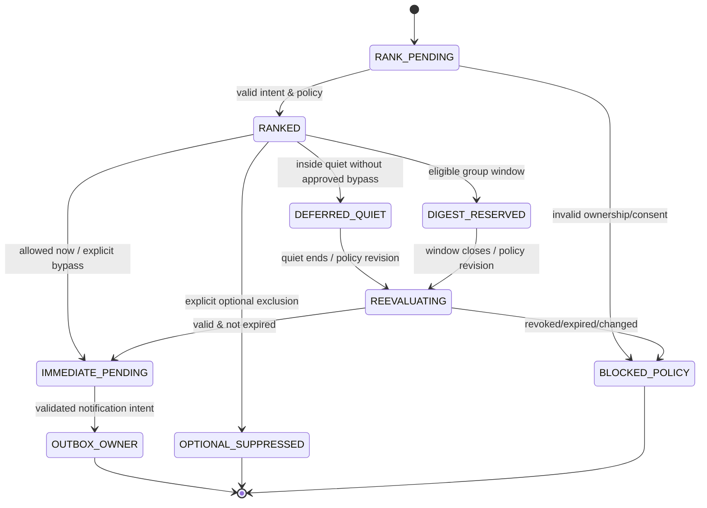

# Notification Intelligence — Detailed Implementation Specification (13-03)

> Owner: CHAT_13 | Canonical path: `docs/13-event-ingestion/notification-intelligence.md` | Status: **Draft / [PROVISIONAL] / NOT LOCKED** | Revision: 0.1 | Research date: 2026-10-30 JST | Source main: `3044c046b1caeea70c5ef6edfea7c57387c6c6da`.
>
> Latest dependent Draft HEADs inspected: CHAT_07 `notification-outbox.md` PR #32 and `observations-and-trigger-evaluation.md` PR #16; CHAT_01 event/domain PR #2/#23, CHAT_08 REST PR #8, CHAT_10 DB PR #10. Tests **designed only, execution count 0**. No implementation or product delivery confirmed.

## 0. 結論と採用方式

**通知の「内容と届ける順番を判断する」層を追加し、Notification Outboxの送信責任を増殖させない。** 入力は他サービスが確定済みの`NotificationIntent`（CHAT_07）、観測Evidence（CHAT_01）、明示的ユーザールール（CHAT_08/14）であり、CHAT_13は`priority decision`, `quiet-hours defer`, `digest membership`, `explanation`を返す。CHAT_07が必ず一意の`NotificationIntent→Outbox→DeliveryAttempt`を所有し、実配送を担当。優先順位の計算結果をもって「配送した」「受信された」と言わない。

**選択:** deterministic priority tiers + auditable finite score + user-required overrides + bounded digest reservation. Modelによる重要度推定は補助の`EXPERIMENT`であり、外部X投稿や通知本文が`critical`を自己申告することはできない。明示的な「この通知は必ず知らせる」が適合すればrankerは黙って除外できない。深夜通知は原則延期するが、**本人が個別かつ明示的に指定した緊急通知**のみ本人の例外ルールに従って静音時間を突破できる。危険な自律判断でその例外を付与しない。

## 1. 責務、受入シナリオ、非目標

- **SC-16:** 「利益の低い商品の通知は不要」「この販売店は対象外」といったユーザーの明示フィードバックを適切なscopeで適用。必須高優先トリガーは通知され、他の低価値重複はdigestまたは説明付きsuppress。quiet hoursで重要イベントが消えない。
- **SC-02:** 価格閾値成立通知は金額/単位/条件/取得時刻・URLを保持。1論理イベント×宛先×目的につき最大1Intent。
- **SC-11:** X投稿起点の研究と成果通知を元Postにリンク。未裏取りの投稿は`verified`へ昇格しない。
- **SC-07/08/09:** 解除/一時停止/暗号化Binding更新、outbox ACK lost、再起動、同時Worker、静音TZとDSTの境界、多量通知、私的情報混入を検証。

**CHAT_13 owns**: rank policy evaluation, quiet-hours/digest decision, dedupe **推薦/episode grouping（論理重複一意性は07）**, explanation codes, policy revision cache invalidation, user visible rank attribution. **CHAT_07 owns**: durable Notification Intent、semantic identity、sourceEventKey、Notification Outbox、Transport attempt/retry、opt-out/revocation、UNKNOWN、actual send admission。**CHAT_08 owns**: UI/REST/Telegram, destination validation。**CHAT_09 owns**: consent/security/privacy/quiet routing permission、CHAT_10 owns physical SQL and transactional leases。CHAT_14 owns feedback learning and Undo; CHAT_13 reads its approved preference revision only. Source credibility CHAT_12、Task/Tool approvals CHAT_02/03、Domain Event CHAT_01。通知ランキングは他ドメインの状態を変更する代理権限を持たない。

## 2. Source-level comparison / research (2026-10-30)

| Prior art | Exact code/test/logic actually inspected | Adoption and limitation |
|---|---|---|
| **OpenClaw** `openclaw/openclaw@8b8c33ef334b3754f42afe2a2e212418abfa80f4`, **MIT** | `src/cron/service/notification-intents.ts` の `CronNotificationJob/CronNotificationRouting/captureCronNotificationRouting`、`src/cron/service/notification-dispatch.ts` `dispatchCronNotification`は routing/dispatchを分離。テスト `src/cron/service.failure-alert-notifications.test.ts` も読んだ。[S1-S3] | intent→dispatch分離とfailure alertは参考。汎用通知ランキングの既存完成実装とは見なさず、tenant/workspace/outbox ledgerは本プロジェクト所有 |
| **changedetection.io** `dgtlmoon/changedetection.io@11c7ca8719bfc59a4ffa8cd06dd5d0c5d090a82b`, **Apache-2.0** | `changedetectionio/notification_service.py` `watch_will_send_content_changed_notification` は `notification_muted` と通知先cascadeを参照; `FormattableDiff`はsnapshot diffフォーマットを構成。[S4] | mute + provider bindingとEvent内容の分離を参考。sourceの通知mutable属性と当Harnessのexplicit consent/Outbox原子性は別に検証 |
| **ntfy** `binwiederhier/ntfy@d397e9d07560f957f3671b6eacc812e736c2bfc0`, **Apache-2.0** | `util/util.go` `ParsePriority`: `min=1,low=2,default=3,high=4,urgent=5`; `server/types.go` `publishMessage.Priority` はtransport metadataとし、`queryFilter.Priority` を提供。LICENSE読解。[S5-S7] | channel priority表現を参考。**transport priorityはユーザー意図・証拠・危険度を判定しない**。優先度5を外部メッセージが指定しても権限を認めない |
| **CHAT_07 Notification Outbox #32** | `NOT-002/020`: semantic uniquenessは`(tenantId,ownerUserId,semanticEventKey,destinationBindingId,deliveryPurpose)`で**policyVersion/formatVersion/binding credential rotationを含めない**。`NOT-006`: send ACK lost→UNKNOWN、`NOT-012`: quiet hours defer、`NOT-021`: unsubscribe/send race strict gate。[S8] | この設計に**従う**。rankerが新sender、独自重複キー、Receipt/UNKNOWNの再分類を作ることを禁止 |

**比較した設計**:
- (A) LLMがすべての通知を即時に優先度分類し勝手に配送決定 → prompt injection、費用、再現性、見落としと権限昇格があるため**却下**。
- (B) 時刻順FIFOで即送信 → 高価値イベントが大量ノイズに埋もれ、夜間の配信制御ができないため**却下**。
- (C) deterministic rules+cost/quality-aware score+mandatory bypass+digest grouping+outboxへの委譲 → **採用**。scoreは人間のreviewなしで恒久的好みや事実を書き換えない。
- (D) 通知本文hashで重複とみなす → 同じ定期レポートの別日イベントを消す、異なる意味を同一化するため**却下**。semantic event keyはCHAT_07。

OSSのランキング精度やspam suppressionは比較対象の実測ではない。本仕様の品質は同じfixtureでFPR、必須通知のrecall、queue age、user-defined SLA、端末結果が不明な件数を測定してから評価する。

## 3. Trust boundary, canonical contracts and authority

```text
Committed Trigger/Task/Watch/Event (01/07)
  → immutable NotificationIntent with consent/binding/sourceEventKey (07)
  → policy read (authenticated user explicit preferences, 08/14)
  → Notification Intelligence 13-03: priority, quiet decision, digest grouping, explanation
  → CHAT_07 Outbox: recheck consent+owner+Watch revision+policy/generation before send
  → CHAT_08 channel adapter (Telegram/Email)
  → delivery receipt accepted/UNKNOWN, not assumed read (07)
```

The ranker receives only sanitized `EvidenceSummary` refs, not raw cookies, access tokens, email addresses, private full chat IDs or the unrestricted source body. External content and model suggestions have **zero authority** to set destination, `requiredByUserRule`, `quietBypassApproved` or consent. The user can configure overrides only through authenticated `If-Match`/Idempotency-Key command via CHAT_08 and CHAT_09. The ranker must validate the saved binding and read the current policy on every decision; cached scores may be used for display but **not** to authorize new send. Restart does not bypass quiet hours or renewal of consent. There is one canonical Notification Outbox; digest is a **group of original intents**, not a new independent delivery pipeline.

## 4. Stable requirements

| REQ | Priority | Deterministic observable outcome |
|---|---|---|
| NIR-001 | MUST | only tenant-scoped committed source NotificationIntent and authenticated active rule produce rank decision |
| NIR-002 | MUST | requiredByUserRule verified server-side wins over rank suppression, no loss of mandatory event |
| NIR-003 | MUST | urgent quiet bypass requires an explicit rule for this event class/destination; model or source cannot enable it |
| NIR-004 | MUST | IANA TZ quiet windows across midnight/DST/leap calendar give a single valid `notBeforeUtc` |
| NIR-005 | MUST | provenance/freshness/confidence/uncertainty affect ranking, never fabricate value/price/corroboration |
| NIR-006 | MUST | explanation lists reasonCode, rule ID, evidenceRefs, policyRevision; same inputs→same result |
| NIR-007 | MUST | ranking/digest never changes CHAT_07 immutable semanticEventKey or per-intent destination uniqueness |
| NIR-008 | MUST | digest groups only compatible tenant/owner/destination/locale/trust/purpose/window, each member traceable |
| NIR-009 | MUST | suppress/defer/digest/expire decisions durable and explainable, never silently delete mandatory pending intent |
| NIR-010 | MUST | user opt-out/Watch retire/revoke/destination changed during policy eval or queue blocks any new send via CHAT_07 |
| NIR-011 | MUST | UNKNOWN delivery outcome remains UNKNOWN; formatting changes do not create new resend intent |
| NIR-012 | MUST | policy update, explicit feedback Undo and version change trigger safe re-evaluation without re-notifying delivered |
| NIR-013 | MUST | bounded per-user/per-channel queue, digest sizes, frequency, costs, TTL and fairness, starvation-free for admitted required class |
| NIR-014 | MUST | restricted data and untrusted source text cannot influence trust/priority/consent or leak through digest/trace |
| NIR-015 | MUST | channel delivery receipt/read are not inferred from score, notBefore, providerAccepted or UI preview |
| NIR-016 | MUST | missing score factors remain missing, not zero; all required alert criteria are read from authoritative evidence |
| NIR-017 | SHOULD | explainable manual comparison of top reasons and user feedback for future policy review |
| NIR-018 | EXPERIMENT | model-generated interest tags may suggest non-required ranks, but may never force bypass or suppression |

## 5. Types, schemas and validation — **local policy proposals, not canonical shared schemas**

```ts
type PriorityTierV1 = "critical"|"high"|"normal"|"low";
type RankDispositionV1 =
  | "immediate" | "defer_quiet" | "digest_candidate"
  | "suppress_optional" | "blocked_policy" | "expired_review";
interface PolicyContextV1 { // [PROVISIONAL: CHAT_08/09/14]
  schemaVersion:"1.0"; tenantId:string; ownerUserId:string;
  destinationBindingRef:string; consentVersion:string; policyRevision:string;
  tz:string; quiet:{start:"HH:mm";end:"HH:mm";days:number[]};
  allowBypassRules:string[]; requiredEventRuleIds:string[];
  excludedSourceIds:string[]; digestCadenceMinutes:number;
  perDayChannelLimit:number; overrides:Array<{
    ruleId:string; eventKind:string; field:string;
    op:"eq"|"gte"|"lte"|"contains"; expected:string;
    priority:PriorityTierV1; required:boolean; quietBypass:boolean;
  }>;
  updatedAt:string;
}
interface RankingInputV1 { // derived solely from committed CHAT_07 intent & evidence
  notificationId:string; tenantId:string; ownerUserId:string; semanticEventKey:string;
  destinationBindingRef:string; deliveryPurpose:string; eventKind:string;
  requiredByUserRule:boolean; matchedRuleIds:string[];
  evidenceRefs:string[]; observedAt:string|null; expiresAt:string|null;
  confidence:"verified"|"reported"|"unknown"; freshness:"fresh"|"stale"|"unknown";
  entityMapping:"confirmed"|"unresolved"|"not_applicable";
  userValue:{kind:"verified_minor_units";amount:string;currency:string}|null;
  sourceReliability:"good"|"unknown"|"degraded";
  sourceOccurrenceId:string; parentWatchId:string|null; createdAt:string;
}
interface RankDecisionV1 {
  version:"1.0"; notificationId:string; policyRevision:string;
  tier:PriorityTierV1; score:number|null; disposition:RankDispositionV1;
  notBeforeUtc:string|null; digestGroupKey:string|null;
  reasonCodes:string[]; matchedRuleIds:string[]; evidenceRefs:string[];
  evaluatedAt:string; expiryReason:string|null; decisionFingerprint:string;
}
interface DigestEnvelopeDraftV1 {
  version:"1.0"; tenantId:string; ownerUserId:string; destinationBindingRef:string;
  windowStartUtc:string; windowEndUtc:string; locale:string;
  members:Array<{notificationId:string;semanticEventKey:string;rankDecisionId:string;
    evidenceRefs:string[];memberStatus:"reserved"|"included"|"already_delivered"|"blocked"}>;
  digestKey:string; generation:string; maximumNotBeforeUtc:string;
}
```

The external `NotificationIntent` schema is **CHAT_07's**, never replace it with `RankingInputV1`. `policyRevision` is server owned and distinct from notification key; `score` is UI advisory only, finite integer 0..100 if factors known, `null` if essential factors absent. `reasonCodes` use allowlisted enum; 1..16 codes, no raw user texts; digest up to 20 members; notification rendered through CHAT_07 sanitized output. Currency and verified monetary evidence use exact string integers, not floating JS amount. Source reliability from CHAT_12 remains `unknown` absent verified profile, never treated as fail or zero. Version `1.0` unknown major rejects; DTO unknown keys reject. Untrusted source post content never becomes rule or metric label. All identifiers are canonical owner types on approved contract; local examples are adapters only. Consent/quietBypass may only be set by authenticated user policy command, not inferred via score.

**Identity**: CHAT_07's dedup = `(tenantId, ownerUserId, semanticEventKey, destinationBindingId, deliveryPurpose)`. No policy/format/bindingVersion is included. A digest groups **already committed intents**; source events aren't recreated if digest is failed. A different day's scheduled occurrence has a new semanticEventKey, even if its text content hash matches. Intent received and digest "contains" are different delivery semantics: membership must be recorded, not guessed from same payload. Policy updates never authorize replay of already accepted/UNKNOWN sends.

## 6. Deterministic scoring and precedence

**Precedence (highest first):**
1. **Guard:** tenant/owner/destination/consent/Watch/revision invalid → `blocked_policy`, no send. Expired unvalidated evidence → `expired_review`, cannot claim current offer.
2. **Explicit user required rule:** if authoritative event and user rule match, tier `critical/high` by configuration; `suppress_optional` impossible. Quiet bypass only if **separate** user opt-in `quietBypass=true` on matching rule *and* destination permits.
3. **Explicit user exclusions:** apply to *optional* messages only, and only within rule scope; if conflicting with required rule, persist `policy_conflict` for user resolution and preserve required path. A user may explicitly disable the required rule through authenticated command; old messages are not implicitly resurrected.
4. **Dedup/episode:** semanticEventKey uniqueness enforced by CHAT_07. Optional *similar* messages from a changing source may be grouped by episode/relevance for digest, never falsely claim same event or overwrite original evidence.
5. **Evidence and relevance:** a confirmed threshold, imminent deadline and credible fresh observation improve rank; low reliability or missing evidence cannot be treated as independently confirmed, and hard triggers remain user rule decisions.
6. **Quiet hours:** compute the next allowed local instant; `critical` without explicit bypass still deferred; expired optional offers become `expired_review` not silently delivered as valid.
7. **Fairness/caps:** admitted required notifications are given protected queue lane with finite cap and alert on overflow; optional items may defer/group with explanation.

**Default deterministic illustrative scoring (not trained, subject to CHAT_00 approval):**
- Begin 40.
- Fresh corroborated evidence +20; source-reliability `good` +10; relevant confirmed user preference +15; expires in <=2h *with verified expiresAt* +15.
- Stale evidence -30, unverified/unresolved identity -30, degraded source -15; no verified price/value factor → no benefit based on value.
- clamp 0..100; `high` >=75, `normal` >=45, `low` otherwise. `critical` never obtained from score alone: explicit user required rule/verified system health owner only. Unknown essential evidence sets `score=null`, recommend `digest_candidate`/review, not fabricated zero-value. Conflicting reported vs official sources are separate Evidence, not averaged into certainty.
- The algorithm is deterministic given pinned policy/version/time; UTC clock used explicitly from `evaluatedAt`. `policyRevision` must be revalidated before scheduled send. Every score reason code references source factor and data source ref. Value/interest ranking may use CHAT_14 preferences only when confirmed and scope matched.

## 7. State machine and sequence



These are **policy-decision states**, not a new CHAT_07 delivery state. `OUTBOX_OWNER` is delegation, not proof of sending. `UNKNOWN/PROVIDER_ACCEPTED/READ` are kept only in canonical CHAT_07/08 tracking.

```mermaid
sequenceDiagram
  participant I as Committed Intent / 07
  participant R as Ranker / 13
  participant P as User Policy / 08/14
  participant D as Storage TX / 10
  participant O as Notification Outbox / 07
  participant C as Channel / 08
  I->>R: sourceEventKey + Evidence refs
  R->>P: fetch authenticated scoped policy version
  P-->>R: rules, TZ, consent reference
  R->>R: deterministic tier+score+quiet/digest
  R->>D: upsert policy decision / digest members; CAS
  D-->>O: committed source Intent + dueTime + immutable refs
  O->>O: recheck auth/consent/policy/Watch/UNKNOWN
  O->>C: approved send only
  C-->>O: provider accepted / failed / unknown
```

## 8. Algorithms, quiet hours and digest semantics

```text
rank(intentId, nowUTC):
  intent := CHAT_07.getCommittedIntent(intentId) # no uncommitted event
  ctx := authenticateScope(intent.tenant, intent.owner, intent.destination)
  policy := loadImmutablePolicyRevision(ctx); verifyConsentAndBinding()
  evidence := loadScopedSourceEvidenceSummary(intent.evidenceRefs)
  if stopped/revoked/owner mismatch: return BLOCKED_POLICY
  rules := matchOnlyUserApprovedRules(policy, immutable source facts)
  if explicitRequiredRule:
       tier := approved tier; mandatory:=true
  else:
       tier := scoreEvidenceAndPreferences() # absent evidence=unknown, not zero
  if optional AND explicit excluded: disposition := suppress_optional
  else if evidence expired: disposition := expired_review
  else if insideQuiet(nowUTC, policy.tz, policy.quiet)
          AND NOT (mandatory AND explicitQuietBypassRule AND bindingSupports):
       disposition := defer_quiet; notBefore := nextQuietEndUTC()
  else if optional AND digestEligible(policy, intent, evidence):
       disposition := digest_candidate
  else: disposition := immediate
  TX: lock intent/rank policy row using deterministic order
      verify version + Watch + binding consent still current
      persist decision unique(intentId, policyRevision, evaluationEpoch)
      if digestEligible: claim membership via unique(intentId,digestKey)
      COMMIT (no network send)
  schedule canonical CHAT_07 outbox handoff with decision and retry-safe dueTime

flushDigest(groupKey, nowUTC):
  TX lock group; re-read each member's source Intent + policy/binding/Watch
     each member must still be undelivered, eligible, non-expired, same user
     sort by protected mandatory lane then priority+source time+stable ID
     if boundary mismatch or revision changed: remove membership, rerank separately
     create one digest presentation ref plus MEMBERSHIP LEDGER under owner-approved
     digest send intent semantics; do not delete, coalesce semantic IDs, or
     mark member delivered without attributable CHAT_07 receipt
     commit outbox pointer atomically
  CHAT_07 owns channel send + receipt, UNKNOWN, retry and user read
```

**Conflict with CHAT_07's canonical one-intent-per-semantic-event:** The digest can be implemented in two candidate ways; **[PROVISIONAL: CHAT_07/10]** exact delivery semantics require owner decision:
- Preferred: a distinct **aggregate presentation/send envelope** with its own deliveryPurpose (e.g. `digest`), referencing N committed member Intent IDs, and an immutable per-member `includedInDigestRef` relation. The original member intents remain queryable and cannot trigger duplicate individual sends while reserved; use transaction/fence. On verified digest provider acceptance, per-member `aggregate_accepted` status is *separately* marked as **covered**, not assumed read. On digest unknown, all included members remain delivery uncertain, no automatic individual retries. A later user-authorized resend is a new audited command.
- Alternative: send individual intents at the end of quiet time, no digest packaging; simplest safe fallback until CH07/10 approve aggregate schema. **Never send an independent digest without being represented in CHAT_07's Outbox and Attempt ledger**.
A digest policy/format version change never makes delivered event fresh again. Digest cancellation restores unsent original intents only with an atomic membership release and current policy check. Parent-child digest membership records allow exactly what was displayed and what remained blocked to be audited.

**Quiet hours**: IANA TZ required (no fixed offset substitute), days are ISO Mon=1..Sun=7. Define `start=22:00 end=07:00` to cover 22:00–next day 07:00 in *local wall time*. `start=end` illegal unless explicit 24h mute mode (separate policy). On DST skipped local end, select first valid instant after nominal end; repeated local end uses **later** occurrence to avoid premature wake; on fall-back repeated start use earliest occurrence. Test via Temporal-compatible zone library chosen by CHAT_08/10 (validate library version before use); never infer zone from provider IP. Date arithmetic iterates at most 8 local days for next quiet end, else blocked config error. On quiet release always recheck verified source validity, binding, consent and policy. Mandatory alert approaching its deadline but without bypass is still deferred, with explicit `may_expire_during_quiet` warning and no fake delivery; user can opt in to bypass via authenticated policy command.

**Fairness and budget:** priority lanes urgent(required)/normal/low; round robin per owner/destination among equal tier, age adjustment max +10 for already valid optional notifications, never convert optional into critical. Max queue/digest window; overflow first stops new optional rank processing with explicit pending notice and metrics; required lane cannot be silently dropped. Per-user priorities cannot grant provider quota; if quota exhausted preserve durable status and earliest permitted retry. No unbounded LLM scoring.

## 9. Failure and race matrix

| Fault / edge | Detection | Recovery & outcome |
|---|---|---|
| missing / uncommitted source Intent | source receipt not confirmed | reject, no new outbox or fake success |
| untrusted X text says “urgent” | author flags from body only | no critical/no quiet bypass |
| same event 100 retries / policy version changes | CHAT_07 canonical unique | same Intent, no new external send |
| user mandatory rule + optional suppression collision | rule precedence | `policy_conflict` explanation; required not suppressed |
| midnight/day-of-week/DST ambiguous | zone-aware conversion | deterministic max valid `notBeforeUtc`, no early send |
| digest member owner/destination mismatch | group scope validator | exclude and rerank, cross-tenant 0 |
| original expiry during quiet | authoritative expiry | `expired_review`, never claim active deal |
| source stale/unknown or source profile degraded | evidence coverage metadata | no verified-value scoring; user override remains explicit |
| sender ACK lost after network send | CHAT_07 Attempt has UNKNOWN | ranker does not retry/reclassify as accepted |
| crash after digest reservation but before send | durable member record/outbox | replay same key; no second digest |
| crash after aggregate send before ACK | send ledger unknown | all members uncertain, no blind individual resend |
| policy Undo during digest build | policy revision CAS mismatch | reconstruct with new rules, old worker no send |
| opt-out and send admission race | CHAT_07 NOT-021 stop/send gate | new send permission=0 after stop, pending in-flight transparent |
| user sends daily identical digest | distinct scheduled occurrence ID | new semantic event accepted, no global text-hash suppression |
| high-volume flood / rate/cost exhausted | finite queue/quotas | optional defer, required backlog/alert visible; no silent drop |
| failed provider with accepted status unknown | attempt receipts | `provider_accepted` only explicit adapter receipt; not read |
| source includes private URL or html | renderer/egress/redaction | no secret in digest/log, malicious link never auto-operated |

## 10. Security, privacy, cost and observability

- Source data is permanently lower-trust than user policy, even if signed webhook or X verified account. Input cannot overwrite `requiredByUserRule`, `quietBypassApproved`, binding, routing, destination or privacy setting. All changes require authenticated owner with revision CAS and user-visible audit. An LLM cannot issue self-granted exemption.
- Ranking only reads metadata/minimum Evidence refs. CHAT_09 privacy rules cover permission, retention, erasure and cross-tenant isolation; CHAT_08 must escape Markdown/HTML in Telegram/digest body and reject unsafe URLs or actions. The ranker never accesses original auth tokens or arbitrary external domains. No direct outbound network access from ranking logic.
- Model-assisted ranking is off by default and optional, maximum 1 inference per 20 eligible optional intents **if explicitly authorized**, no raw secret, token cap 1,024 output/1,024 input and spend bounded by user budget; model cannot set mandatory/critical and must go through deterministic policy validator. Default ranking uses **zero model calls**.
- Proposed initial finite envelope [PROVISIONAL CHAT_00/07/08/09/10]: optional per user max100 intents/day; max20 digest members; max one digest/window/channel/owner (but explicit separate semantic purpose for repeated scheduled windows); digest window 60min; one ranking worker per user/destination, max4 concurrent tenants globally per service instance; 30-day maximum quiet deferral, 7-day optional expiry; 256 queued optional per user before block/admission pause; each decision <16 reason codes and 2KiB explanation JSON; digest text up to min(4096 bytes, channel limit); user-required lane max100 per day without policy override (exceeding quota = visible blocked, **not dropped**). Provider rate constraints always stricter where applicable. **These are design defaults, not measured SLAs.** Actual values need policy/bench approval.
- Metrics: `ranked_total{tier,disposition,reason}`, `user_required_deferred_total`, `required_suppressed_violation_total` (target 0), `quiet_bypass_total{ruleType}`, `digest_members_reserved_total`, `digest_member_overlap_total`, `digest_flush_total`, `delivery_unknown_total` (from owner Outbox), `policy_race_recheck_total`, `rank_latency_ms`, `queue_age_seconds`, `suppressed_optional_total`, `notification_cost_usd` (when known); do not label with user IDs, emails, post text or URL. Trace links: hashed semanticEventKey, intentId, policy revision, decision, membership ledger, outbox/Attempt receipt, provenance refs. Benchmark 1/4/16 workers, 1k users ×100 events, 25% duplicates, timezone/DST, 20% source incomplete and 10% transport UNKNOWN, equal source fixtures; report correctness, p50/p95, RSS, queue age and billable external sends, no invented performance.

## 11. Persistence/transaction, migration and rollout — [PROVISIONAL: CHAT_10/07]

CHAT_13 asks for **policy evaluation receipts** (tenant, intentId, policyRevision, evaluatedAt, disposition, reasonCodes, deferral due), **digest group** (tenant, owner, destination, window, purpose, locale, unique digestKey), **digest membership** (tenant, originalIntentId, digestId, reserved/released/covered/unknown, policyRevision, per-member source ref) with unique `(originalIntentId, active reservation)`, plus explicit immutable user policy revision & verified binding reference owned by CHAT_08/09/10. No other canonical outbox, no new sender, and no replacement of CHAT_07 semantics. Unique group and member constraints require Postgres TX, per-user+destination lock and optimistic fence. SQL and transaction isolation are CHAT_10 decisions, API/DAL method names here are pseudocode.

**Atomicity boundaries:** ranking and digest reservation may commit without network send. A committed source intent cannot vanish due to grouping. When owner Outbox commits digest presentation SendIntent, all members and render payload refs must be frozen and attached in the same domain event/outbox transaction. On revocation before actual Send admission, all transport sends denied; on lost ACK member status UNKNOWN, not silently released as not sent. Old policies cannot open new send admission after revision change. No network I/O in a long-held DB transaction (CHAT_07/10 owner coordinates linearized send gate), nor does a DB lock falsely imply provider RPC has stopped.

**Migration:** first shadow rank existing Outbox without changing delivery → turn on explainability view only → canary optional group using verified bindings → enable quiet deferrals and digest per opt-in user → monitor duplicates/required misses → rollback: halt new rank writes, let CHAT_07 canonical sends resume only after every active membership is reconciled and fence rejects old digest worker. Existing delivered/UNKNOWN intents are never automatically resent or rewritten; old policy version can read but not claim authorization to send. Every Rollout/rollback has explicit owner and audit. P0 dependencies stay provisional until owners agree.

## 12. UI and external API proposals — [PROVISIONAL: CHAT_08]

Display a notification inbox with source URL/evidence date, priority tier, **why** (rule/verified evidence/unknown reason), delivery status, `quietDeferredUntil`, `digestWindow`, and `includedEvents` count. Show provider accepted vs sent-vs-read distinctions and UNKNOWN clearly. Notify users when a required event is deferred/expired or queue budget is blocked, without claiming it already arrived. Controls: policy settings `GET/PUT /api/v1/notification-policy` (If-Match and owner auth), rules plus explicit `quietBypass` opt-in per verified destination, `POST .../feedback` with Undo via CHAT_14 (not direct preference model mutation); manual resend requires separate authenticated, reasoned command and CHAT_07 semantically new resend event, not policyRevision trick. GET notification history displays unique sourceEventKey safety-redacted provenance and digest members. A user may override an optional suppression only for explicitly selected matching future scope, not rewrite the historical source event.

## 13. Implementation PR decomposition (future runtime repo)

NIR-I1 deterministic ranking, strict inputs and precedence fixtures → NIR-I2 quiet calendar DST/timezone, deferral and expiry checks → NIR-I3 policy revision/feedback read-only binding and explanation → NIR-I4 digest reservation/membership + CHAT_07 atomic Outbox bridge (after contract approval) → NIR-I5 UI/notification settings/REST, explicit override and provenance → NIR-I6 security, multi-tenant, crash/UNKNOWN, bench, canary + rollback. Each phase has non-production mock tests first; this repo contains **specification only**.

## 14. Tests — **all DESIGNED / NOT RUN**

| TEST | Level / setup → action | Expected |
|---|---|---|
| NIR-T01 | Unit: uncommitted intent, wrong tenant, revoked owner → rank | no rank/send, explicit blocked reason |
| NIR-T02 | Unit: required user trigger low score, optional exclusion → evaluate | required preserved, conflict recorded, suppress=0 |
| NIR-T03 | Security: X payload has "urgent" and `quietBypass=true` → evaluate | critical/bypass=0 without authenticated rule |
| NIR-T04 | Calendar: Tokyo22–07, Berlin spring/fall DST missing/repeated hour, weekdays | correctly calculated UTC due, no premature delivery |
| NIR-T05 | Unit: stale Evidence, unverified X, verified fresh price, unknown source | deterministic confidence/rank and missing remains null |
| NIR-T06 | Contract: same input/policy/clock 100× and policy new revision | identical reason/rule IDs, stable fingerprint; versioned eval |
| NIR-T07 | Integration: same event replay with format/credential/policy version changed | one canonical CHAT_07 Intent/Outbox, no repeat send |
| NIR-T08 | DB race: digest of 20 candidates plus other tenant/destination | all members valid same scope, 0 leak, max20 |
| NIR-T09 | Fault: crash after digest reserve / source expiry while deferred | member audit intact, expired explicit, required not silently lost |
| NIR-T10 | Race: opt-out between rank and send; Watch retire | old worker cannot start new send, UNKNOWN in-flight disclosed |
| NIR-T11 | Fault: fake provider accepts then drops ACK | UNKNOWN retained, no blind digest or member resend |
| NIR-T12 | Unit: Undo feedback at evaluation boundary, delivered intent same source | current policy re-eval only unsent, no re-notify delivered |
| NIR-T13 | Load: 1k users ×100 intents, bound/quiet window/digest bursts | finite memory/queue; required backlog visible, no silent drop |
| NIR-T14 | Security: malicious HTML/email, embedded URL token, cross-user Evidence | no network action/secret/priority elevation/leak |
| NIR-T15 | Contract: provider accepted but no read ack | UI `accepted`, not delivered/read; policy doesn't invent status |
| NIR-T16 | Unit: missing price value or missing source timestamp | no numeric zero substitution, critical only explicit rule |
| NIR-T17 | E2E: 4 low-priority posts + one required threshold within quiet | low options grouped/deferred, high required never dropped, trusted bypass only |
| NIR-T18 | Benchmark: 1/4/16 workers, 25% replay, known fixture and clocks | p95/RSS/cost documented, duplicate sends/required omissions must be 0 |

Types: Unit/Contract/Integration/Fault/Security/E2E/Benchmark. Backend mock Provider/Channel/FakeClock/Local Postgres and 2+ Workers are required. No live Telegram or email sends and no user-facing push were executed.

## 15. Traceability for every MUST

| REQ | TEST IDs (prefix NIR-) | SC |
|---|---|---|
| NIR-001 | T01 | SC-07,SC-08,SC-16 |
| NIR-002 | T02,T17 | SC-02,SC-16 |
| NIR-003 | T03,T17 | SC-08,SC-16 |
| NIR-004 | T04 | SC-09,SC-16 |
| NIR-005 | T05 | SC-02,SC-11,SC-14 |
| NIR-006 | T06 | SC-16 |
| NIR-007 | T07 | SC-07,SC-16 |
| NIR-008 | T08 | SC-08,SC-16 |
| NIR-009 | T09 | SC-07,SC-16 |
| NIR-010 | T10 | SC-07,SC-08,SC-16 |
| NIR-011 | T11 | SC-07 |
| NIR-012 | T12 | SC-07,SC-16 |
| NIR-013 | T13,T18 | SC-09,SC-16 |
| NIR-014 | T14 | SC-08 |
| NIR-015 | T15 | SC-02,SC-16 |
| NIR-016 | T16 | SC-01,SC-16 |

## 16. Unresolved questions and Cross-team proposals

| Proposal | Target owner / severity | Exactly requested canonical change / acceptance |
|---|---|---|
| NIR-P01 | CHAT_07 `notification-outbox.md` **P0** | digest aggregate-to-member semantics, sourceIntent immutable identity preserved; member `covered/UNKNOWN` with Outbox Attempt receipt linkage, never new sender. NIR-T07/T08/T09/T11; NOT-T20/21 |
| NIR-P02 | CHAT_10 `database-schema-and-migrations.md` **P0** | unique membership reservation across multiworker, atomic digest send intent/refs, policy generation CAS + opt-out/send barrier, work queue fairness. T08/T09/T10/T13 |
| NIR-P03 | CHAT_08 `rest-api.md`, Dashboard, Telegram **P0** | user-scoped policy API+quiet bypass opt-in + policy ETag; receipt statuses and notification detail/digest membership UI. T03/T04/T15/T17 |
| NIR-P04 | CHAT_09 `authentication-and-user-isolation.md`, privacy **P0** | verified destination/consent, per-tenant policy isolation, opt-out barrier, sensitive Evidence redaction and retention. T01/T10/T14 |
| NIR-P05 | CHAT_01 `event-envelope-and-stream.md` **P1** | safe causation refs from original NotificationIntent/Task/ExternalEvent to aggregate digest notification event, no new canonical event kind without owner. T07/T08 |
| NIR-P06 | CHAT_14 `feedback-learning.md` **P1** | explicit scoped feedback+Undo with immutable policy revision, cannot alter original Evidence and silently update required rule. T12/T16 |
| NIR-P07 | CHAT_12 `source-reliability-profiles.md` **P1** | reliability/freshness as versioned scoped profile vs direct untrusted score, unknown field explicit. T05/T16 |
| NIR-P08 | CHAT_11 `end-to-end-acceptance.md` **P1** | SC-16 multiworker fake-timezone, duplicate, policy-Undo, ACK loss and required alert tests, no real sends. T04/T07/T10/T11/T17 |
| NIR-P09 | CHAT_00 Product ADR **P1** | required vs critical definitions, allowable emergency bypass, expiry during quiet, digest membership coverage and UNKNOWN user UX. T02/T17 |

**Important pending decision:** aggregate digest semantics require CHAT_07/10/08 contract acceptance; do not ship a separate sender or claim delivery before it. If digest contract is not agreed, safe fallback is delayed individual notifications from existing Outbox, not a new system. `NIR-P01/P02/P03/P04` block Locked status; tenant/user/workspace and recordVersion/revision/leaseEpoch reconciliation also pending. Any source API price or channel capability not independently verified remains unknown.

## 17. Source references, inspection state and licensing

All inspected **2026-10-30**, fixed git SHA where available; code/test read but never executed, and no integration performance measured.
- [S1] **Code verified**, OpenClaw `CronNotificationRouting`, `captureCronNotificationRouting`, `CronNotificationJob` `@8b8c33ef334b3754f42afe2a2e212418abfa80f4`: https://github.com/openclaw/openclaw/blob/8b8c33ef334b3754f42afe2a2e212418abfa80f4/src/cron/service/notification-intents.ts
- [S2] **Code verified**, OpenClaw `dispatchCronNotification` and policy routing at same commit: https://github.com/openclaw/openclaw/blob/8b8c33ef334b3754f42afe2a2e212418abfa80f4/src/cron/service/notification-dispatch.ts
- [S3] **Test file read, not executed**, OpenClaw `src/cron/service.failure-alert-notifications.test.ts`: https://github.com/openclaw/openclaw/blob/8b8c33ef334b3754f42afe2a2e212418abfa80f4/src/cron/service.failure-alert-notifications.test.ts ; **License verified MIT** https://github.com/openclaw/openclaw/blob/8b8c33ef334b3754f42afe2a2e212418abfa80f4/LICENSE .
- [S4] **Code verified**, changedetection.io `watch_will_send_content_changed_notification`, `FormattableDiff` `@11c7ca8719bfc59a4ffa8cd06dd5d0c5d090a82b`: https://github.com/dgtlmoon/changedetection.io/blob/11c7ca8719bfc59a4ffa8cd06dd5d0c5d090a82b/changedetectionio/notification_service.py ; License Apache-2.0 verified https://github.com/dgtlmoon/changedetection.io/blob/11c7ca8719bfc59a4ffa8cd06dd5d0c5d090a82b/LICENSE .
- [S5] **Code verified**, ntfy `ParsePriority` `@d397e9d07560f957f3671b6eacc812e736c2bfc0`: https://github.com/binwiederhier/ntfy/blob/d397e9d07560f957f3671b6eacc812e736c2bfc0/util/util.go .
- [S6] **Code verified**, ntfy `publishMessage.Priority` and `queryFilter.Priority`: https://github.com/binwiederhier/ntfy/blob/d397e9d07560f957f3671b6eacc812e736c2bfc0/server/types.go .
- [S7] **LICENSE verified**, ntfy Apache-2.0: https://github.com/binwiederhier/ntfy/blob/d397e9d07560f957f3671b6eacc812e736c2bfc0/LICENSE .
- [S8] **Draft contract verified, not Locked**, CHAT_07 #32 exact `notification-outbox.md` HEAD: https://github.com/choko510/aiagent-md/pull/32 ; CHAT_07 #16 https://github.com/choko510/aiagent-md/pull/16 ; CHAT_10 #10 https://github.com/choko510/aiagent-md/pull/10 .
- [S9] **Issue report (not reproduced)**, OpenClaw issue #138348 delivery pressure and restart discussion https://github.com/openclaw/openclaw/issues/138348 .
- [S10] **Hypothesis / proposed design**, ranking weights, aggregation membership, DST policy, fairness and quotas unique to this Harness; **integration unverified**.

## 18. Round-2 all-Draft contract audit / distribution correction (2026-10-30)

The 49 pre-CHAT_13 Draft PRs (#1–#49) and every changed-file patch were enumerated/scanned at their HEADs. Key direct upstream contracts: CHAT_07 #32 `NOT-020` ensures semantic uniqueness despite format/policy/binding credential rotations, and `NOT-021` strictly gates opt-out versus actual send start; CHAT_08 #39 Telegram requires notification quiet hours/priority policy from CHAT_07/13 rather than adapter override; CHAT_10 #22 supplies common Outbox job pointer and lease, **not** independent digest delivery; CHAT_11 #38 benchmarks required-notification omission as release-blocking. All these are **drafts**, no owner approval to redefine canonical state is implied.

**Aggregate digest decision remains [PROVISIONAL: CHAT_07/10].** If a digest summary is a single provider message containing N original intents, the owner shall choose and test whether the original members become `COVERED_BY_AGGREGATE_ACCEPTED` only upon unambiguous provider acceptance, and `AGGREGATE_DELIVERY_UNKNOWN` when the digest ACK is lost; these are **illustrative proposed projection labels**, not new `NotificationPublicStatus` enum values. The original `NotificationIntent` identities and audit remain immutable. During aggregate failure/UNKNOWN, no member may be automatically sent again as individual messages until owner-led reconciliation or authenticated manual resend. If no reliable member coverage ledger can be implemented without conflicting with CHAT_07's one-intent/outbox invariant, **disable digest batching and use delayed individual deliveries**. `NIR-T19`: fail each boundary: before reservation commit, after member reserve, before aggregate send, after send but before ACK, after opt-out starts. Pass: 0 double logical intents, 0 member blind resend, verified covered/unknown state reflected accurately, no new send admission after revocation gate. `NIR-007/008/009/010/011 MUST → NIR-T19 → SC-07/08/16`.

**Versioned upstream change/Issue evidence**: OpenClaw `notification-intents.ts`/`notification-dispatch.ts` and failure-alert tests at pinned `8b8c33ef` show separate intent routing vs dispatch but do **not** establish at-most-once provider delivery. [OpenClaw issue #138348](https://github.com/openclaw/openclaw/issues/138348) is an issue report about cron notification behavior, **not reproduced locally**. [changedetection.io releases](https://github.com/dgtlmoon/changedetection.io/releases) document ongoing notification/restock functionality changes, so any source API integration must pin release+lockfile and rerun contract tests. The [ntfy priority parser](https://github.com/binwiederhier/ntfy/blob/d397e9d07560f957f3671b6eacc812e736c2bfc0/util/util.go) is only a channel-transport numeric priority validator, never a substitute for user policy or Evidence verification.

Test status unchanged: **19 designed, zero executed**; tenant/owner/canonical NOT digest and privilege contract dependencies remain P0. None of these documents alter another owner's branch, and no main push/merge was made.

## 19. Round 4 — Digest membership & delivery-uncertain contract
Physical ledger proposal is in CHAT_10 PR #10 `notification_digest_envelopes` and `notification_digest_members`, with membership unique per original notification and sender always CHAT_07 Notification Outbox. Ranking CHAT_13 **cannot call transport.send()**.
Linearization: lock all eligible immutable intent rows in deterministic order → verify owner/consent/policy revision/destination/quiet hours/Watch alive → reserve each member `reserved` and create a digest send intent + outbox pointer in one TX → send by CHAT_07 only after fresh authorization. The original intents must remain queryable but locked from individual send while covered/reserved. If digest reservation fails atomically, fall back to deferred individual send (never simultaneously send both).
Outcome mapping: `provider_accepted` ⇒ member `covered_accepted` (not human received/read); send timeout/ACK lost ⇒ digest `unknown` + all included members `coverage_unknown`, forbid automatic individual retry; provider definitive reject before send ⇒ release only provably unsent members with current policy. Revocation after dispatch cannot retroactively unsend. Digest content retains each member's Evidence source/observedAt and unique event key.
Compatibility: optional digest feature gate default OFF until CHAT_07/10 agree and real crash/fault tests pass; **immediate and quiet deferral still work through the existing outbox**. No extra sender. Tests NIR-R4-T01 two parallel digest workers same notification→one reservation; T02 ACK lost→UNKNOWN and no individual resend; T03 cancel before send releases members; T04 cancel during send yields UNKNOWN not false unsent; T05 required priority bypasses digest and quiet policy obeys explicit user choice; T06 retailer opt-out rechecks at send admission. SC-02,07,16. DRAFT.

