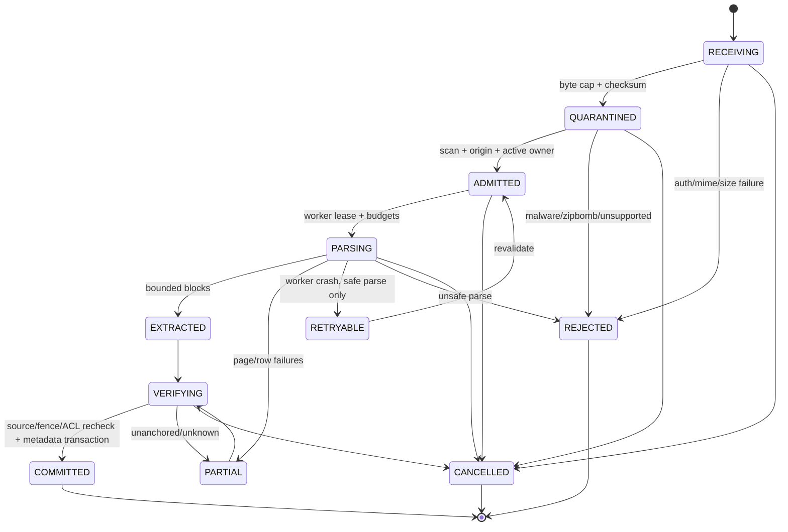
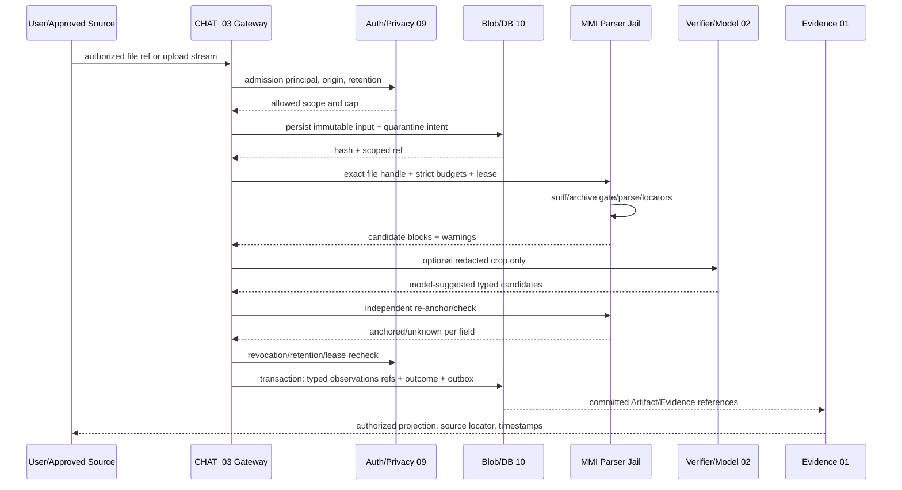

# Safe Multimodal Ingestion — Detailed Implementation Specification (15-01)

> Owner: **CHAT_15** | Path: `docs/15-multimodal/multimodal-ingestion.md` | Rev: 0.1 | **Draft / PROVISIONAL / NOT LOCKED** | Investigation: 2026-10-30 JST | Base: `main@3044c046b1caeea70c5ef6edfea7c57387c6c6da` | SC-15 / 01 / 05 / 07 / 08 / 09 / 10 / 14. **仕様のみ**。本HarnessのParser/DB/API/コンテナの実装・テスト実行は行っていない。

## 0. 結論・採用案・境界

**決定:** 原本と抽出結果を分離した、非ネットワーク・非特権の短命Parser Sidecarを使用する。ユーザーが明示的に渡すファイル、またはCHAT_04/05が適法かつ権限内で取得しArtifact化したファイルを受け取り、(1) byteレベルの事前審査、(2)隔離保存、(3)形式別の制限付き構文解析、(4)画像/OCRを含む座標付き抽出、(5)原本照合できる候補だけをObservation/Evidence提案、(6)必要な場合のみモデルの**提案**、(7)再照合・永続化を行う。原本のバイト列は不変であり、「OCRの自信度」と「事実の検証済み状態」を混同しない。

**正本は既存DraftのCHAT_01 `evidence-artifact-contracts.md`、`tool-io-schema.md`、`event-envelope-and-stream.md`とCHAT_03 Gateway、CHAT_09 Auth/Privacy、CHAT_10 DDL/Blob/Queue、CHAT_08 API。** 本文の `Mmi*` は15内部の提案型であり、同名のグローバル Artifact/Evidence/Event/Tool 型を定義し直さない。新規共通フィールドは必ず `[PROVISIONAL: CHAT_XX]` と記載する。関連Draftは未マージで採用確定ではない。

**推奨エンジン:** PDF born-digitalの文字と表は pdfplumber（MIT）のページ座標＋テーブル候補、PDF/画像のラスタ処理は制限付きレンダラ＋Tesseract（Apache-2.0、実機言語モデル品質未検証）、XLSXはExcelJSのstream reader（MIT）をZIPプリフライト・短命隔離プロセスの内側で利用。CSVはRFC4180相当の厳格な逐次パーサ、DOCX/PPTXは安全なZIP+XMLイベント解析で本文・段落・スライドの論理位置を取得する。汎用Tikaサーバーの全面導入は初期版では行わず、追加形式の隔離Parser候補とする。**xlsx/OOXMLのZIPチェックはライブラリ側の「安全な解凍」を信じず、前段の独立gateと実行時cgroupの両方で強制する。**

## 1. Scope / 非責務 / Use case

| 入力 | v1のMUST結果 | 非対応・明示的制限 |
|---|---|---|
| PDF（digital/mixed/scanned）| ページ毎に文字・bbox・表のセル候補・OCR経路・原文対応、抽出不能をunknown | パスワード付きPDFは `PASSWORD_REQUIRED`、Embedded JavaScript/attachmentsを実行・再帰抽出しない |
| PNG/JPEG/WebP 画像、チラシ、スクリーンショット | 補正後画素座標の領域・OCR文字・視覚候補・向きと変換行列、原本対照 | 画像認識のみで確定値としない。EXIF位置はモデルに送らない |
| CSV/TSV | BOM、区切り、encoding、論理row/column、引用・改行、数値原文、空/不明 | 自動CSV数式実行なし、曖昧なencoding/localeは不明。ユーザー明示の文字コードを優先 |
| XLSX | workbook/sheet!A1参照、行列/結合セル/表示形式/hidden、式とcached resultの区別 | XLSM/XLSB・暗号化・OLEの旧xlsはv1 `UNSUPPORTED_ACTIVE_CONTENT` / `UNSUPPORTED_FORMAT` |
| DOCX/PPTX | 段落・表・スライド・shapeの**論理位置**、脚注等は欠落報告 | DOCの実ページ番号はレイアウトエンジン無しでは保証できない。旧doc/pptと埋込みOLEはv1不対応 |
| 外部URL | 既存の許可されたFetch/Connector → immutable Artifact → 本処理 | このモジュールがURLを直接fetch、認証/SSRFを迂回、外部ストレージへ公開、任意スクリプト実行しない |

ユーザーによるアップロードは**所有者がファイルを提供した**ことを表すだけで、第三者への公開・外部モデル送信を許可したことにはならない。外部Webからのファイルは取得ポリシーと利用権に従う。OCR済みの価格を自動購入・自動通知の確定価格にしない。Office renderingやレイアウト完全再現、ウイルス無害化の保証は非目標。

**Scenario:** SC-15：PNGのチラシ、視覚表のPDF、価格リストXLSXを混在入力し、金額・条件・根拠座標と不明値を返す。SC-01 商品同一性と価格条件、SC-05 Web資料比較、SC-07 Kill/再開、SC-08 悪性添付・注入、SC-09 費用/資源、SC-10 発掘、SC-14 出典品質にも影響する。

## 2. OSS実装調査・比較・採否

| 対象 / ref（2026-10-30確認） | 実際に読んだ実装/テストと仕組み | ライセンス/制限 | 採否 |
|---|---|---|---|
| **pdfplumber** `stable@4c64b92d5caccd71c645e98e0fabb0c4dba7ff45`, CHANGELOG 0.11.10 | `pdfplumber/page.py` `Page.extract_words/extract_text/find_tables/extract_tables/crop/to_image`; `tests/test_table.py` にgrid/strategy/null/複数表確認。表候補は罫線・文字配置に依存 | MIT LICENSE確認。スキャンOCR専用ではない。Issue #1360（nested box等）、#1380（行境界）報告あり、未再現 | **採用**：PDFのネイティブ文字+表候補。bbox検証と画像OCRを追加 |
| **ExcelJS** `master@5bed18b45e824f409b08456b59b87430ded023ab`, package 4.4.0 | `lib/stream/xlsx/workbook-reader.js` の `parse`/ZIP entry走査、`worksheet-reader.js`、`lib/xlsx/xlsx.js`; `spec/integration/workbook-xlsx-reader.spec.js` の行/列制限・formula/error/XML欠損系 | MIT LICENSE確認。Issue #3074：formula cached errorがstream readerでNaN/blankになる報告、Issueは未再現。shared stringsキャッシュによるRSS増の可能性、ZIP自体は信頼しない | **条件付き採用**：行・セルの参照。formulaエラーは独立XML属性検査でunknownに戻す |
| **Apache Tika** `main@20676c0c3d0abfef3122cb0c243cb831b3ea536a` (`4.3.0-SNAPSHOT`)、4.1.x公式security docs | `AutoDetectParser.java::parse` と `config/EmbeddedLimits.java` の深さ・個数制限、`CHANGES.txt` のzipBombRatio変更。in-process parseはCPU/heap枯渇しうると公式Securityが警告 | Apache-2.0。依存が多く、制限値デフォルト（unlimited箇所あり）とサンドボックス挙動を個別固定する必要 | **v1一般導入を却下**。未知形式向けの後日隔離Adapter候補 |
| **Tesseract OCR** `main@7e548e6eff172f38f97664afe7f7ce40db36c8d6` | `src/api/baseapi.cpp` `TessBaseAPI::GetUTF8Text/GetTSVText/MeanTextConf`、`unittest/baseapi_test.cc` のOCR文字とhOCR出力検査を閲覧 | Apache-2.0 LICENSE確認。字体・言語・低解像度・表罫線で誤る。confidenceは真実確率でない | **採用候補**：日本語+英語language pack固定、TSV語bbox検証。初期精度はfixture実測待ち |
| **PyMuPDF** 公式page/API/licensing（コード未精査） | `Page.get_text` / `get_textpage_ocr` のDocs確認 | AGPLv3 or 商用ライセンス。ライセンス適合と配布モデル未決 | **代替候補として保留**、初期MUST依存から除外 |

**対立設計:** (A) LLMへrawファイル一括送信→機密・費用・根拠位置を担保できず**不採用**。(B) Tika/LibreOfficeに全て丸投げ→広範囲だがparser脆弱性・変換の副作用・リソース制御が重く**初期不採用**。(C)形式別parser＋uniform evidence locator＋隔離予算＋独立再検証→**採用**。(D) PDF全ページOCR→文字PDFの誤変換・費用が増えるため**選択式**。OCRはtext coverage・画像面積・構造整合で追加し、ネイティブ文字を上書きしない。

**Issue/変更履歴の境界:** 上記Issueはユーザー報告であり実機再現/修正状況の保証ではない。pdfplumber CHANGELOG 0.11.10は依存pdfminer.six更新を記載。ExcelJS sourceの先頭バージョンはpackage 4.4.0で、実行配布物のpinは実装PRでlockfile SHAに確定する。Tika main snapshotはreleaseではない。画像OCRの日本語精度・性能、PDF rendererの安全性、ライブラリtransitive dependencyの現行CVE審査は未実施。

## 3. 正本 / 所有権 / Trust Boundary

```text
User / approved connector / CHAT_04 Fetch
    -> CHAT_08 authenticated upload or CHAT_03 Tool Gateway intake
    -> CHAT_09 principal + scope + retention + privacy policy
    -> CHAT_10 scoped quarantine blob + signed immutable checksum
    -> CHAT_15 validate + sandboxed parser (no sockets; file bytes only)
    -> bounded parsed-block artifact (private) + local Mmi* record
    -> [optional LLM via CHAT_02 model router, approved privacy/usage]
    -> deterministic re-anchor / strict schema / no authority transfer
    -> CHAT_01 Observation/Evidence/Artifact contract through Gateway
    -> CHAT_10 atomic metadata/outbox; CHAT_08 scoped preview
```

Owner別責務: CHAT_15は入力判定・形式解析・候補値/座標・構造化/再照合ルールの**内部純粋処理**を所有。CHAT_01がArtifact/Observation/Evidence IDs、状態・Event envelopeを所有。CHAT_03がTool registry/intent/policy/approval/実行結果確定を所有。CHAT_04/05がURL取得の資格と出典を所有。CHAT_09がTenant+owner/Secret/出力削除・保持・モデル送信可否を所有。CHAT_10がraw blob・SQL・ジョブ・queue・cleanupの永続化を所有。CHAT_11がfixtureと全体E2Eの正本を所有。

**権限二重確認:** 入口とArtifact read/Tool dispatch、書込み前の3地点で認可・tombstone・GoalRevision・Run leaseEpoch・policyVersionを再確認。Digest/SHAだけで所有権を推論しない。Tenant内同じ内容の別Userの原本は相互参照不可。初期認可・物理保存のtenant/workspace対応は他チームの未Locked P0。

## 4. 規範要求と判定基準

| ID | 強度 | 観測可能な要件 |
|---|---|---|
| MMI-001 | MUST | 認証済みowner+Task/Run・許可Fetch contextなしの取り込みを拒否 |
| MMI-002 | MUST | streaming intakeでmagic/declared MIME/extension/サイズを照合し、曖昧/多重polyglotはquarantine |
| MMI-003 | MUST | 原本不変SHA-256とrefを発行し、検証前のArtifactをモデル/公開APIへ渡さない |
| MMI-004 | MUST | 解凍済みbytes/entry数/depth/ratioと資源上限を実行前と実行中に強制 |
| MMI-005 | MUST | PDF page番号、原座標系+rotation/transform、Native/OCR由来を別々に記録 |
| MMI-006 | MUST | PDF native/scan/mixedで領域別OCRを選び、表のcell provenanceを照合 |
| MMI-007 | MUST | 画像Exif orientationを処理、OCR bbox/言語/認識不確実性を記録しsource pixelへ逆変換 |
| MMI-008 | MUST | CSV/XLSXのrow/column/sheet/cell/hidden/merged、encoding/localeとraw値を記録 |
| MMI-009 | MUST | formula、cached value、error、CSV injection、macro/外部リンクを無評価で隔離し条件付き表示 |
| MMI-010 | MUST | DOCX/PPTXのparagraph/table/slide位置を捏造ページなしで出典化 |
| MMI-011 | MUST | 数値・通貨・税込/税別・期間・数量・例外の曖昧さをunknown/conditionalとし、0へ変換しない |
| MMI-012 | MUST | 値候補は原本ハッシュ＋頁/セル/文字・画素bboxを再照合し、不一致はEvidence確定禁止 |
| MMI-013 | MUST | 外部ファイル記述は非信頼データ。命令・埋込み式・マクロ・スクリプト・外部fetchを実行しない |
| MMI-014 | MUST | Parserはno-network/非root/読み取り限定/資源制限短命隔離で、サンドボックス不成立時fail closed |
| MMI-015 | MUST | Cancel/Steer/tombstone/lease loss時に新規処理とコミットを防ぎ安全な一時ファイル消去 |
| MMI-016 | MUST | crash/duplicate/restartはsource checksum+parser revisionで冪等再利用し、partialを成功と偽らない |
| MMI-017 | MUST | Model/vision送信はprivate policyと予算を満たした最小のredacted cropだけ、必要なら人間承認 |
| MMI-018 | MUST | Unknown/partial/errorをUI・ToolResultへ明示。秘密・原文・PIIを標準ログ/Eventに含めない |
| MMI-019 | MUST | 保存/削除/アクセスにowner+retention+DB/Blobの整合と失敗時GCを設ける |
| MMI-020 | MUST | 入力/CPU/RSS/ページ/行/セル/Token/課金/並列度を有限に制限し、上限超過を説明 |
| MMI-021 | MUST | end-to-endのPDF/PNG/XLSX正常・偽金額・ZIP bomb・注入・crash/ACL試験を設計 |
| MMI-022 | SHOULD | 文書品質検出（傾き・ぼけ・解像度）をOCRの条件付き追加処理に使う |
| MMI-023 | SHOULD | 同じ原本の部分再解析時、同一versionと処理ポリシーに限定してpage/sheet cache利用 |
| MMI-024 | LATER | Tika隔離Adapter、DOCXページレンダリング、旧Office/追加画像形式、校正済みOCR confidence |

## 5. 15内部の型 / Validator / API（共有正本ではない）

```typescript
// 15内部契約。ArtifactId, TaskId, RunId, EvidenceId, CitationLocator はCHAT_01からimport。
// Tenant/Owner/Run fencing情報は既存認証済み Gateway context がserverで構築。
// 文字列Public IDのUUIDv7検証・CAS形式はCHAT_01正本に従う。
type MmiSource = { kind:"user_upload"|"authorized_fetch"|"authorized_connector";
  acquiredAt:string; sourceUrlSanitized:string|null; upstreamArtifactId:string|null };
type MmiFormat = "pdf"|"png"|"jpeg"|"webp"|"csv"|"tsv"|"xlsx"|"docx"|"pptx";
type MmiSourceLocator =
  | {kind:"pdf"; artifactId:string; page1:number; pageSizePt:[number,number];
     rotationDeg:0|90|180|270; normalizedBbox:[number,number,number,number]; textSpan?:[number,number]; layer:"native"|"ocr"}
  | {kind:"image";artifactId:string; sourceWidthPx:number;sourceHeightPx:number;
     exifOrientation:number;normalizedBbox:[number,number,number,number]; transformId:string;layer:"ocr"|"vision"}
  | {kind:"sheet";artifactId:string;sheetName:string;sheetOrdinal1:number;
     cellA1:string;endCellA1?:string;hiddenState:"visible"|"hidden"|"veryHidden";
     mergedAnchorA1:string|null;rawType:string;displayFormat:string|null}
  | {kind:"csv";artifactId:string;record1:number;field1:number;
     byteStart:string;byteEnd:string;headerText:string|null}
  | {kind:"office";artifactId:string;format:"docx"|"pptx";partName:string;
     paragraph1?:number;table1?:number;row1?:number;column1?:number;
     slide1?:number;shapeId?:string;physicalPage:"unknown"};
type MmiCandidate = {fieldKey:string;rawText:string|null;valueState:"observed"|"derived"|"estimated"|"unknown";
  normalized:{kind:"money";amountDecimal:string;currency:string;tax:"included"|"excluded"|"unknown";unit:string|null}
    |{kind:"text";text:string}|{kind:"number";decimal:string;unit:string|null}|null;
  conditions:string[];missingReason:string|null; locator:MmiSourceLocator|null;
  extractionMethod:"native"|"csv"|"xlsx"|"ooxml"|"ocr"|"vision";
  recognitionConfidenceRaw:number|null;verification:"anchored"|"unverified"|"contradicted";
  provenance:{sourceSha256:string;parserBuildDigest:string;normalizerVersion:string;languageHint:string|null}};
type MmiRequestV1 = {version:"1.0";sourceArtifactId:string;source:MmiSource;
  requestedFields:string[];preferredLocale:string|null;allowLocalOcr:boolean;
  allowExternalVision:boolean;idempotencyKey:string;deadlineAt:string};
type MmiOutcomeV1 = {version:"1.0";sourceArtifactId:string;
  status:"complete"|"partial"|"unknown"|"rejected"|"cancelled";
  candidates:MmiCandidate[];missingFields:string[];warningCodes:string[];
  derivedArtifactId:string|null;parserBuildDigest:string;processedAt:string};
type MmiParserError =
  "MIME_MISMATCH"|"AMBIGUOUS_FORMAT"|"MAX_INPUT"|"EXPANSION_LIMIT"|"PIXEL_LIMIT"|
  "PAGE_LIMIT"|"ROW_LIMIT"|"CELL_LIMIT"|"PARSE_TIMEOUT"|"PARSER_CRASH"|
  "BAD_ARCHIVE"|"BAD_XML"|"PASSWORD_REQUIRED"|"UNSUPPORTED_FORMAT"|
  "UNSUPPORTED_ACTIVE_CONTENT"|"EXTERNAL_REFERENCE"|"INVALID_ENCODING"|
  "SOURCE_MISMATCH"|"POLICY_DENIED"|"OWNER_REVOKED"|"STALE_LEASE"|
  "QUARANTINED"|"MODEL_BUDGET"|"CANCELLED";
interface MmiParser { parse(input:Readonly<MmiRequestV1>, auth:TrustedGatewayContext):Promise<MmiOutcomeV1> }
```

**Validation:** JSON envelope `version="1.0"` のみ、unknown keysは拒否。UUID/domain/fenceはCHAT_01+03からの検証結果だけを使い、入力値で認可を上書き不可。独立のMmiSourceLocatorは **[PROVISIONAL: CHAT_01]**: 正本の `CitationLocator` は `pdf` / `image` / `sheet` の表現があるが、rotation/transform, OCR/native layer, CSV byte offset, DOCX paragraph/PPTX slideを保持する正式拡張先が未決。本ローカル型は観測用内部metadataであり、他Ownerが決定するまで正本APIへ直接公開しない。既存 `CitationLocator.pdf.page` は1-based、`sheet.cellRange` は大文字A1正規化、pdf/image `rect` は正本の座標規則へ変換する。

**bbox:** PDF Point座標をページcrop boxとrotationに従い固定し、内部は左上原点正規化 `[x0,y0,x1,y1]`（0..1、x1>x0,y1>y0）。変換matrixをversioned metadataへ保存し、原文を後でレンダリングしたとき同一領域を指すことを検証する。非直交rotationやtransform不可ならlocator=null/unknown。画像EXIF補正後bboxを元画素へ逆写像し、crop hashを保持。隠れた透明/重ね文字の矛盾は画像とテキストを別候補にして検証へ送る。

**価格:** `amountDecimal`は正規化したdecimal string。円は `JPY`。記号だけの`¥`で国別が曖昧ならcurrency unknown、数値が目視できても通貨を補完しない。`1,200` vs `1.200`、税別、期間限定、会員条件、クーポン、入数、単位が未確定なら `normalized=null` と `missingReason="AMBIGUOUS_*"` を出す。再計算や為替推測禁止。式セルのcached resultは「前回計算された未検証値」であり、現在の計算済み価格とはしない。

**Event/API正本:** `MmiOutcomeV1` はGatewayに返す内部結果。Event`multimodal.done` / DB`ingestion_jobs` 等は**正式には存在しない**。追加時は `[PROVISIONAL: CHAT_01/08/10]` としてOwnerへ審査提出し、現時点は既存ToolResult/Artifact/Evidence参照で表現する。

JSON example（OCRを理由に確証化しない）:
```json
{"version":"1.0","sourceArtifactId":"<server-authorized-id>","status":"partial",
 "candidates":[{"fieldKey":"price","rawText":"¥ 12,800","valueState":"observed",
 "normalized":{"kind":"money","amountDecimal":"12800","currency":"JPY","tax":"unknown","unit":null},
 "conditions":["税込表記未確認"],"missingReason":null,
 "locator":{"kind":"pdf","artifactId":"<same-authorized-id>","page1":2,
 "pageSizePt":[595,842],"rotationDeg":0,"normalizedBbox":[0.35,0.41,0.48,0.44],"layer":"ocr"},
 "extractionMethod":"ocr","recognitionConfidenceRaw":68,
 "verification":"unverified",
 "provenance":{"sourceSha256":"<64-hex>","parserBuildDigest":"sha256:<digest>","normalizerVersion":"1.0","languageHint":"jpn+eng"}}],
 "missingFields":["effective_price"],"warningCodes":["OCR_UNVERIFIED","TAX_UNKNOWN"],
 "derivedArtifactId":null,"parserBuildDigest":"sha256:<digest>","processedAt":"2026-10-30T00:00:00Z"}
```
※表示用プレースホルダ。正本スキーマに適用する前に `[PROVISIONAL: CHAT_01]` の locator adapter とIDsを決める。

## 6. 状態 / Sequence / 線形化点





**線形化点**はCHAT_10のstatus/result/Observation/Evidence/Event-outboxの単一DB transaction。BlobはDBと不可分の1 transactionではないため `pending` →checksum verification→DB reference publish、失敗はorphan GC。モデル候補やOCRを返した瞬間は `COMMITTED` ではない。Task Runが新epochへ再取得されたら旧WorkerのCOMMITをCASで拒否。CancellationとGoalRevision変更は「処理停止要求」と「書込み線形化点」の競合として扱い、Cancelが先にcommitされれば旧結果は新しい成果に昇格させない。

## 7. 処理アルゴリズムと具体制限

**プロジェクト提案の安全側初期上限（実測・他Owner承認前は[PROVISIONAL: CHAT_09/02/10]）**:
- 1 raw 20MiB、1 Task入力10件、全raw合計80MiB、読取開始からwall 60秒/file、CPU 20秒、RSS 384MiB、TMP 128MiB、1 worker当り1件/同一owner最大2件・ホスト全体4件（より厳しいGateway側上限を優先）。
- 1 PDF 100ページ、1頁レンダリング4MP、全ファイルの累積画素40MP、最大辺10000px、画像1件30MPのどちらか低い方、色チャンネルやICC変換後byteも制限。PDFのページcrop/透明重ねによる超巨大描画も阻止。
- ZIP-based XLSX/DOCX/PPTX: entry <=2,000、総展開後<=100MiB、単一entry<=16MiB、展開比<=100:1、階層depth<=8、XML node count<=500,000、part参照<=2,000。entry compressed/uncompressed size、重複名、`..`、absolute path、symlink、ZIP64異常、CRC不一致を拒否。比率は0-byte entryで分母ゼロしない。**未申告inflate bytesはstream counterで強制終了**。
- CSV maxRows 100,000、maxCols 200、max cells 2,000,000、1 field <=32KiB、1 record <=256KiB。XLSX maxRows 100,000/sheet、maxSheets 20、maxCells 2,000,000/workbook、shared string aggregate <=16MiB。超過時は完全成功ではなく `LIMIT_EXCEEDED` + bounded partial/unknown; price証明として使わない。
- OCRは1入力最大20領域、モデルvision fallback最大3crop、解像度<=4MP/crop、外部model call<=3/file、最大出力4,096tokens/file、最大概算USD 0.20/file（pricingの実測取得・user budget優先、cost確定前は外部Vision無効）、生データ・位置情報を送らない。Local OCRはlanguage pack digest固定、認識結果最大4MiB。
- 重要: 数値は**初期安全提案**で実測保証/ユーザー同意の代わりでない。超過時に上限を自動引き上げない。高負荷拡張は別Policy/ユーザー承認が必要。低予算/新Planで上限を下げることができる。

```typescript
async function ingest(req: MmiRequestV1, ctx: TrustedGatewayContext):Promise<MmiOutcomeV1> {
  const scope = await gateway.assertCommittedToolIntentAndOwner(ctx); // CHAT_03
  await privacy.assertReadableAndNotTombstoned(req.sourceArtifactId,scope); // CHAT_09
  const raw = await blobs.openVerifiedScopedHandle(req.sourceArtifactId,scope); // CHAT_10
  const intake = await sniffStreamingAndMeasure(raw,{maxBytes:20*MiB});
  if (!strictAllowlistedFormat(intake.magic,intake.declaredMime,intake.extension))
    return reject("MIME_MISMATCH");
  const key = sha256canonical([scope.tenant,scope.owner,raw.sha256,
      "MMI/1",ctx.policyVersion,ctx.parserImageDigest,req.requestedFields,
      req.preferredLocale,req.allowLocalOcr,req.allowExternalVision]);
  const prior = await gateway.findCommittedIdempotentResult(key,scope);
  if (prior && await privacy.mayRead(prior,scope)) return prior; // results never bypass ACL
  const lease = await gateway.claimParseAttempt(key,ctx.runLeaseEpoch); // per key CAS
  try {
    await assertRunFenceAndBudget(lease);
    const parts = await parseInDisposableJail(raw.handle, {
      noNetwork:true, noExec:true,denyLinks:true,denyMacros:true,
      archives:boundedZipGate, timeLimitMs:60000, rssBytes:384*MiB
    });
    let candidates = [];
    for await (const part of parts) {
      if (lease.cancelled || !await gateway.currentFence(lease)) throw Cancelled();
      candidates.push(...deterministicExtractWithLocator(part,req.requestedFields));
      if (needsOcr(part) && req.allowLocalOcr) candidates.push(...localOcrCandidate(part));
      enforceMaxCandidatesAndComputeBudget(candidates);
    }
    if (needsModel(candidates) && req.allowExternalVision) {
      await privacy.assertModelDisclosureAllowed(scope,redactedCrops(candidates));
      const proposals = await boundedModelVision(redactedCrops(candidates),ctx.budget);
      candidates.push(...proposals.map(markAsUnverified)); // no policy/tool from prompt
    }
    const checked = candidates.map(c=>strictNormalizeAndReanchor(c,raw.sha256,parts));
    const outcome = classifyCoverageWithUnknown(checked,req.requestedFields);
    await gateway.commitResultWithEvidenceCAS(lease,outcome,ctx); // CHAT_01/03/10
    return outcome;
  } catch (err) {
    await gateway.recordSafeFailure(lease,classify(err)); // no fake success
    return outcomeFor(err);
  } finally { await killJailAndWipeTemp(lease); await raw.close(); }
}
```

`sha256canonical` は例示の内部キー。JSON順序や任意文字列連結ではなく length-prefix/確定canonicalizationを実装し、`[PROVISIONAL: CHAT_03]` Tool idempotency/ledgerへ集約する。元ファイルhash同一でも **scope、policy、parser digest、requested fields、visibility、OCR privacy** が異なれば同一結果にしない。Worker再起動で入力は永続Blobから再開するが、前Workerの部分結果を確定としない。**外部file取得**はCHAT_04/05の副作用台帳の再照合を通すため、ここでは再fetchしない。

**PDF**: 1-based page loop。ペースト可能な文字と表の候補を抽出→画像レンダラで観察可能領域との視覚整合（font hide/overlay/clip/表位置）→文字面積低・画像主体のregionのみOCR→原生文字とOCR文字を二重観測し、違いはcontradicted/unknown。セルはpdfplumber `find_tables` からtable.bbox/rows.cellsを得て原pageの文字符号範囲と交差を検証。表の列見出しと金額が複数行に跨る場合、勝手に結合せず候補を複数保持。raw `extract_tables` の入れ子文字列だけではセルbboxを失うためEvidence locatorに直接使わない。PDF JS, launch actions, annotations、埋込みファイル、URLやfont外部読込は起動しない。PDF描画は短命別プロセス、未知オブジェクトや破損XRefは失敗扱い。

**画像**: magic検証→decoderでEXIF orientationだけ取得→最大pixel制限を先にチェック→decode/sanitize→preprocess（deskew/contrast等は明示Version）→OCR+bbox/word confidence→読みやすさ閾値不足ならunknown。二値化や傾き補正の結果は原本でなくderived artifactへ。モデルに見せるcropは顔・氏名・住所・EXIF等のprivacy gate通過後のみ。OCR word confidenceの値を価格の正しさの確率として扱わず、`12,800` と `72,800` のようなdigit ambiguityは見た目/原画像cropで再評価。小さな注意書きを見落とした場合 `effective_price=unknown`。

**CSV**: UTF-8/UTF-8 BOMを既定。Shift_JIS/CP932はユーザー提供の明示format hintまたは確かな決定的検証がある場合のみ採用、推定のみなら候補を複数出して `INVALID_ENCODING` / unknown。CSVはQUOTEとCRLF、quoted newline、空文字と欠損を区別。行/列とUTF-8 byte offsetを保存し、列見出しに注入されたFormulaも**データ**。ExcelへのCSV exportを別モジュールが提供する場合は先頭`=`/`+`/`-`/`@`、tab等を安全にエスケープするが、**このモジュールでは元値を破壊しない**。数値のマイナス`-100`と実行式文字列を区別し、必ず文字列で受け渡す。

**XLSX**: ZIP gateは `[Content_Types].xml`、`xl/workbook.xml`、`xl/worksheets/sheet*.xml` とrelationshipsを厳格にallowlist。OOXML XMLでDTD/ENTITY/外部relationship/ActiveX/OLE/vbaProject.binを検知したら拒否（遅延fetchしない）。ExcelJS stream readerでsheet/row/cell順に読む。隠しsheet/行/列は候補にhidden source flagを付けUIでは黙って価格一覧へ統合しない。結合セルはanchorと元範囲を保持し、セルの表示文字だけで金額を判断せず `cell type / style / raw XML t / cached v / formula f` を並記。式のcached resultはcalcしていないので `estimated` ないし `unknown`、エラー型 `t=e` の値を0/blankとして扱わず `FORMULA_CACHED_ERROR`。外部リンクを保存しても参照先を読まない。公式XLSXと悪意のある同一拡張子ZIPを区別し、単なる拡張子ベースの許可は禁止。

**DOCX/PPTX**: 同じZIP/XML gateで `word/document.xml`、明示的な関連 `word/header*.xml`/footnotes、`ppt/slides/slideN.xml`、`ppt/presentation.xml` 等をstream解析。XMLはDTD/ENTITY/外部リンク無効で namespaceを検証、text runはoffset付きで合成。DOCXのページ位置は**physicalPage="unknown"**（セクション改ページは真のPDFページ番号ではない）。PPTXは `slide1` とXML shape id/bbox単位。グラフや埋込みオブジェクトを勝手に計算/起動しない。図画像は安全な同一media処理へ参照させるが、埋込みOLEや外部画像参照は取り込まない。消費者は引用不可な脚注/コメント/altTextがあることをwarningsで把握する。

**Evidence promotion**: detectorが作った候補値の元バイト列・座標を独立Verifierが再読し、同一raw SHAから再現できる場合にだけ `anchored`。これは「正しい現実価格」の保証ではなく出典があることの保証。値の誤認・対象SKUの違い・条件はVerifier(02)とentity resolution(12)が追加検証する。タイムスタンプは `sourcePublishedAt`（ファイルに明示されれば）/ `acquiredAt` / `processedAt` を別保存。画像ファイル作成時刻を値札の有効日時として扱わない。元URLがないアップロードにもArtifact ID＋checksum＋ページ/セルで出典を示せる。

## 8. 障害・並行・復旧マトリクス

| 事象 / detection | 復旧/安全な判断 | 最終ユーザー表示 |
|---|---|---|
| MIME/polyglot、ZIP traversal、暗号化Office | quarantine・再試行なし。Operator許可なきフォーマット変換禁止 | REJECTED + reason |
| ZIP central header偽装・inflate 100MiB超/100:1超 | stream counterが強制停止、jail終了。ratioだけで合格禁止 | LIMIT_EXCEEDED、価格unknown |
| PDF 101 pages / giant image / 2,000,001 XLSX cells | page/pixel/row/cell capで停止、既処理はpartial (非確定) | PARTIAL + omitted regions |
| OCRで0/8混同、税込条件欠落 | raw cropとの矛盾を保存、金額を最終確定せず無理に埋めない | UNKNOWN/CONTRADICTED |
| formula cached `#REF!`、`NaN` | cached resultを使用せずerror status、value=null | UNKNOWN |
| 画像中の「Ignore previous instructions」 | data-only処理、Tool/Policy instruction変換なし | 通常のOCR文（危険文字列はモデル隔離） |
| 悪性PDFでparser child crash / timeout | private blob残存・短命子をkill。有限retry最大1回（同一build・安全read-onlyのみ） | RETRYABLE→PARSER_CRASH / PARTIAL |
| Blob作成後DB transaction失敗 | orphan marker保存、GCで遅延削除。成果の存在を確定しない | PENDING/FAILED |
| Worker kill after outcome commit before ACK | result ledgerから同一キーの完了を再取得。二重Evidence/Notification禁止 | COMMITTED exactly once **in DB** |
| stale lease、Steer、Cancel競合 | CAS失敗で新成果への昇格・次処理を停止。無理に新Runへ写さない | CANCELLED/STALE |
| Assetのユーザー削除・retention失効 | privacy tombstoneでread拒否・衍生物/preview/cache掃除 | REVOKED (復活不可) |
| user-uploaded PII、外部Vision未許可 | モデル外送せずlocal parse/OCRだけ。必要なら明示承認要求 | PARTIAL + LOCAL_ONLY |
| エンジン更新でbboxがずれる | build digestでcache miss、再解析して旧出典は旧version維持 | NEEDS_REVERIFY |
| 重複ファイルを他ownerが提出 | SHA一致でもscope別ACL、他owner resultを参照不可 | 独立Taskで処理 |
| source取得が403、マルウェア検査が不可 | fetch側エラー/安全検査不能ならfail closed | UNAVAILABLE/QUARANTINED |

`UNKNOWN`は外部副作用の不確定結果 `UNKNOWN`（CHAT_03）とは**別**の文書値の不確定性。ToolのSide-effect statusに独自enumを足さない。Parser自体は読取り専用だからsafe retry可能だが、モデル課金のLost ACKは再請求しないようbudget ledger照合まで外部API再送を止める。

## 9. セキュリティ / Privacy

入口は認証済みupload or approved connector artifact referenceに限定。web-origin添付は同じ内容でも `origin=untrusted_external` の扱いで、URL権限と利用規約の再評価をCHAT_04/05に委ねる。MIMEはmagicと内部ZIP content-typeを照合する（すべての検出器が一致しないとき安全拒否）。ファイル名はUIでescaped displayのみ、保存パスはserver-created opaque ID。名前・ZIP pathをUnix pathとして使わない。

Jailは専用UID・非root、`cap_drop ALL`、no-new-privileges、seccomp/AppArmor、rootfs read-only、bounded tmpfs、ファイルhandle-only read、no bind mount of host secrets、network namespaceにNICなし・非DNS・proxyなし、outbound IP fail-closed、`execve`/任意subprocess禁止（許可された固定Parser binaryのみsupervisorが起動）、子孫プロセス上限・cgroup CPU/memory/pids・wall-clock killを強制。実コンテナのPS/Namespace isolationのテストが合格するまではproductionに受け入れない。マルウェア検出を入れても「無害化済み」を保証しない。TikaやLibreOfficeの導入でParser権限を増やさない。

外部ファイル内のHTML/script、PDF JS, JSURL, VBA, external workbook links, DDE, XXE, CSS fetch, formula, prompt injectionは一切実行・昇格しない。LLMへの渡し方は `untrusted document excerpt` としてcontext分離し、任意のTool呼び出しスキーマ・system prompt・権限をファイルから構築しない。Secret/Cookie/個人名/住所はprompt・event・trace・サポートログにデフォルト非出力。画像cropの外部送信はユーザーポリシー、PII detection/局所redaction、Provider data retention/region/費用を確認し、許されないときlocal-onlyで停止。人間によるファイルアップロードが外部API送信許諾を意味しない。

原本・派生サムネ・OCR・セルキャッシュ・モデルtranscriptをprivacy deletion graphに含める。保存期限未設定は無期限ではなく入口拒否または管理者規定の明示policy。法的holdとbackup復旧時tombstone replayはCHAT_09/10の正本へ提案。Audit logはsafe jobID/taskID/elapsed/resources/error codes/hash prefixだけ、ハッシュ全文やファイル名を出すかもpolicyに従う。

## 10. 計測・評価・費用

`mmi_intake_bytes_total`、`mmi_format_reject_total{code}`、`mmi_archive_expanded_bytes`、`mmi_parser_wall_ms`、`mmi_parser_cpu_ms`、`mmi_parser_peak_rss_bytes`、`mmi_ocr_regions_total`、`mmi_candidates_total`、`mmi_candidates_unknown_total`、`mmi_anchoring_failures_total`、`mmi_external_model_input_tokens`、`mmi_model_cost_estimated_usd`、`mmi_model_cost_billed_usd`、`mmi_cleanup_pending_total`、`mmi_owner_denials_total`。labelにownerID・URL・ファイル名・OCR文・高cardinality内容を使わない。TraceにはRun/ToolAttempt correlation opaque IDs、build digest、policy versionと結果分類のみ。

Benchmark：Ubuntu Linux/CPU/RAM/locale/language pack/image digest固定、1/2/4並列で各fixture20回、median/p95 wall/CPU/peak RSS、元PDF/PNG/XLSX行・セルbbox F1、金額exact match、critical misquote 0、金額をunknownとした割合、機密外送0、Cancel後commit0を測定する。品質とfalse positivesは単なる総合scoreで相殺しない。**測定は未実行で達成値を主張しない**。OSS公称性能を本環境の性能値に使わない。外部OCR/visionのmodel価格は採用時点で別途API料金/データ利用規約を確認してからenableし、予算予約額と確定請求額を分離する。

## 11. Persistence / Transaction / Migration [PROVISIONAL: CHAT_10]

正本の `agent.artifacts(tenant_id,id,object_key,sha256_hex,bytes,media_type,classification_code,object_state_code,expires_at)` はPR #10 Draftに存在するが、rawとderivedは別Artifact IDでimmutable parent relation、provenance and parser cacheには列・関連表の追加合意が必要。**本仕様にはCREATE TABLEを含めず、物理DDLの書込み権限はCHAT_10。**

提案 `mmi_parse_attempts` (names provisional): PK `(tenant_id,parse_key,attempt_no)`; `owner_user_id`, `task_id`, `run_id`, `lease_epoch`, `input_artifact_id`, `input_sha256`, `parser_build_digest`, `privacy_policy_version`, `config_sha256`, `status`, `output_artifact_id`, `warnings_count`, `retry_count`, `created_at`, `expires_at`, `record_version`. Uniqueness on `(tenant_id, owner_user_id, parse_key, committed_state)` should guarantee <=1 committed result; PostgreSQL partial unique index design owned by CHAT_10. Composite FK for same tenant, separate owner authorization with authorization join, not `tenant==owner`. ToolIntent/Run fencing ledger from CHAT_03/02 is canonical, these are parser-specific metadata only.

段階移行: (1) storage metadataとstatus-only version gate、(2)Parser isolated rollout local files、(3)OCR+visual and provenance converters、(4)external vision opt-in、(5)old cached parserRevisionのread-only retention/expiry、(6)backfillは新しいparsed artifactsを別ID発行して元を改変しない。旧`unversioned` extractionは `unverified`、再検証までEvidence「verified」に昇格禁止。Rollbackは新Parserのwriteを停止、既存old-version ArtifactをACL付き読み取り専用で提供。GCはblob／OCR crop／DB reference／search index／cacheを削除対象とし、DBとObjectStoreの非原子的差をsweeperで可観測化する。

## 12. REST/UI/周辺Adapter [PROVISIONAL: CHAT_08/01/03]

CHAT_08提案: `POST /api/v1/uploads` initiation → short-lived scoped upload token/url（許可されたContent-Type/sizeのtoken binding）→ finalize checksum → `POST /api/v1/tasks/{id}/attachments` またはToolInvocationにArtifactRef bind。**上記ルート名は未承認案であり現行REST契約ではない。** 同じownerの認可済みTaskからのみ処理。Responseは `attachmentId`, `status`, `warningCodes`, `sourceRef`, `acceptedAt` の安全projection。検索/ダウンロードはスコープとretentionを毎回照合する。増分SSEはCHAT_01 Event Envelopeを使い独自raw progressイベントを定義しない。

UIはPDF page thumbnailを正しい座標へハイライト、画像crop原画との対比、XLSX `Sheet1!C12`、CSV row/col、DOCX paragraph、PPTX slide/shapeを表示する。認識由来（native/OCR/vision）、不明・条件付き・矛盾・期限切れを表示し、値をクリックしたときだけ限定寿命のArtifact previewを開く。未認証共有URLやraw file名を外へ出さない。存在しないDOCXページ番号を表示しない。Missing fieldは `unknown` とし、0円・空文字に変換しない。

CHAT_03へは `ingest_file_readonly` Tool manifest / strict schema / maxCost / maxInputBytes / `effectClass: read_only`（enum名はGateway-ownerの最終承認待ち）をproposal。Parser moduleはToolRegistryに自分をregisterするだけで、実行権限・承認・課金を独断判定しない。

## 13. 本番実装PR分割（このrepoへのコード実装はしない）

1. **MMI-IMPL-01** Upload/quarantine/magic/zip/XML preflight、trusted scoped file handle、mutation-free byte hashing、security tests。
2. **MMI-IMPL-02** Parser jail manifest/build digest/cgroup/seccomp/no-network、cancel/kill cleanupとadmission negative tests。
3. **MMI-IMPL-03** PDF native+table bbox、Image OCR/Tesseract crop+transform、mixed/contradiction fixtures。
4. **MMI-IMPL-04** CSV/XLSX streaming + OOXML docx/pptx logical locators、formula/error/externalLinkとbounds tests。
5. **MMI-IMPL-05** Candidate normalization + source re-anchor + Evidence/Artifact/Observation adapter + CAS/FK/outboxに接続（依存: CHAT_01/03/10契約合意）。
6. **MMI-IMPL-06** REST UI preview + privacy retention/deletion + opt-in vision + fault/e2e/performance gating（依存: CHAT_08/09/11、モデル料金確認）。

最初の2本はraw parse outputをUIへ露出しない。Evidence契約が未LockならAdapterはin-memory test doubleに留める。テスト用fixtureでの日本語フォント/帳票/zipbombを固定しCI SBOM+image digest/OS kernel情報を必ず添付。

## 14. テスト設計（すべて**未実行**）— setup / action / expected

| TEST | 種別 | Setup → Action | Expected |
|---|---|---|---|
| MMI-T01 | Contract/Auth | 同一tenant異なるowner A/BでAのArtifact→Bがparse | 403・blob read/model send 0 |
| MMI-T02 | Unit | `application/pdf` + PNG magic、拡張子pdf、ZIP polyglot → intake | MIME_MISMATCH / AMBIGUOUS_FORMAT、quarantine |
| MMI-T03 | Integration | 同じ20MiBのファイルをchunk upload・末尾hash破損 | unchecked Artifact非公開、checksum拒否 |
| MMI-T04 | Security | ZIP中央indexが安全値だがdeflateが101MiB、path traversal、symlink、重複名 | 解凍中止、書込先host path 0、parser child kill |
| MMI-T05 | Unit/PDF | 日本語PDF page2 bbox `12,800`、rotation90、2列罫線 | page1=2、原画像へbbox逆変換し同領域に一致 |
| MMI-T06 | PDF/OCR | 同じPDFにnative文字とscan画像と誤った透明重ね `72,800` | native/OCR両候補、矛盾またはunknown。確定値1個へ潰さない |
| MMI-T07 | Image | EXIF orientation6・日本語縦書き・画像内 `税込` 小文字 | transformed bboxは原画に戻り、見落とす税区分はunknown |
| MMI-T08 | Spreadsheet | UTF8 BOM CSV quoted newlineとCP932曖昧文字列 | 物理行ではなく論理record、byte offsets一致、曖昧encoding unknown |
| MMI-T09 | XLSX | `Visible!C12=12800`, hidden `Old!A2`, merged range、style | cellA1 / hidden/merged / displayFormatが保存され、hidden価格は黙って採用不可 |
| MMI-T10 | XLSX | Formula `=D2*2` cached error `#REF!`、外部workbook、xlsm | 値unknown、外部fetch/式実行0、macro reject |
| MMI-T11 | Office | DOCX paragraphs+table、PPTX slide4 shape19、埋込みOLE | paragraph/slide locator、physicalPage unknown、OLE拒否 |
| MMI-T12 | Unit | `1.200` (locale未明)・`¥12,800` 税区分欠損 | `unknown`またはconditional、 `effective_price` null、0への変換0 |
| MMI-T13 | Evidence | OCR候補を原本hash Aから生成後Bで再照合 | SOURCE_MISMATCH、Evidence unverified、公開禁止 |
| MMI-T14 | Injection | PDFにsystem prompt偽装・リンク`http://169.254.169.254/`・DOCX external entity | no outbound sockets、policy unchanged、秘密のログ/LLM出力0 |
| MMI-T15 | Sandbox | 非root、no-network、read-onlyFS、cgroupを一つずつ無効化 | startup BLOCKED_UNSAFE_RUNTIME。production実行不可 |
| MMI-T16 | Fault | parse中Kill、再開、同一idempotency keyを並列2workerで実行 | committed result 1件、outbox重複0、旧epoch commit 0 |
| MMI-T17 | Fault | Cancel/Steer/tombstoneを各state transition直前にcommit | 最終ACK前は無効化・新しいmodel/side-effect 0・temp削除 |
| MMI-T18 | Privacy | PII付きチラシ、external vision不許可、local OCR可 | provider送信0、safe local result、logsからPII 0 |
| MMI-T19 | Integration | Blob保存成功、DB commit拒否、GC worker停止→復帰 | orphan記録、再開後期限内削除、phantom success 0 |
| MMI-T20 | Limit/Benchmark | 101page PDF/30MP画像/100001 row/2,000,001cell; 1/2/4並列 | 所定上限で停止、RSS/CPU/実測記録、unknown示す |
| MMI-T21 | E2E SC15 | PNGチラシ(条件付き1,280円)、PDF table page2(税別12,800円)、XLSX Sheet1!C12(12800)、読めないC13 | 3形式の正しいlocator+金額原文、税別/条件差、C13 unknown、モデル推測で埋めない |
| MMI-T22 | E2E/Scope | Authorized Web PDFとuser-upload PDFの両方、同一bytes、異owner | 権限別source・retention・audit、共有不可 |
| MMI-T23 | Cost | low budgetで3 crops要請、provider費用未確認 | external vision起動0、LOCAL_ONLY + MODEL_BUDGET |
| MMI-T24 | Deletion | 完了直後privacy delete、restore/snapshotから旧blobをreindex | tombstoneの再処理禁止、派生crop/キャッシュ削除証拠、復活0 |
| MMI-T25 | Regression | ExcelJS streaming cached formula error issue #3074再現fixture＋通常reader比較 | `NaN`/blankをpriceに昇格しない |
| MMI-T26 | Security | 巨大nest ZIP、XXE/DTD、externalRelationship、脆弱parser error messageに秘密 | 外部参照0、fail-closed、例外logはredacted |
| MMI-T27 | E2E | Modelが元文書に存在しない価格とbboxを返す | verifier source re-anchor不成立、Evidence verified 0 |
| MMI-T28 | Version | Parser build/language pack/policy revisionを変更し同一rawを再解析 | cache miss、新derived version、新と旧を混ぜない |

**実行状況**: 上表は設計したmock/fixture/隔離実機テスト。実行0件、CI結果0件、DB migration結果0件、モデル費用bench結果0件。一次資料のOSS実コードとテストの**静的閲覧**は実施したが、本Harnessの実装確認ではない。

## 15. 全MUST要件 → TEST-ID → SC traceability

| REQ | TEST | Scenario / 合格判定 |
|---|---|---|
| MMI-001 | T01,T22 | SC-06/08/15：他owner読取0 |
| MMI-002 | T02,T04 | SC-08/15：spoof/polyglot拒否 |
| MMI-003 | T03,T19 | SC-07/15：hash不一致非公開 |
| MMI-004 | T04,T20,T26 | SC-08/09/15：inflate/CPU/RSS上限 |
| MMI-005 | T05,T21 | SC-05/15：ページ/座標原画像一致 |
| MMI-006 | T06,T21 | SC-15：mixed/OCR表の誤読を確定禁止 |
| MMI-007 | T07,T21 | SC-15：縦/回転画像正規化 |
| MMI-008 | T08,T09,T21 | SC-15：sheet/CSVの正しいcell refs |
| MMI-009 | T10,T25 | SC-08/15：数式/外部link実行0 |
| MMI-010 | T11 | SC-05/15：DOCX/PPTX論理位置、偽page0 |
| MMI-011 | T12,T21 | SC-01/10/15：価格欠損を0へ変換しない |
| MMI-012 | T13,T27 | SC-05/14/15：source mismatchのEvidence verified 0 |
| MMI-013 | T10,T14,T26 | SC-08/15：命令/XXE/埋込み内容実行0 |
| MMI-014 | T15,T26 | SC-08/09/15：sandbox不成立で実行不可 |
| MMI-015 | T17,T24 | SC-07/08/15：cancel/削除後commit0 |
| MMI-016 | T16,T19,T28 | SC-07/15：同一結果1・旧lease書込0 |
| MMI-017 | T18,T23 | SC-08/09/15：未許可Vision送信0 |
| MMI-018 | T07,T12,T21 | SC-01/05/15：partial+unknownとredacted UI |
| MMI-019 | T19,T22,T24 | SC-07/08/15：owner+retention/GC一致 |
| MMI-020 | T20,T23 | SC-09/15：resource/token/USD上限測定 |
| MMI-021 | T04,T06,T10,T16,T21,T26 | SC-15/07/08：fixture suiteすべて設計 |

合否は「CSV/PDF/XLSXから数字が出せるか」だけでなく、**誤った確定値を出さず、必要な出典へ実際に戻れること**が主要条件。OCRのconfidence閾値は画像・言語別の実測較正前に固定しない。LATER項目は今期テスト義務から除く。

## 16. Cross-team proposals / 未決事項

| Proposal / severity | Owner（変更先） | 現状と必要な差分 / Migration / test / 解消条件 |
|---|---|---|
| **MMI-X01 P0** | CHAT_01 `evidence-artifact-contracts.md` | 現在のCitationLocatorはpdf/image/sheetのみ。rotation, textSpan, CSV logical row+byte offset、DOCX para/PPTX slide、OCR/native flagとsource hash adapterの正式収容先を議論。ver1維持ならversioned `locatorDetailArtifactRef` 新設。compat fallbackは既存pdf/page/sheetに投影、拡張値はprivate metadata。MMI-T05/T08/T11/T13 |
| **MMI-X02 P0** | CHAT_09 `authentication-and-user-isolation.md`, CHAT_10 `database-schema-and-migrations.md` | Tenant+User+Workspace ownership mapping不整合が未Locked。原本/derived/previewのcross-ownerアクセス、retention tombstoneと複合FK要合意。MMI-T01/T22/T24 |
| **MMI-X03 P0** | CHAT_03 `tool-execution-gateway.md`, CHAT_01 `tool-io-schema.md` | read-only ingestion toolのmanifest, opaque Blob handle, cached result key, safe retry, schemaVersion, ToolResult status mapping、Run leaseEpoch/GoalRevision CAS。MMI-T16/T17/T19 |
| **MMI-X04 P0** | CHAT_10 `database-schema-and-migrations.md`, `job-queue-and-outbox.md` | ParseAttempt/derived→raw parent refs, orphan blob GC、atomic outcome/Evidence/outbox、strict owner scoped idempotency/unique index、recovery migration。MMI-T16/T19/T28 |
| **MMI-X05 P1** | CHAT_08 `rest-api.md` / `web-chat-interface.md` | 採用するUpload protocol、size/CSRF/attachment-to-Task binding、preview auth、status/unknown, highlighted locatorsを協議。既存routeの直接上書き禁止。MMI-T03/T21/T22 |
| **MMI-X06 P0** | CHAT_09 `sandbox-and-capabilities.md` + CHAT_10 `docker-deployment.md` | Python/PDF/JVM child jailのnonroot/no-network/UID/temp/cgroupと“execve固定binaryのsupervisor起動”例外、signature scan、CI env validationを確定。MMI-T04/T15/T26 |
| **MMI-X07 P1** | CHAT_09 `privacy-audit-and-retention.md` | raw/derived/crop/OCR caches/model transcript/backup deletion graph、privacy consent and user-upload ≠ vision-consent、retention defaults。MMI-T18/T24 |
| **MMI-X08 P1** | CHAT_11 `end-to-end-acceptance.md`, `benchmark-and-release-gates.md` | SC-15 synthetic files (PNG/PDF visual table/XLSX) + corrupted Excel cached error, Japanese OCR, ZIP bombs, WAF/egress, CPU/RSS gates、golden coordsを固定。MMI-T05..28 |
| **MMI-X09 P1** | CHAT_04 `http-fetch.md` + CHAT_05 `connector-framework.md` | Web source document fetchのcontent-type/cap、original source URI sanitized, approved auth, disabled external linksを連携。MMI-T22 |
| **MMI-X10 P1** | CHAT_02 `budget-and-limits.md`, `model-router.md` | 画像外部Visionのmodel provider資格/単価/データ保持、費用予約、Lost ACK、OCR vs LLM cost routingとfallback semantics。MMI-T18/T23 |

**P0 blocker**: owner/workspace/tenant正本、Artifact locator拡張、Tool/DB commit+fencing、parser sandbox実機検証。担当仕様はDraftとして提出できるが、この状態で`Locked`/実装確定は不可。Cross-team提案はOwnerが決定し、承認内容をこのMDにも反映した後、独立レビューが必要。

**仕様完成の範囲**: 本CHAT所有の15-01は本MD一件。mainへ直接書かず専用Draft PRで提案する。実測/セキュリティテストや実装を完了したという意味ではない。

## 17. Sources（調査日: 2026-10-30 JST / 根拠グレード）

- **[S1 Code verified]** pdfplumber `stable@4c64b92d5caccd71c645e98e0fabb0c4dba7ff45`: [`pdfplumber/page.py` `Page.extract_tables/find_tables/extract_words/to_image`](https://github.com/jsvine/pdfplumber/blob/4c64b92d5caccd71c645e98e0fabb0c4dba7ff45/pdfplumber/page.py), [`tests/test_table.py`](https://github.com/jsvine/pdfplumber/blob/4c64b92d5caccd71c645e98e0fabb0c4dba7ff45/tests/test_table.py), [MIT LICENSE](https://github.com/jsvine/pdfplumber/blob/4c64b92d5caccd71c645e98e0fabb0c4dba7ff45/LICENSE.txt), [CHANGELOG 0.11.10](https://github.com/jsvine/pdfplumber/blob/4c64b92d5caccd71c645e98e0fabb0c4dba7ff45/CHANGELOG.md). File実体/テスト定義を静的閲覧、未実行。
- **[S2 Issue report]** [pdfplumber #1360 nested-table layout](https://github.com/jsvine/pdfplumber/issues/1360), [#1380 last table row](https://github.com/jsvine/pdfplumber/issues/1380), [OCR-derived table limitation discussion #988](https://github.com/jsvine/pdfplumber/discussions/988) (報告/議論、現バージョン再現未確認)。
- **[S3 Code verified]** ExcelJS `master@5bed18b45e824f409b08456b59b87430ded023ab` package 4.4.0: [`lib/stream/xlsx/workbook-reader.js`](https://github.com/exceljs/exceljs/blob/5bed18b45e824f409b08456b59b87430ded023ab/lib/stream/xlsx/workbook-reader.js), [`worksheet-reader.js`](https://github.com/exceljs/exceljs/blob/5bed18b45e824f409b08456b59b87430ded023ab/lib/stream/xlsx/worksheet-reader.js), [`lib/xlsx/xlsx.js`](https://github.com/exceljs/exceljs/blob/5bed18b45e824f409b08456b59b87430ded023ab/lib/xlsx/xlsx.js), [integration tests incl. row/col/formula/errors](https://github.com/exceljs/exceljs/blob/5bed18b45e824f409b08456b59b87430ded023ab/spec/integration/workbook-xlsx-reader.spec.js), [package.json](https://github.com/exceljs/exceljs/blob/5bed18b45e824f409b08456b59b87430ded023ab/package.json), [MIT LICENSE](https://github.com/exceljs/exceljs/blob/5bed18b45e824f409b08456b59b87430ded023ab/LICENSE).
- **[S4 Issue report]** [ExcelJS #3074 streaming formula cached error](https://github.com/exceljs/exceljs/issues/3074)（2026-08-24報告、環境再現未実行）；関連するreaderの`parseFloat`挙動はsourceと異常fixtureで実装時要照合。
- **[S5 Code verified / Docs verified]** Apache Tika `main@20676c0c3d0abfef3122cb0c243cb831b3ea536a` (snapshot): [`AutoDetectParser.java::parse`](https://github.com/apache/tika/blob/20676c0c3d0abfef3122cb0c243cb831b3ea536a/tika-core/src/main/java/org/apache/tika/parser/AutoDetectParser.java), [`EmbeddedLimits.java`](https://github.com/apache/tika/blob/20676c0c3d0abfef3122cb0c243cb831b3ea536a/tika-core/src/main/java/org/apache/tika/config/EmbeddedLimits.java), [`CHANGES.txt`](https://github.com/apache/tika/blob/20676c0c3d0abfef3122cb0c243cb831b3ea536a/CHANGES.txt), [Apache-2.0 LICENSE](https://github.com/apache/tika/blob/20676c0c3d0abfef3122cb0c243cb831b3ea536a/LICENSE.txt), [Tika Security 4.1](https://tika.apache.org/docs/4.1.x/security.html), [embedded bounds 4.0](https://tika.apache.org/docs/4.0.x/advanced/setting-limits.html). Tika固有test sourceは**未確認**、本番利用せず追加調査が必要。
- **[S6 Code verified]** Tesseract `main@7e548e6eff172f38f97664afe7f7ce40db36c8d6`: [`src/api/baseapi.cpp` `GetTSVText/GetUTF8Text/MeanTextConf`](https://github.com/tesseract-ocr/tesseract/blob/7e548e6eff172f38f97664afe7f7ce40db36c8d6/src/api/baseapi.cpp), [`unittest/baseapi_test.cc`](https://github.com/tesseract-ocr/tesseract/blob/7e548e6eff172f38f97664afe7f7ce40db36c8d6/unittest/baseapi_test.cc), [Apache-2.0 LICENSE](https://github.com/tesseract-ocr/tesseract/blob/7e548e6eff172f38f97664afe7f7ce40db36c8d6/LICENSE). Language model/data package digestとJPN精度は未検証。
- **[S7 Docs verified]** [PyMuPDF official page/OCR methods](https://pymupdf.readthedocs.io/en/latest/page.html), [AGPL/commercial licensing](https://pymupdf.io/licensing). ソース/テスト未監査のため初期採用なし。
- **[S8 Project Draft — NOT LOCKED]** CHAT_01 [Evidence + Tool IO PR #33](https://github.com/choko510/aiagent-md/pull/33), CHAT_04 [Extraction PR #37](https://github.com/choko510/aiagent-md/pull/37), CHAT_08 [REST PR #8](https://github.com/choko510/aiagent-md/pull/8), CHAT_09 [Sandbox PR #18](https://github.com/choko510/aiagent-md/pull/18), [Privacy PR #47](https://github.com/choko510/aiagent-md/pull/47), CHAT_10 [DB PR #10](https://github.com/choko510/aiagent-md/pull/10), [Docker PR #26](https://github.com/choko510/aiagent-md/pull/26), CHAT_11 [E2E PR #13](https://github.com/choko510/aiagent-md/pull/13). すべてHEADファイル/関連契約の静的参照であり未マージ。矛盾解決の所有権は各担当へ。

## 18. Round 4 — Parser confinement and Evidence locator protocol
**Required canonical mapping:** CHAT_01 `CitationLocator` supports PDF page+rect, image rect, sheet name/cellRange and raw text lines, but derived OCR/rotated/cropped content also needs `sourceArtifactId`, `sourceSha256`, `derivedArtifactId`, `parserJobId`, parserBuildDigest, transform/crop coordinate map, `locatorSchemaVersion` and strict page/sheet/cell positions. CHAT_10 PR #10 proposes `parser_jobs` and `artifact_derivations`. These are lineage records **not** a second Evidence type.
No parser has unrestricted FS/socket. Per job bounded input bytes/pages/ZIP entry count/uncompressed ratio, timeout, memory and CPU; fixed verified container image, rootfs read-only, non-root, egress none, no host mounts or Docker socket. Disallow macro, Office formula evaluation, PDF JavaScript, external references, DNS/file hyperlinks and automatic recursive archive extraction. Native PDF text and OCR candidates must carry separate confidence/coordinate transform. CSV and XLSX formula cells are untrusted literal text, never executed and not rendered as spreadsheet commands.
Atomic lifecycle: obtain quarantined raw Artifact → validate SHA/MIME/owner and quota → create parser_job with lease → isolated parse to staging → verify per-field source bbox/page/cell and transform → commit derived Artifact and lineage + Evidence in one DB TX, else quarantine/orphan GC. Reclaim only under current parser lease; cancel/retention tombstone forbids publishing extracted claims after revoke. External vision is disabled without explicit consent and budget.
Tests MMI-R4-T01 malicious compressed XLSX zip bomb hits unpack cap; T02 macro/Formula and CSV formula causes zero execution; T03 embedded PDF URL performs zero DNS/network; T04 OCR crop coordinate maps to exact original page; T05 same raw sha across two users has no cross-owner retrieval; T06 kill after staging leaves no visible Evidence; T07 cancel vs publish CAS denies stale parser; T08 source SHA mismatch quarantines; T09 PDF page and Excel cell citation roundtrip. SC-15/07/08. **Execution against real parser jail NOT YET VERIFIED.**

